[课程网页链接](https://clcs-sustech.github.io/zh/course/cse5026/)

## Course Introduction & Overview

### background

Psychology, Gestalt, Behaviorism, S-R theory, Information Processing Theory

### Methodology

- Internalism

    心智状态完全由大脑内部的物理状态决定，过于主观
    1. Reductionism
    2. Functionalism
    3. Introspectionism
    4. Cognitivism / Symbolism

- Externalism

    心智状态部分由外部世界决定
    1. Behaviorism
    2. connectionism

#### Technology
 - Brain-related Technology
 - Behavioral Studies
 - Tools; Experimental designs; Math and statistics.

### Supplementar: CPM & Hypothesis Testing

对于两类假设
- $H_0$：原假设（null hypothesis）
- $H_A$：备择假设（alternative hypothesis）

以及显著性水平（significance level）
- $\alpha$

假设检验通常包括：
- Type I error（$α$）：$H_0$ 为真，却错误拒绝 $H_0$；
- Type II error（$β$）：$H_A$ 为真，却没有拒绝 $H_0$；
- Power：$H_A$ 为真，并成功拒绝$H_0$。

$\alpha$ ,$\beta$, $power$ 的关系是：

- $\beta$：在计算Type I error 使用 $\alpha$ 确定临界值后，用 $H_A$ 的分布算出没有在拒绝区域的概率：
$$
\beta=P_{\mu_A}(Z\le 1.645) \text{   OR   } 
\beta=P_{\mu_A}\left(\bar X\le c_\alpha\right)
$$
- $power=1−β$
- 增加样本量会提高 power：标准误变小，样本均值的分布变窄，因此更容易超过拒绝阈值。
- 一般性的样本量与 power 关系，适用于许多正态近似的假设检验：在给定噪声大小、显著性水平、目标 power 和最小可检测效应后，需要多少样本。
    
    $\Delta$：希望检测到的真实效应大小
$$
n\ge
\frac{\sigma^2\left(z_{1-\beta}+z_{1-\alpha}\right)^2}{\Delta^2}
$$

## Neural Basis of Cognition

从神经元到数学模型到真实大脑结构

### Neuron

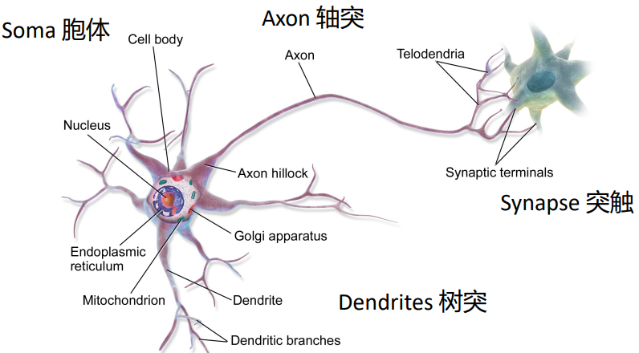

树突主要接收其他神经元传来的信号，胞体包含细胞核并维持细胞生命，同时也参与整合输入；轴突则把神经元产生的信号传向其他位置。

- Soma/Cell 胞体：出现在脑，脊髓灰质，神经节，结构和其他细胞相似
- Cell Membrane 细胞膜：神经细胞膜敏感，上面有蛋白质构成受体(receptors)和离子通道(ion channels )，受体和神经递质结合传递信号， 乙酰胆碱(Acetylcholine) 或 γ-氨基丁酸(GABA)的结合 改变膜电位 (membrane permeability and potential)，造成兴奋(excitation)或抑制(inhibition)
- Synapse 突触: 由Charles Sherrington 提出，认为信息在这些位置传递
    - 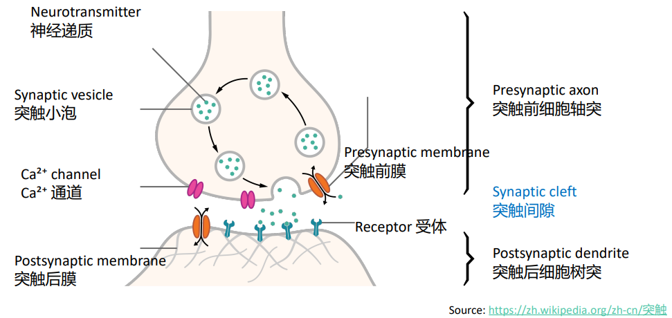
    - 信号的的传递是电信号到化学信号再到电信号
        1. 突触前兴奋（Presynaptic excitation）使突触前膜（presynaptic membrane）发生去极化（depolarization），钙离子（Ca²⁺）内流。
        2. 神经递质（Neurotransmitters）释放进入突触间隙（synaptic cleft），在间隙中扩散，并与突触后受体（postsynaptic receptors）结合。
        3. 离子通道（Ion channels）开放，引发突触后膜去极化（depolarization，膜内负电位减少）或超极化（hyperpolarization，膜内负电位增多）。
    - 突触连接（synaptic connections）可以发生改变 (Hebbian learning)：神经元反复共同激活会建立关联，使得其中一个神经元有助于激活另一个。若神经元 A 反复激活神经元 B，二者之间的突触连接会增强。
    - 突触可塑性（synaptic plasticity）一起放电的神经元，连接在一起（Cells that fire together, wire together.）fire是神经元放电
- 神经递质（Neurotransmitters）

- 神经递质（Neurotransmitters）是由突触前末梢（presynaptic terminals）释放的化学物质。它们结合突触后神经元（postsynaptic neurons）或效应器细胞（effector cells）上的受体，用来传递信息。
  - 乙酰胆碱（Acetylcholine）
  - 儿茶酚胺（Catecholamines）：去甲肾上腺素（norepinephrine）、多巴胺（dopamine）
  - 5-羟色胺 / 血清素（Serotonin / 5-HT）

### Resting Membrane Potential & Action Potential

#### Resting Membrane Potential  静息电位

静息膜电位约 −70 mV，膜内电位相对于膜外为负。膜外 Na⁺、Cl⁻浓度更高；膜内 K⁺浓度更高。

钠钾泵（sodium–potassium pump）消耗 1 分子 ATP，将 3 个 Na⁺运出细胞，同时将 2 个 K⁺运入细胞。

##### Hodgkin–Huxley Experiments

- 英国生理学家 A. L. 霍奇金（A. L. Hodgkin）与 A. F. 赫胥黎（A. F. Huxley）将玻璃微电极（glass microelectrodes）插入乌贼巨轴突（squid giant axons），记录细胞内部的膜电位。（后续二人建立霍奇金‑赫胥黎数学模获得诺奖）
- 电压钳（Voltage clamp）技术：HH 实验操作，向神经元（轴突，axon）内部注入电流（current），观察膜电位相对于静息电位（约‑70 mV）如何发生变化。

细胞膜可以近似等效为电容与电阻并联
- 电容 $C$：在膜两侧储存电荷
- 电阻 $R$：代表离子跨膜漏电流
- 输入电流 $I(t)$：外部注入电流

$$
I(t)=I_C(t)+I_R(t) = \frac{dQ}{dt} + \frac{V}{R} = C\frac{dV}{dt} + \frac{V}{R}
$$

$$
RC\frac{dV}{dt}=IR-V
$$

$$
\frac{dV}{dt}=-\frac{V}{RC}+\frac{I}{C}
$$

注入恒定电流，电压不变，膜电位最终趋近的稳定电压 $\boldsymbol{V_\infty=I_0R}$

定义膜时间常数 $\boldsymbol{\tau=RC}$

$$
\frac{dV}{dt}=-\frac{V}{\tau}+\frac{V_\infty}{\tau}
$$

$$
\boldsymbol{\frac{dV}{dt}=\frac{V_\infty-V}{\tau}}
$$

电压变化速率和当前电压距离稳态值的差值成正比

$$
V(t)=V_\infty+\big(V(0)-V_\infty\big)e^{-t/\tau}
$$

$\tau$ 的意义：当时间等于 \($\tau$\)，电位完成从起点到稳态总变化量的 63.2%。
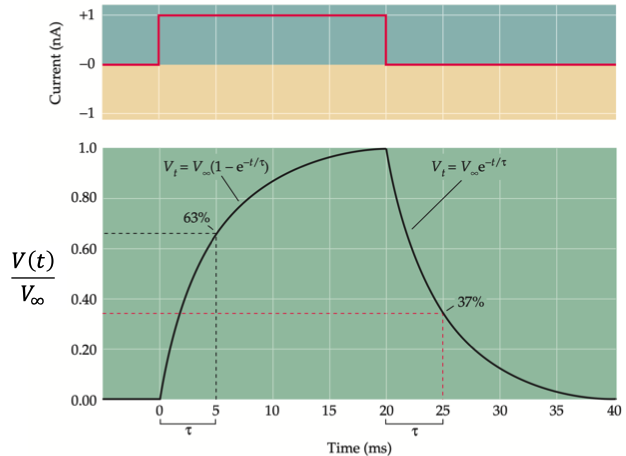

#### Action Potential 动作电位

膜内电压高于膜外，触发动作电位需要刺激强度超过阈值电位，一旦超过，动作电位迅速达到顶峰，然后返回静息电位

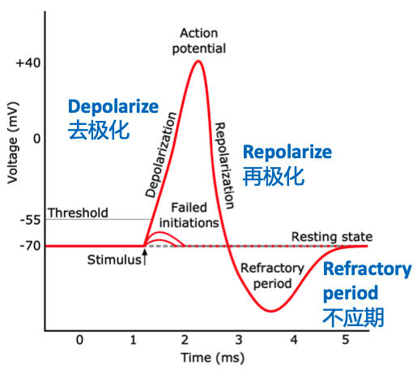

- Propagation（传导）：在某一区域，刺激引发膜电位发生快速反转。该区域相当于电池，使邻近细胞膜电位上升至阈电位以上，从而触发新的动作电位。动作电位可远距离不衰减传导（without decrement）

###  Leaky Integrate-and-Fire (LIF) Neurons 渗漏积分激发模型

#### Neuromorphic Computing 神经形态计算（类脑计算）

- 设计模仿生物神经系统(biological nervous systems)信息处理方式的计算系统。
- 主流范式：神经元维持内部状态，通过脉冲（spike）通信，并依靠带权重的突触完成相互作用。
- 脉冲神经网络（Spiking neural networks, SNN）：可在软件中运行，也可部署在专用硬件上。
- 一套简单规则决定神经元什么时候发放脉冲。神经元接收突触前神经元的脉冲信号时，会不断累积势能（膜电位）。当该势能超过阈值，神经元就发放脉冲

#### LIF Neurons

突触后神经元对来自所有突触前神经元的输入做累加（积分），但该电位值会随时间衰减（渗漏）。如果输入累加总和达到最低阈值，神经元就发放脉冲。（A Leaky Bucket Analogy：累加的越多，衰减的越快）


#### Neuromorphic Computing 神经形态计算（类脑计算）

- 设计模仿生物神经系统(biological nervous systems)信息处理方式的计算系统。
- 主流范式：神经元维持内部状态，通过脉冲（spike）通信，并依靠带权重的突触完成相互作用。
- 脉冲神经网络（Spiking neural networks, SNN）：可在软件中运行，也可部署在专用硬件上。
- 一套简单规则决定神经元什么时候发放脉冲。神经元接收突触前神经元的脉冲信号时，会不断累积势能（膜电位）。当该势能超过阈值，神经元就发放脉冲

#### Resistor-Capacitor (RC) circuit model

>Q：为什么把神经元的活动总是比做RC电路呢？

>A：胞内外总有电压差$\rightarrow$电容。胞上离子通道的通过难易度$\rightarrow$电阻。突触信号：电流。但是没办法描述脉冲（fire）

$$I(t)=I_R(t)+I_C(t)=\frac{v(t)}{R}+C\frac{dv(t)}{dt}
$$

$$
v'(t)=\frac{1}{C}I(t)-\frac{1}{RC}v(t)
$$
$$
\frac{dv(t)}{dt}=-\frac{v(t)}{\tau}+\frac{v_\infty}{\tau}
$$
1. 当膜电位 $v(t) \ge v_{th}$ ($v_{th}$ 发放阈值)，神经元发放脉冲（fire，产生动作电位动作电位）。
2. 发放后进入不应期（refractory period）：膜电位被重置，此阶段无法再次发放脉冲

$$
\frac{dv(t)}{dt}\approx\frac{v(t+\Delta t)-v(t)}{\Delta t}
$$

$$
v[t] = v[t-1]\left(1-\frac{\Delta t}{\tau}\right) + \frac{\Delta t}{\tau}I[t]
$$
可以根据上述公式写出LIF，然后拼几个成为SNN。

#### STDP

SNN权重如何更新：
权重变化完全看两个神经元脉冲的先后顺序 & 时间差

1. 前神经元先放、后神经元后放（Pre $\rightarrow$ Post）是因果正确（输入激活了输出）$\rightarrow$ 权重增强（LTP）
2. 后神经元先放、前神经元后放（Post $\rightarrow$ Pre）
无因果、乱同步
$\rightarrow$ 权重减弱（LTD）

> Q：SNN和NN的区别是什么

> A：持续积累变化（时间维度），到达阈值才启动（稀疏）。SNN使用STDP更新权重
### Brain

- The brain includes the cerebrum (大脑), cerebellum (小脑), brainstem (脑干), and diencephalon (间脑).
- The cerebrum has two hemispheres (大脑半球). Each has four lobes (脑叶): frontal (额叶), parietal (顶叶), temporal (颞叶), and occipital (枕叶)
- 大脑皮层由灰质（gray matter）构成，负责高级脑功能，有沟回，神经元数量百亿级别，哺乳动物特有新皮层（neocortex）由外到内分为6层

**一张重要的图片**

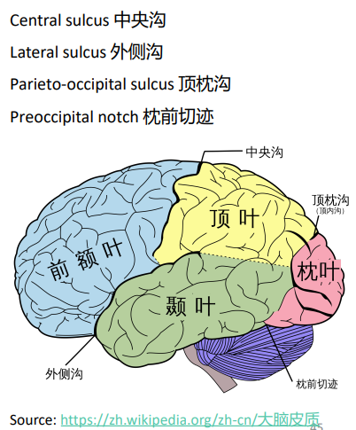

| 脑叶（英文） | 核心功能 |
| --- | --- |
| 额叶（frontal lobe） | 高级认知：学习、语言、决策、抽象思维、情绪 |
| 顶叶（parietal lobe） | 躯体感觉（somatosensation）；整合空间、视觉、身体信息 |
| 颞叶（temporal lobe） | 听觉、嗅觉、高级视觉加工、左右分辨、长期记忆（long‑term memory） |
| 枕叶（occipital lobe） | 视觉处理（visual processing） |

重要解剖沟：中央沟（Central sulcus）、外侧沟（Lateral sulcus）、顶枕沟（Parieto‑occipital sulcus）、枕前切迹（Preoccipital notch）

- 布罗德曼分区（Brodmann Areas）K. Brodmann，依据脑组织染色后的神经元组织形态，把大脑皮层划分52 个区域。皮层三大功能分区：
    1. 感觉皮层（sensory cortex）
    2. 运动皮层（motor cortex）
    3. 联合皮层（association cortex）

- 皮层电活动（Electrical Activity of the Cortex）：皮层神经元持续产生节律性电压波动，称为自发脑电活动（spontaneous brain electrical activity），即脑电波（brain waves）。按频率划分四类脑波（慢波振幅大，快波振幅小）：

    1. δ 波（Delta）：0.5‑3 Hz
    2. θ 波（Theta）：4‑7 Hz
    3. α 波（Alpha）：8‑13 Hz
    4. β 波（Beta）：＞14 Hz

## Perception and Attention

这一节讨论两个相互关联的问题：我们如何把感官收到的刺激组织成对世界的理解，以及在信息过多时，我们如何选择优先处理的内容。

### Perception

Perception（感知 / 知觉）并不是对外界刺激的简单记录，而是大脑对感觉信息进行获取、筛选、组织、识别和解释的过程。它最终形成的是我们对物体或环境的整体理解。

从低层到高层，可以将这一过程写成：

$$
\text{Sensation}\longrightarrow\text{Perception}\longrightarrow\text{Representation}
$$

- Sensation（感觉）：感觉器官受到刺激后，大脑首先记录颜色、亮度、声音强度等局部属性。
- Perception（知觉）：把分散的感觉信息整合成完整的对象或经验。
- Representation（表征）：在反复感知同一对象或同一类对象后形成的内部印象，使我们即使不直接面对对象，也能在心中表示它。

因此，感觉更接近“接收到了什么信号”，知觉则要回答“这些信号意味着什么”。

#### Perceptual systems

感知系统可以按照感觉器官和受体类型进行划分：

| System | 典型活动 | 主要受体 | 主要结构 |
| --- | --- | --- | --- |
| Basic orienting | 身体定向和平衡 | Mechanoreceptors | 前庭器官 |
| Auditory | Listening、声音定位 | Mechanoreceptors | 耳蜗、中耳和外耳 |
| Haptic | Touching、主动探索 | Mechanoreceptors / thermoreceptors | 皮肤、关节、肌肉 |
| Olfactory | Smelling | Chemoreceptors | 鼻腔 |
| Gustatory | Tasting | Chemical / mechanical receptors | 口腔 |
| Visual | Looking | Photoreceptors | 眼睛、眼肌及相关身体结构 |

感知并不局限于视觉。不同系统接收不同形式的物理或化学刺激，但都需要将刺激转换成神经系统能够处理的信息。

#### Sensory thresholds and psychophysics

并非所有刺激都能产生感觉。刺激需要达到一定强度，才可能被感知。

- Absolute threshold（绝对阈限）：一个人能够检测到某种刺激的最低强度。
- Difference threshold（差别阈限）：能够察觉两个刺激存在差异所需的最小变化，也称为 just noticeable difference, JND（最小可觉差）。
- Psychophysics（心理物理学）：研究物理刺激的变化如何对应感觉经验的变化。

##### Weber's Law

在一定范围内，差别阈限与原刺激强度近似成固定比例：

$$
\frac{\Delta I}{I}=k,
$$

- $I$：原刺激强度；
- $\Delta I$：刚好能够被察觉的强度差；
- $k$：Weber fraction，不同感觉通道具有不同的 $k$。

Weber 定律的重点不是“增加了多少”，而是“相对于原来的强度增加了多少”。例如，从 10 个点增加到 20 个点与从 110 个点增加到 120 个点，虽然都增加了 10 个点，但前者的相对变化为 $1$，后者只有约 $0.09$，因此前者明显得多。

##### Weber-Fechner Law

Fechner 在 Weber 定律的基础上进一步提出：主观感受强度随物理刺激强度近似呈对数增长，

$$
p=\alpha\ln\frac{S}{S_0},
$$

其中 $p$ 表示主观知觉强度，$S$ 表示刺激强度，$S_0$ 表示初始或阈限刺激。

这意味着：当刺激本来已经很强时，再增加同样的物理量，主观上带来的变化会更小。

### Perceptual Constancy

Perceptual constancy（知觉恒常性）是指：即使观察条件和感觉输入不断变化，我们仍会把物体的大小、形状和颜色知觉为相对稳定的属性。

真实世界中的同一物体会因为距离、角度和光照不同，在视网膜上形成完全不同的图像。如果没有恒常性，我们每次改变观察位置，看到的都像是一个新物体。所以 perceptual constancy 实际上是人类能够生活在稳定世界里的基础之一。他同时告诉我们perception也是一种inferencce，输入是什么是由大脑解释的，而不是我们真实看到了什么。

> 输入在变，世界没变，大脑必须学会“忽略不重要的变化”。

#### Size constancy

物体离我们越远，它在视网膜上的成像越小，但我们通常不会认为物体本身真的缩小了。大脑会利用距离、透视和环境背景等线索，对视网膜图像进行解释。

这也会产生一些视觉错觉：

- Ponzo illusion（庞佐错觉）：汇聚的线条提供深度线索，使视网膜尺寸相同的物体看起来大小不同。
- Müller-Lyer illusion（缪勒-莱尔错觉）：线段两端箭头的方向改变了我们对线段长度的判断。
- Ebbinghaus illusion（艾宾浩斯错觉）：两个大小相同的中心圆，会因为周围圆的大小不同而显得不一样大。

大小恒常性会受到情境影响：丰富的深度线索通常能加强恒常性；距离过远时恒常性可能减弱；水平观察通常也比垂直观察更有利于判断真实大小。

#### Shape constancy

Shape constancy（形状恒常性）是指：即使观察角度或物体朝向发生变化，导致视网膜图像的形状改变，我们仍会认为物体的真实形状保持不变。

例如，一扇矩形的门逐渐打开时，它在视网膜上的投影会从矩形变成越来越窄的四边形，但我们仍然知道这是一扇矩形的门。

#### Color constancy

Color constancy（颜色恒常性）是指：即使照明条件发生变化，物体的颜色仍被知觉为相对稳定。例如，同一个绿色苹果在正午和日落时反射到眼睛中的光谱并不相同，但我们通常仍认为它是绿色的。

Checker shadow illusion 中，A、B 两个方格可以具有相同的像素值，但阴影和周围棋盘提供的光照线索会使它们看起来深浅不同。这说明我们感知的并不只是孤立的 RGB 数值，而是结合场景对“物体在当前光照下应当是什么颜色”进行推断。

#### Perceptual constancy in VLMs

一项实验显示，Vision-Language Models 的知觉恒常性仍明显落后于人类：模型在形状恒常性上相对较好，但在大小恒常性和颜色恒常性上更容易受图像表面特征影响。

例如，模型可能正确理解远处的栈桥只是因为透视而显得更窄，却把绿色光照下魔方中央方块的表面颜色直接回答成绿色，而不能恢复其真实颜色。

> 知觉恒常性测试的不是模型能否识别像素，而是模型能否区分“观察条件造成的变化”和“物体本身属性的变化”。

### Organization of Perception

20 世纪初的 Gestalt psychology（格式塔心理学）强调：知觉经验是以整体形式被组织起来的，不能只还原为孤立感觉元素的总和。

#### Gestalt Theory

$$
\text{Whole}\neq\sum \text{Parts}
$$

Holism: The brain organizes experience into wholes

这里并不是说整体中凭空多出某种物质，而是说部分之间的关系和组织方式本身也携带信息。同一组局部元素以不同方式排列，可以形成完全不同的整体知觉。

#### Three properties of Gestalt perception

- Reification（具体化 / 实体化）：知觉会主动补充感觉输入中没有明确画出的结构。例如，若干缺口图形可以让我们看见一个并未真正画出的三角形或球体。
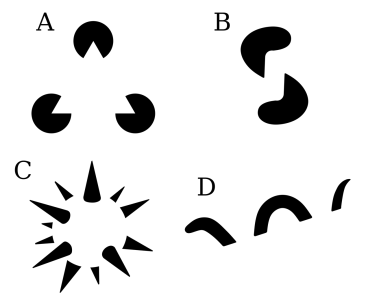
- Multistability（多稳态）：一个模糊刺激可以支持两种或更多种合理解释，知觉会在它们之间切换。例如 Necker cube、Rubin vase 和 Escher 的背景—前景图形。
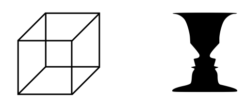
- Invariance（不变性）：即使图形经历旋转、平移、缩放、形变、光照变化或绘制元素变化，我们仍能识别其结构。
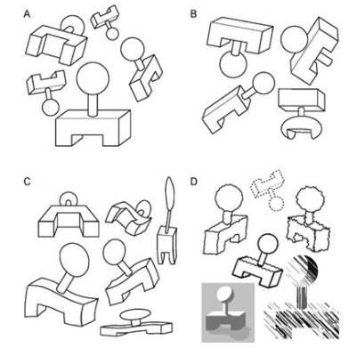

#### Law of Prägnanz

Law of Prägnanz（简洁律）认为，人倾向于把感觉输入组织成尽可能规则、有序、对称和简单的形式。常见的组织原则包括：

- Proximity（邻近律）：空间距离较近的元素更容易被看作一组。
- Similarity（相似律）：形状、颜色或大小相似的元素更容易被归为一组。
- Closure（封闭律）：即使轮廓存在缺口，我们仍倾向于看见完整的物体、字母或图形。（IBM标志）
- Symmetry（对称律）：对称元素更容易被组织成一个连贯整体。
- Continuity（连续律）：相交或被遮挡的线条更容易被理解为平滑延续的整体，而不是互不相关的片段。

中国文字中的会意字也可以帮助理解“整体不同于部分之和”：例如“好”由“女”和“子”组合，“信”由“人”和“言”组合。新字的意义来自部件及其组合关系，而不只是两个部件意义的机械相加。

> Q：为什么我们没有显示的训练过这种能力，但是我们的大脑却自然的让我们有这样的能力？
> A: 人类的大脑里存在大量inductive bias，是通过进化塑造的。而我们在持续学习，且人类的数据是交互式的，世界不断在给人类反馈，所以人本身在不断的自监督学习。且人类特有的多模态同一性质，让所有的模态映射到一个隐空间，让我们的经验更加深刻。​

### Attention

Attention（注意）可以理解为对意识的定向：在多个对象或事件中，选择性地优先处理某些信息。

在认知科学中，注意是一种调节刺激加工的内部机制。它试图解决一个基本矛盾：环境中的输入非常丰富，但认知系统的深层处理能力有限，因此必须决定哪些信息继续加工，哪些信息被削弱或延迟。

#### Dichotic listening

Dichotic listening task（双耳分听任务）会同时向左右耳播放不同内容，并要求被试只关注其中一侧。这类实验被用于判断信息在加工的哪个阶段被选择。

##### Broadbent's Filter Model

Broadbent 的过滤器模型认为：

1. 感觉信息先短暂进入 sensory memory；
2. 一个 all-or-none filter 一次只允许一个通道通过；
3. 选择依据是声音位置、音高等低层物理特征；
4. 只有通过过滤器的信息才继续接受语义分析。

因此，它是一种 early selection model（早期选择模型）。过滤发生在意义分析之前，其作用是防止有限容量的系统过载。

但严格的全有或全无过滤很难解释 cocktail party effect（鸡尾酒会效应）：我们在嘈杂环境中专注于一个人的谈话时，仍可能注意到另一段谈话中出现了自己的名字或熟悉的母语。未被注意的通道似乎没有被彻底阻断。

##### Treisman's Attenuation Model

Treisman 的衰减模型把“完全阻断”改成了“降低信号强度”：

- 注意与非注意通道的信息都可以通过；
- 非注意信息会被削弱，但仍可能接受进一步加工；
- 不同词语具有不同的 activation threshold；
- 自己的名字等高相关信息阈值更低，即使信号被衰减，也可能达到激活阈值。

它仍然保留了早期选择的基本假设，但比严格过滤模型更能解释鸡尾酒会效应。

##### Late Selection Model

Deutsch and Deutsch 的后期选择模型认为，选择发生在语义分析之后：

- 被注意和未被注意的信息都可以接受语义加工；
- 信息的相关性决定哪些内容进入意识，或控制最终反应；
- 注意限制的主要是 conscious access / response，而不是最初的语义识别。

一个经典双耳分听结果是：左耳播放 “Dear - 7 - Jane”，右耳播放 “9 - Aunt - 6”。被试没有按照左右耳分别报告，而可能报告 “Dear - Aunt - Jane” 和 “9 - 7 - 6”。这表明选择可以依据意义进行，而不只是依据声音来自哪只耳朵。

三类模型的差异可以概括为：

| Model | 选择位置 | 未注意信息 | 选择依据 |
| --- | --- | --- | --- |
| Broadbent filter | 语义分析前 | 基本阻断 | 低层物理特征 |
| Treisman attenuation | 较早阶段 | 被削弱但未消失 | 信号强度与激活阈值 |
| Late selection | 语义分析后 | 可完成语义加工 | 相关性、意识与反应需求 |

#### Flanker Task

Eriksen flanker task（侧翼干扰任务）用于研究视觉选择性注意。被试需要对中央目标作出反应，同时忽略两侧的干扰物：

- Congruent：干扰物与目标对应相同反应；
- Incongruent：干扰物诱导竞争性反应；
- Neutral：干扰物不对应任何反应。

不一致条件下的反应通常更慢，说明即使被要求忽略，侧翼刺激仍会参与加工并造成反应冲突。EEG 实验还发现，不一致刺激出现后会引发明显的 N200 成分，它与冲突检测和控制过程有关。

### Attention in AI

#### Transformer attention

Transformer 中的 attention 根据 query 与 key 的匹配程度，为不同 value 分配权重：

$$
\alpha_{ij}=\operatorname{softmax}_j\left(\frac{q_i^\top k_j}{\sqrt{d_k}}\right),
\qquad
a_i=\sum_j\alpha_{ij}v_j.
$$

从“信息不是全部通过，而是获得不同权重”这一点看，它在形式上更像 attenuation，而不是 Broadbent 式的 all-or-none filter。但这种类比是有限的：Transformer attention 是一种可微分的信息路由与加权计算，心理学中的 attention 则描述有限认知资源、意识访问和行为选择。二者使用了同一个词，不代表机制相同。

#### Human gaze guides visual attention

Gaze-VLM 使用人类 gaze heatmap 指导模型学习图像 patch 的注意分布：训练时使模型 attention 接近人的注视位置，测试时则不再需要眼动输入。

在 Ego4D 实验中：

| Task | Baseline | Gaze-guided |
| --- | ---: | ---: |
| Future activity prediction | 0.653 | 0.751 |
| Current activity understanding | 0.718 | 0.785 |

人的视线可以提供“当前哪些物体与下一步动作最相关”的线索。例如，普通模型可能只预测一个人正在伸手拿饮料，而 gaze-guided 模型可以进一步判断他正在拿巧克力。

#### Human fixation guides reading comprehension

人类阅读时的注视模式也可以用来监督 decoder attention：

1. 让读者先阅读段落，再看到问题；
2. 统计回答正确的读者在每个词上的平均停留时间；
3. 将其归一化为 word-level fixation target；
4. 训练模型同时完成 QA，并使最后若干 decoder layers 对段落词语的 attention 接近人类注视分布。

在 Qwen3-0.6B、OneStop 数据上的结果为：

| Measure | QA only | QA + fixation |
| --- | ---: | ---: |
| Four-choice QA accuracy | 86.17% | 89.45% |
| Human-model correlation (Pearson) | 0.228 | 0.812 |

加入 fixation supervision 后，QA 准确率提高了 3.28 percentage points。打乱注视位置会削弱效果，说明收益不只是来自额外的正则化，而与人类实际关注的词语位置有关。

> 人类注意可以作为训练信号改善模型注意，但 attention map 变得更像人类，并不能直接证明模型与人脑使用了相同机制。

> Q：人类大脑的注意力和我们计算机算的attention矩阵有哪些区别，根据这节课的内容来回答

> A：人类的注意力并不一定代表着和当前任务相关，而是大脑决定什么应该信息应该接收，并且什么信息应该在现在处理，当我们处理信息的时候，人类才能主管上感知到注意力被吸引。所以人类的注意力更像是多种信息来源，每种信息的阈值不同，比如自己专注事情上的激活阈值就低，其他的会提高，只要达到阈值就被注意。大脑更像是一个优先系统，优先级由很多种因素决定。而attention矩阵似乎都是一样的阈值。

## Vision

视觉系统从视网膜接收到二维光信号，然后逐层提取颜色、边缘、形状、运动、深度等信息，最后形成对物体和空间的表征。

### Physiological Basis of Vision 视觉的生理基础

外界物体反射的光进入眼球并聚焦在视网膜（retina）上，视网膜将光信号转换为神经信号，再通过视神经传递到大脑视觉皮层。

大致的信息流：

$$
\text{Light}
\rightarrow
\text{Retina}
\rightarrow
\text{Optic Nerve}
\rightarrow
\text{Optic Chiasm}
\rightarrow
\text{LGN}
\rightarrow
\text{V1}
$$
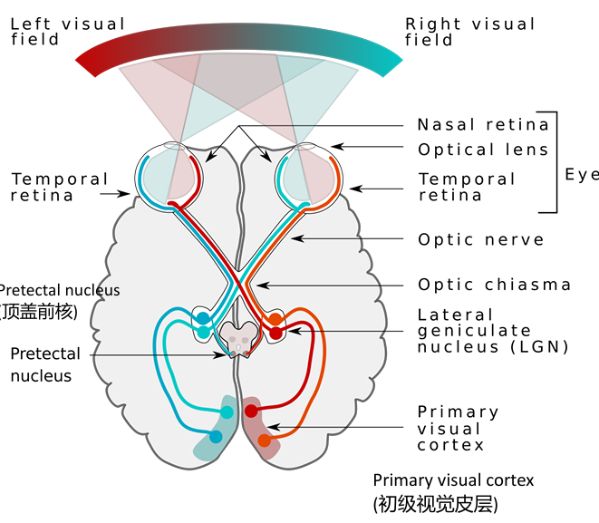

#### Retina 视网膜

视网膜（retina）实际上属于中枢神经系统的一部分，主要可以理解成三级神经元：

1. 光感受器（photoreceptors）
   * 视杆细胞（rod）
   * 视锥细胞（cone）
2. 双极细胞（bipolar cell）
3. 神经节细胞（ganglion cell）

神经节细胞的轴突汇集形成视神经（optic nerve）。

* Rod：
  * 数量约 $1.2\times10^8$
  * 对弱光非常敏感
  * 主要负责暗视觉
  * 基本不能区分颜色

* Cone：
  * 数量约 $6\times10^6$
  * 需要较强光线
  * 可以感知颜色
  * 负责高空间分辨率视觉
  * 大量集中在中央凹（fovea）

* ganglion 数量相比数量少的多

中央凹（fovea）区域 cone 密度最高，因此我们注视某个物体时，会主动移动眼睛，让目标落在中央凹附近，从而获得最清晰的视觉。

#### Visual Pathway 视觉神经通路

左右眼的视神经在视交叉（optic chiasm）处发生部分交叉：

* 鼻侧视网膜（nasal retina）的神经纤维交叉到对侧
* 颞侧视网膜（temporal retina）的神经纤维保持在同侧

因此：

* 右半视野 $\rightarrow$ 左半球
* 左半视野 $\rightarrow$ 右半球

之后信号进入丘脑中的外侧膝状体（Lateral Geniculate Nucleus, LGN）。

LGN：

* 一共有 6 层
* 是视觉信号从 retina 到 cortex 的重要中继站
* 保持视觉空间的拓扑关系（retinotopy）
* 随后通过 optic radiation 将信号传递到 V1

视觉系统之后大致分成两个通路：

* Ventral pathway 腹侧通路：“What”
  * $V1\rightarrow V2\rightarrow V4\rightarrow IT (Inferotemporal cortex, 颞下皮层)$
  * 物体是什么
  * 形状、颜色、物体识别

* Dorsal pathway 背侧通路：“Where / How”
  * $V1\rightarrow V2/V3\rightarrow MT\rightarrow Parietal$
  * 物体在哪里、如何运动
  * 空间位置、运动以及视觉引导的行为

### Visual Cortex 视觉皮层

视觉皮层主要位于枕叶（occipital lobe）。

直接从 LGN 接收大量视觉输入的是初级视觉皮层（Primary Visual Cortex, V1）。


视觉信息随后经过：

$$
V1\rightarrow V2\rightarrow V3/V4/V5/V6
$$

不同区域逐渐处理更加复杂的视觉特征。

粗略而言：

* V1/V2：边缘、方向、颜色、局部运动等基本特征
* V3：形状和动态信息
* V4：颜色、形状等，与物体识别密切相关
* V5/MT：运动信息
* 更高级区域：复杂物体、脸、空间关系等

#### Receptive Field 感受野

一个视觉神经元只对视觉空间中的某一部分刺激产生响应，这个区域称为感受野（receptive field）。

Hubel 和 Wiesel 对猫和猴视觉皮层的研究发现，不同视觉神经元具有不同的 feature selectivity。

例如神经元可能只对：

* 特定方向（orientation）
* 特定空间频率（spatial frequency）
* 特定运动速度（velocity）
* 双眼视差（binocular disparity）
* 特定颜色

产生强烈响应。

#### Simple Cell & Complex Cell

V1 中的 simple cell 主要响应特定位置、特定方向的边缘或条纹。其感受野可以近似用 Gabor filter 表示。

Complex cell 同样具有 orientation selectivity，但是对刺激的精确位置没有那么敏感。

从这里已经可以看到一种层级结构：

$$
\text{Pixel}
\rightarrow
\text{Edge}
\rightarrow
\text{Shape}
\rightarrow
\text{Object}
$$

这也是后来 CNN 的重要生物学启发之一。

#### V1 Saliency Hypothesis

V1 Saliency Hypothesis（V1SH）认为 V1 不仅提取局部特征，还可能通过神经元之间的相互作用形成一个 bottom-up saliency map，用来告诉系统哪里最值得注意？

核心机制之一是 iso-feature suppression。

假如大量邻近神经元都响应相同方向，它们之间会发生较强的相互抑制。如果突然出现一个不同方向，对应位置的神经元受到的同特征抑制较少，因此响应相对突出。

于是：

$$
\text{unique feature}
\rightarrow
\text{large relative neural response}
\rightarrow
\text{high saliency}
$$

高 saliency 的位置随后可以吸引注意力或者眼球注视。

> V1 创建 saliency map 是一个理论假说，而不是说 saliency 是 V1 唯一或者已经完全确定的功能。

#### Visual Search

Visual Search 实验中要求被试从 distractors 中找到 target。

衡量搜索效率的一个常用方法：

$$
RT=a+bN
$$

其中：

* $RT$：reaction time
* $N$：distractor 数量
* $b$：搜索曲线斜率

$b$ 越大，说明 distractor 增加以后反应时间增长得越快，搜索越困难。

##### Feature Search

如果 target 在某一个基本特征上与其他物体不同，例如：

* 一个红色点在绿色点中
* 一条斜线在竖线中

target 通常会发生 pop-out。搜索时间受 distractor 数量影响较小。

##### Conjunction Search

如果 target 需要结合多个特征才能确定，例如：

> 找“红色竖线”，但背景里同时存在红色横线和绿色竖线。

此时单一特征无法直接定位目标，需要进行更多特征结合，因此通常搜索更困难。

另外视觉搜索还有：

* background homogeneity effect：背景越一致，异常目标越容易突出
* visual search asymmetry：A 在 B 中好找，并不意味着 B 在 A 中同样好找

### Color Theory 颜色理论

颜色可以分成：

* 非彩色：白、灰、黑
* 彩色：黑白灰之外的颜色

彩色有三个基本属性：

1. Hue 色调 / 色相
2. Brightness 明度
3. Saturation 饱和度,单一波长的光通常具有很高的饱和度；向颜色中不断加入白光，饱和度会降低。

#### RGB & CMYK

RGB 是加色模型（additive color model）：

$$
R+G+B
$$

不同颜色的光叠加形成新的颜色。

主要用于：

* 屏幕
* 显示器
* 摄像和数字图像

CMYK 是减色模型（subtractive color model）：

* Cyan
* Magenta
* Yellow
* Key / Black

颜料通过吸收白光中的一部分波长产生颜色，因此主要用于印刷。

### Marr's Theory 马尔的视觉计算理论

Marr 认为视觉不是直接从 image 一步得到 object，而是经过一系列中间 representation：

$$
\text{Image}
\rightarrow
\text{Primal Sketch}
\rightarrow
\text{2.5D Sketch}
\rightarrow
\text{3D Model}
$$

#### Primal Sketch 初始简图

从原始图像中提取基本结构：

* edge
* line
* region
* intensity change

#### 2.5D Sketch

在 primal sketch 的基础上加入深度和表面信息：

* surface orientation
* distance
* binocular disparity
* texture
* illumination
* depth

之所以叫 2.5D，是因为已经加入了 depth，但还没有形成完整、视角无关的 3D object representation。

#### 3D Model

最后形成更加稳定的 object-centered representation。

目标是让一个物体即使发生：

* viewpoint change
* rotation
* position change

仍然能够被识别为同一个物体。

### Topological Theory 拓扑视觉理论

视觉研究中长期存在两种思路：

* Atomism 原子论
* Holism 整体论

Atomism：先处理局部特征，再组合成整体。Marr 的理论基本属于这一类。

Holism：某些整体性质可能在非常早的视觉阶段就已经被检测出来，而不一定需要先完成所有局部分析。陈霖提出的“拓扑性质初期知觉”假说属于这一方向。

#### Topological Property 拓扑性质

拓扑学关心的是：一个图形在连续拉伸、扭曲、弯曲之后，哪些性质保持不变？在这种变换下仍然保持不变的性质包括：

* connectivity 连通性
* number of holes 洞的数量
* inside / outside 包含关系
* adjacency 邻接关系

例如圆和正方形可以通过连续变形互相得到：它们都有一个连通分量,没有洞因此拓扑结构相同。

#### Early Topological Perception

关键问题：我们是先看到局部形状，再得到拓扑结构；还是拓扑结构本身就可以被非常早地检测？

实验结果被用来支持：

$$
\text{Topological Difference}
\rightarrow
\text{can be detected very early}
$$

> Q：为什么“整体”的拓扑性质反而可能比局部形状更早？

> A：这里的整体并不等于“先把所有局部特征算完再拼起来”。连通、洞等拓扑性质可能由视觉系统中的另一类快速机制直接检测，因此 global property 不一定必须建立在完整 local geometry 之后。

### Convolutional Neural Networks

CNN 是计算机视觉中经典的层级视觉模型。

从传统 computer vision 的角度可以把视觉任务分成：

1. Visual foundations
2. Low-level processing
3. Mid-level processing
4. High-level processing

常见结构规律：

* 前面：convolution，提取空间特征
* 中间：逐层形成越来越复杂的 representation
* 后面：fully connected / classifier，完成具体任务

具体内容可以见课程资料和深度学习笔记

### ConvNets and Visual Systems

CNN 不只是工程模型，也可以作为 biological visual system 的 computational model。

Yamins & DiCarlo 的工作比较了 CNN internal representation 和 monkey visual cortex neural response结果发现一种层级对应关系：

* CNN intermediate layers 对 V4 neural response 的预测较好
* CNN later layers 对 IT（inferior temporal cortex）neural response 的预测较好

在 object classification 上表现更好的模型，其内部 representation 往往也能更好地预测 IT neural response。说明 task optimization learn to recognize objects，可能自然地产生一些与生物高级视觉系统相似的 representation。

#### RDM
Representational Dissimilarity Matrix（RDM）不直接比较单个 neuron 和单个 artificial unit，而是比较整个 representation 的几何结构。

Representational Similarity Analysis (RSA) 两个系统面对同一批图片时，它们是以多相似的方式组织这些图片的？

对于两个 stimuli $i,j$：

$$
RDM_{ij} = d(r_i,r_j) =  1 − PearsonCorr(r_i, r_j)
$$

$$
\text{RSA score}
=
\operatorname{SpearmanCorr}
\left(
\operatorname{upper}(D^A),
\operatorname{upper}(D^B)
\right)
$$

$r_i,r_j$ 是系统看到两幅图像之后产生的 representation。

如果两个系统具有类似的 RDM：哪些图片被认为相似、哪些被认为不同，这种整体关系结构比较一致。

因此可以比较：

* CNN layer
* human V1-V3
* human IT

之间 representation structure 的相似程度。

> Q：CNN 和 visual cortex 有对应关系，是不是对应大脑的大部分真实机制？

> A：不是。这里说明的是 representation 和 hierarchy 存在一定相似性。CNN 是一个可以用来解释部分神经响应的 computational model，但真实视觉系统存在大量 recurrent connections、feedback、attention、眼球运动以及更复杂的生物神经机制。

## Auditory and Speech Systems

这一节从两个层面讨论声音：听觉系统如何把声波变成神经信号，以及我们如何从声音中识别语言、理解意义并产生言语。

### Auditory Sensory System 听觉系统

#### The Auditory Process 听觉形成过程

听觉不是声音直接进入大脑，而是经历机械振动 mechanical motion、电信号 electrical changes、化学传递 chemical transmission 神经冲动 neural impulses和中枢加工 central processing：
 
$$
\text{Sound}
\rightarrow\text{Outer Ear}
\rightarrow\text{Middle Ear}
\rightarrow\text{Cochlea}
\rightarrow\text{Auditory Nerve}
\rightarrow\text{Auditory Pathways}
\rightarrow\text{Auditory Cortex}
$$

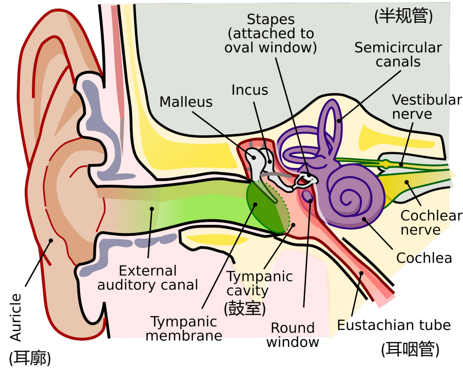

* Outer ear 外耳：收集声波，经外耳道传到鼓膜（tympanic membrane）。
* Middle ear 中耳：鼓膜振动带动三块听小骨：
  * Malleus 锤骨
  * Incus 砧骨
  * Stapes 镫骨
* Cochlea 耳蜗：内部充满液体，传入的振动引起液体和基底膜（basilar membrane）运动。
* Hair cells 毛细胞：静纤毛（stereocilia）发生偏转，将机械运动转换成细胞的电变化，再通过释放神经递质激活听神经纤维。
* Auditory nerve 听神经：把神经冲动传入中枢，经过听觉通路到达听觉皮层。

可以把前面的过程理解成：

$$
\text{机械振动}
\rightarrow\text{毛细胞电变化}
\rightarrow\text{递质释放}
\rightarrow\text{听神经脉冲}
\rightarrow\text{中枢加工}
$$

cochlear nerve（耳蜗神经）主要传递听觉信息；vestibular nerve（前庭神经）主要与平衡有关。

#### Hearing Frequency Range 听觉频率范围

人类通常能听到约 $20$–$20{,}000\ \mathrm{Hz}$ 的声音，不同物种的范围不同。

| 物种 | 听觉频率范围 / 上限 |
| --- | --- |
| Human | 约 20 Hz–20 kHz |
| Dog / cat | 低频下限相近，高频上限可到约 65 kHz |
| Bat | 高频上限可到约 200 kHz |
| Beluga whale 白鲸 | 约 1–123 kHz |
| Bottlenose dolphin 宽吻海豚 | 约 150 Hz–150 kHz |

听不听得到，不只取决于 frequency，也取决于 intensity。同一个频率的声音太弱时仍然听不到，因此听觉范围需要放到“频率 × 强度”的平面里理解。

### Sound Pressure and Loudness 声压与响度

Measures of sound intensity

#### Sound Pressure Level 声压级

Sound Pressure Level（SPL）是**客观物理量**，用参考声压的对数比值表示：

$$
L_p=20\log_{10}\left(\frac{p_{\mathrm{rms}}}{p_0}\right)\ \mathrm{dB}
$$

* $p_{\mathrm{rms}}$：有效声压 / 均方根声压
* $p_0=20\ \mu\mathrm{Pa}=2\times10^{-5}\ \mathrm{Pa}$：空气中的标准参考声压
* dB：decibel，分贝

非常安静的房间约 20–30 dB SPL；1 m 处的正常交谈约 40–60 dB SPL。

由公式可知，声压变成原来的 10 倍，SPL 增加 20 dB；声压变成 2 倍，SPL 约增加 6 dB。

> Q：0 dB SPL 是完全没有声音吗？
>
> A：不是。它表示有效声压等于参考声压 $p_0$。分贝表示的是相对于参考值的比值，而不是“声音存在 / 不存在”。

#### Weber's Law in Hearing

前面的 Weber 定律同样适用于听觉中的差别阈限：

$$
\frac{\Delta I}{I}=k
$$

例：在指定的初始刺激和实验条件下，pitch（2,000 Hz）的 Weber fraction 约为 $1/333$，loudness（100 phon，1,000 Hz）约为 $1/11$。

这些值强调的是不同感觉属性具有不同的辨别敏感度，不能脱离刺激条件，把某个 $k$ 当作适用于所有声音的固定常数。

#### Loudness & Equal-loudness Contours

Loudness（响度）是**主观感受**，SPL 是客观声压级。相同 SPL 的两个声音，如果频率不同，听起来不一定一样响。

Equal-loudness contours（等响度曲线）把“听起来一样响”的不同频率和 SPL 组合连接起来。

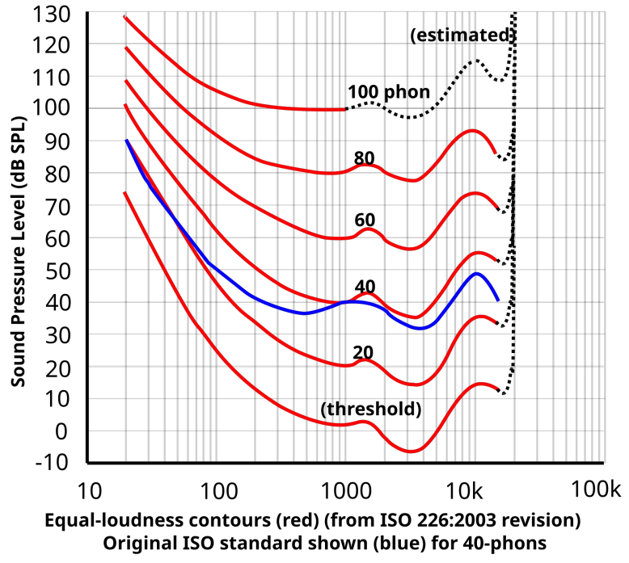

* 横轴：frequency
* 纵轴：SPL，单位 dB
* 同一条曲线上的点：主观响度相同
* 曲线低的位置：达到该响度所需的声压较小，耳朵对该频段更敏感

例如低频声音通常需要更高的 SPL，才能听起来与中频声音一样响。

#### Loudness Level 响度级

响度级的单位是 phon，用 1,000 Hz 的参考纯音定义：

> 如果一个声音听起来与 1,000 Hz、$x$ dB SPL 的纯音一样响，那么它的响度级就是 $x$ phon。

因此：

* 对 1,000 Hz 的纯音，phon 数值与 dB SPL 数值相同。
* 对其他频率，需要通过等响度曲线找到对应的 dB SPL。

> Q：40 phon 就是 40 dB SPL 吗？
>
> A：对 1,000 Hz 的参考纯音成立。换成其他频率，达到 40 phon 所需的 SPL 可能不同。

### Auditory Cortex 听觉皮层

听觉皮层主要位于 temporal lobe（颞叶），包括：

1. Primary auditory cortex 初级听觉皮层，A1
2. Secondary auditory cortex 次级听觉皮层，A2
3. Auditory association areas 听觉联合区

它们分析来自耳蜗信号中的时间和频率结构。神经元按照偏好的频率呈现有序分布，这种组织方式称为 tonotopy（音调拓扑组织 / 频率拓扑映射）。

可以和前面视觉系统中的 retinotopy 类比：视觉保留视野位置的组织关系，听觉则保留频率的组织关系。

A1 也不只是对某一个孤立频率作出反应，还参与编码更复杂的声音特征。

### Speech Perception & production

#### Ellis & Young Model 口语通路模型

Ellis & Young（1988）用多个功能模块描述 spoken word perception and production。这里讨论的是从听到单词到识别、理解和复述的认知加工通路。

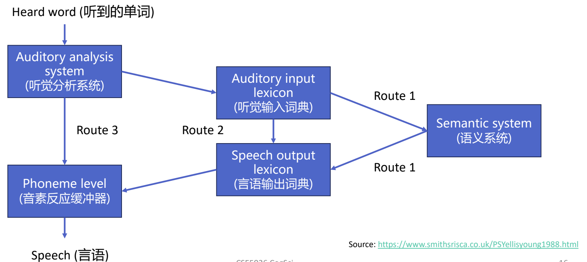

#### Functional Modules

| 模块 | 作用 |
| --- | --- |
| Auditory analysis system 听觉分析系统 | 提取声学特征和音位信息 |
| Auditory input lexicon 听觉输入词典 | 判断是否为熟悉的口语词形 |
| Semantic system 语义系统 | 提供词的意义 |
| Speech output lexicon 言语输出词典 | 提供已存储的口语输出形式 |
| Phoneme level 音素反应缓冲器 | 暂时保持说出声音所需的信息 |

Phoneme（音位）是能够区分词义的最小语音单位。例如，普通话不送气的 /p/（如“爸”）与送气的 /pʰ/（如“怕”）说明：这种语音差异可以区分词义。phoneme 严格说是“音位”，phone 是实际发出的“音素”。

Semantic system 是功能层面的抽象，不要求大脑中存在一个独立、集中的“词义盒子”。它也可能由分布式表征实现，可以类比 semantic embeddings。

#### Three Routes for Spoken Repetition

##### Route 1: Semantic Route 语义通路

听觉分析 $\rightarrow$ 听觉输入词典 $\rightarrow$ 语义系统 $\rightarrow$ 言语输出词典 $\rightarrow$ 音素缓冲器 $\rightarrow$ 说出。

识别词形、理解意义，再提取输出形式。它是经过 meaning 的复述路径。

##### Route 2: Lexical Route 词汇通路

听觉分析 $\rightarrow$ 听觉输入词典 $\rightarrow$ 言语输出词典 $\rightarrow$ 音素缓冲器 $\rightarrow$ 说出。

熟悉的口语词形可以直接连接到输出，不一定需要访问词义。

##### Route 3: Nonlexical Route 非词汇通路

听觉分析 $\rightarrow$ 音素缓冲器 $\rightarrow$ 说出。

绕过词典与语义系统，因此可以复述陌生词或 nonwords（非词 / 无意义的语音组合）。

#### Word Meaning Deafness 词义性耳聋

患者听到词后理解意义受损，但复述可能保留。这说明：

$$
\text{能够复述}\not\Rightarrow\text{已经理解}
$$

> Q：为什么不理解一个词，还能把它说出来？
>
> A：复述可以通过不访问语义的 Route 2，或直接进行语音转换的 Route 3。因此“听清声音”“识别熟悉词形”“理解意义”“说出来”并不是同一个功能。

### Articulatory Phonetics 发音语音学

Articulatory phonetics 研究口腔、咽喉和鼻腔中的发音器官，如何改变来自肺部的气流以产生语音。

#### Voiced & Unvoiced Sounds 清浊音

* Voiced sounds 浊音：声带（vocal folds / cords）振动，例如 [b]、[d]、[g]。
* Unvoiced / voiceless sounds 清音：声带不振动，例如 [p]、[t]、[k]。

声带靠近并在气流作用下周期性振动，是浊音声源的重要来源；声带张开、没有这种振动时，可以产生清音。这里的 [b]、[p] 等是语音符号，不能直接等同于汉语拼音字母。前面普通话“爸 / 怕”的例子区分的是送气，不是简单的清音与浊音。

#### Consonants & Vowels 辅音与元音

* Consonants 辅音：气流在声道某处受到明显阻碍或封闭，可以是清音，也可以是浊音。
* Vowels 元音：气流受到的阻碍较小，通常是浊音，相比辅音往往更响、持续时间更长。

不同的舌位和发音部位会改变声道形状，从而产生不同语音。

#### Vowel Space 元音空间

元音可以根据舌头的大致位置组织成一个空间：

* High / low：舌位高低
* Front / back：舌位前后
* 图中的路径：发音过程中舌位发生变化，例如 diphthongs（双元音）

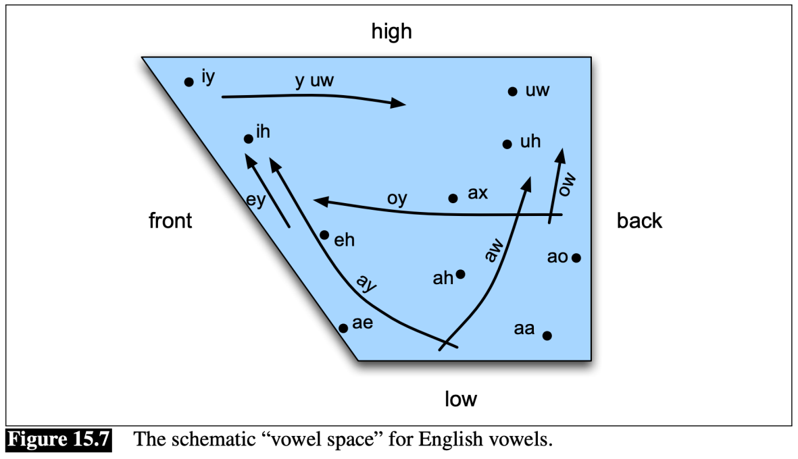

#### Syllables 音节

辅音和元音可以组合成 syllable（音节），通常围绕一个元音或其他可充当音节核的响音组织：

$$
\text{Syllable}=\text{Onset}+\text{Rime}
$$

$$
\text{Rime}=\text{Nucleus}+\text{Coda}
$$

* Onset 首音：音节开头的辅音，可以缺省
* Nucleus 核音：音节中心，通常是元音
* Coda 尾音：音节末尾的辅音，可以缺省
* Rime 韵：核音与尾音的组合

例如 dog 是一个音节，/d/ 是 onset，中间元音是 nucleus，/g/ 是 coda。Catnip 则包含 cat 和 nip 两个音节。

### Prosody 韵律学

Prosody 关注语调、节奏等跨越单个音素的结构。主要涉及：

1. Fundamental frequency 基频，$F_0$ 和音高有关
2. Energy 能量 和向度有关
3. Duration 时长

这些变化可以传达情绪、语用意图和对话结构。说了哪些词相同，并不意味着表达的重点和态度相同。

#### Prosodic Prominence 韵律突显

* Pitch accent 音高重音：通过音高变化突出某个词或音节。
* Lexical stress 词汇重音：词内部音节的重音结构，pitch accent 通常落在能够承载重音的音节上。
* Vowel reduction 元音弱化：非重读位置的元音可能弱化成 schwa /ə/（央元音）。

词汇重音和句子里的突出位置属于不同层次：一个词有自身的重音模式，但它在当前句子里是否被重点强调，还取决于语境。

#### Intonation 语调

Intonation 是 $F_0$ 随时间的升降模式。

* 句尾 $F_0$ 上升：英语 yes–no question 常见的 question rise
* 句尾 $F_0$ 下降：英语 statement 常见的 final fall

这是一种典型例子，具体语调仍取决于语言和语境，不能把所有问句都等同于升调。

### Basics of Speech Signal Processing

#### Waveform 波形

一个简单的正弦波：

$$
y(t)=A\sin(2\pi ft)
$$

* $A$：amplitude，振幅
* $f$：frequency，频率，每秒振动的周期数，单位 Hz
* $t$：time

Waveform 用时间作横轴，记录声压相对于平衡值的变化。正值对应 compression（压缩），负值对应 rarefaction（稀疏）。真实语音波形通常不是单一正弦波。浊音常呈现近似周期性，而辅音中的闭塞和爆破也会留下不同的波形结构。

#### Sampling 采样

Analog-to-digital conversion（模数转换）包含两个主要步骤：sampling 和 quantization。

Sampling rate $f_s$ 表示每秒记录多少个采样点。Nyquist frequency（奈奎斯特频率：对于均匀采样的带限信号，能够保证无混叠重建的最高频率界限）为：

$$
f_N=\frac{f_s}{2}
$$

为了避免 aliasing（混叠），输入中需要保留的最高频率应低于 $f_s/2$ 即采样率要大于声音频率的两倍，因此通常写成：

$$
f_s>2f_{\max}
$$

如果按语音信息主要位于 10 kHz 以下估算，则理论最低采样率约为 20 kHz；实际系统还需要给滤波留出余量。

* Traditional landline telephony：8 kHz 采样，能保留的频带上限低于 4 kHz
* 常见的在线视频音频采样率：48 kHz

采样率决定时间上记录得多密，并不等于声音本身的频率。

#### Quantization 量化

Sampling 离散化时间，quantization 离散化振幅：把每个采样点的幅度映射到有限的数值等级。

* 8-bit signed integer：$-128$ 到 $127$
* 16-bit signed integer：$-32{,}768$ 到 $32{,}767$

位深越高，可表示的幅度等级越多；在其他条件相同时，量化误差通常越小。

补充一个存储量计算，忽略文件头等开销：

$$
\text{bitrate}=f_s\times\text{bit depth}\times\text{channels}
$$

因此，8 kHz、8-bit、单声道音频的码率是 $64{,}000\ \mathrm{bit/s}=64\ \mathrm{kbit/s}$，每秒约 8 kB。

> 音乐软件中的高解析度音频（Hi-Res Audio）通常具有更高的采样率和量化位深！

#### μ-law PCM
人耳对微弱声音的变化往往更敏感，而对于很大的声音，相同幅度的变化相对不那么明显。μ-law PCM（脉冲编码调制中的 μ 律压扩）先对归一化幅度进行非线性压缩，再量化来解决这个问题：

$$
F(x)=\operatorname{sgn}(x)\frac{\ln(1+\mu|x|)}{\ln(1+\mu)},
\qquad -1\le x\le1
$$

μ-law 的 8-bit 编码通常采用 $\mu=255$。

曲线在 $x$ 接近 0 时较陡，因此在压缩后的数值上均匀量化，相当于给原始小幅度信号更细的分辨率，给大幅度信号更粗的分辨率。

直觉上：小声音中的细微差异需要更多保留，大声音可以容忍更大的绝对量化误差。这也呼应了前面心理物理学中的相对敏感度。

### Frequency, Pitch and Signal Power

#### Fundamental Frequency 基频

浊音中的声带反复打开和闭合，产生近似周期性的压力脉冲。重复周期为 $T_0$ 时：

$$
F_0=\frac{1}{T_0}
$$

例如，一个波形在约 38.75 ms 内出现约 10 个周期，因此可以估算：

$$
F_0\approx\frac{10}{0.03875}\approx258\ \mathrm{Hz}
$$

Pitch track（音高轨迹）画出 $F_0$ 随时间的变化。例如 “Three o'clock?” 的末尾基频升高，对应疑问语调。

> **音乐软件中的无损音质与 Hi-Res Audio**
>
> 音乐软件中常见的 **16-bit/44.1 kHz（CD 音质）** 和 **24-bit/96 kHz（高解析度音频）**，分别对应 Quantization 的位深和 Sampling 的采样率。更高的采样率可以记录更高频率的信号，而更高的位深可以降低量化噪声、扩大动态范围。但人耳通常只能听到约 20 Hz–20 kHz，因此 CD 音质理论上已经能够覆盖人类的可听频率范围，Hi-Res 不一定带来可感知的音质提升。
>
> 音乐播放的过程是：**音乐文件（FLAC/ALAC/AAC）→ 数字解码（PCM）→ DAC（数模转换）→ 耳机**。其中解码不等于量化，而是将编码文件还原为数字音频。有线耳机配合合适的 DAC 更容易实现完整的无损传输，但不代表一定能听出 Hi-Res 与普通无损的区别。
>
> **💡 一个有趣的问题：** 为什么软件可以把 16-bit 音频转换成 24-bit，却不能真正提升到原生 24-bit 的音质？因为 Quantization 本质上是有信息损失的多对一映射：原始振幅中的细微差异在量化时已经丢失，增加位数只能更精细地表示现有数据，无法凭空恢复丢失的信息。

#### Signal Power 信号功率

瞬时振幅只描述一个采样点。要描述一个时间窗中的整体强弱，可以取幅度平方的均值：

$$
P=\frac{1}{N}\sum_{i=1}^{N}x_i^2
$$

* $N$：时间窗内的采样点数
* $x_i$：第 $i$ 个采样点的幅度

功率比的分贝形式：

$$
L=10\log_{10}\left(\frac{P}{P_{\mathrm{ref}}}\right)
$$
用分贝（dB）表示声音强度，就是将声音的强度与一个参考值进行比较，而这个参考值对应于人类的听觉阈限（Hearing Threshold）

补充说明：如果 $x_i$ 的单位是 Pa，则 $P$ 是均方声压，计算 SPL 应使用参考声压的平方：

$$
L_p=10\log_{10}\left(\frac{\frac{1}{N}\sum_i x_i^2}{p_0^2}\right)
=20\log_{10}\left(\frac{p_{\mathrm{rms}}}{p_0}\right)
$$

这里把均方声压的表达与前面的 SPL 定义统一，避免将“声压”直接与“声压平方”相比。若 $x_i$ 只是未校准的数字音频幅度，也不能直接把计算结果当作实际 dB SPL。

#### Pitch & Mel Scale 音高与梅尔标度

* Frequency / $F_0$：物理频率
* Pitch：主观音高，通常 $F_0$ 越高，听起来越高
* Intensity：物理强度
* Loudness：主观响度

物理量和知觉量不是简单的线性对应。Mel scale 用非线性函数近似描述频率与知觉音高尺度的关系：

$$
m=1127\ln\left(1+\frac{f}{700}\right)
$$

* $f$：频率，单位 Hz
* $m$：mel 值

该映射在低频部分近似线性，高频部分更接近对数关系；相等的 mel 差用于近似表示相等的知觉音高间隔。Mel（梅尔尺度）模拟的是人耳对不同频率的感知分辨率

### Spectrum and Spectrogram

#### Interpreting Speech Waveforms

从波形中可以先观察到一些粗略线索：

* 元音通常较长、较响，并呈现较规则的周期性。
* Stop consonants（塞音）可能出现接近静音的闭塞阶段，随后出现短暂的 burst（爆破）。
* 例如，“baby” 中的两个 [b] 可以用来观察闭塞与释放的波形变化。

但仅看时间波形，很难清楚判断复杂声音中包含哪些频率，因此需要转到 frequency domain（频域）。

#### Fourier Analysis 傅里叶分析

复杂信号可以分解为不同频率、幅度和相位的正弦成分。例如：

$$
y(t)=A_1\sin(2\pi f_1t)+A_2\sin(2\pi f_2t)
$$

其中 $f_1=10\ \mathrm{Hz}$，$f_2=100\ \mathrm{Hz}$。

* Waveform：不同成分叠加后，随时间如何变化
* Spectrum 频谱：有哪些频率，各自的幅度有多大

例如，一个信号的主要周期约为 234 Hz，还包含约 $4\times234=936\ \mathrm{Hz}$ 的更快振荡成分；可以通过 discrete Fourier transform（DFT）得到它的频谱。

#### Spectrogram 声谱图

语音的频率结构随时间变化，因此需要对多个短时间窗分别计算频谱，再沿时间排列。补充用 short-time Fourier transform（STFT）概括这一过程：

$$
X(m,k)=\sum_{n=0}^{N-1}x[n+mH]w[n]e^{-j2\pi kn/N}
$$

* $m$：帧编号
* $H$：hop size，相邻帧的间隔
* $w[n]$：窗函数
* $k$：频率索引

Spectrogram 在二维图上同时表达三个量：

| 图中的信息 | 对应量 |
| --- | --- |
| 横轴 | Time |
| 纵轴 | Frequency |
| 深浅 / 颜色 | Amplitude 或 power，常取对数 |

灰度声谱图中，较深的位置表示更强的频率成分。

#### Formants 共振峰

Formants 是声道共振使能量特别增强的频带，在声谱图上常表现为较深的带状结构。

不同元音对应不同的舌位和声道形状，因此具有不同的共振峰分布，可以据此区分元音。

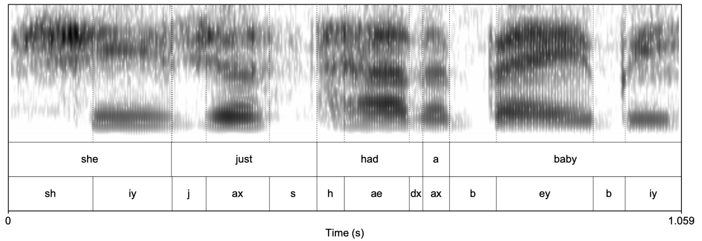

> Q：$F_0$ 和 formants 是一回事吗？
>
> A：不是。$F_0$ 主要描述声带振动的重复速率，与音高有关；formants 描述声道对某些频率的共振增强，与元音音质有关。可以用不同音高发同一个元音，也可以在相近音高下发不同元音。

### Automatic Speech Recognition 语音识别

ASR 把 speech waveform 转换成文字，例如从一段声音识别出 “It's time for lunch!”。

#### Acoustic Features & ConvNet

一个典型的处理流程：

$$
\text{Waveform}
\rightarrow\text{Spectrum / Spectrogram}
\rightarrow\text{Log-Mel Features}
\rightarrow\text{Acoustic Encoder}
\rightarrow\text{Text Decoder}
$$

补充展开 log-mel 的含义：在频谱上使用按 mel 标度分布的滤波器组，汇总各频带能量，再取对数，得到随时间变化的特征。语音识别使用 Mel Spectrogram，主要是为了按照人类听觉的频率分辨特性重新组织频谱，而不是简单地用主观声音强度取代物理强度。进一步使用 Log-Mel Spectrogram，则通过对数变换压缩能量的动态范围，使语音特征更适合机器学习模型处理。

ConvNet 可以在这些特征上提取局部的时间和频率模式。可以类比前面的视觉 CNN：卷积处理的输入结构变成了语音的时频表示。

#### Encoder–Decoder Architecture

* Encoder：把输入声学特征编码为连续的内部表征。
* Decoder：结合编码结果与已生成的内容，逐步输出字母或 tokens。

补充用条件概率表示：

$$
P(Y\mid X)=\prod_{t=1}^{|Y|}P(y_t\mid y_{<t},\operatorname{Encoder}(X))
$$

这里 $X$ 是声学输入，$Y$ 是输出文字序列。语音帧与文字 token 的长度通常不同，因此需要模型建立两者之间的对应关系。

#### Whisper Architecture

Whisper 展示了 Transformer encoder–decoder 如何用于语音识别：

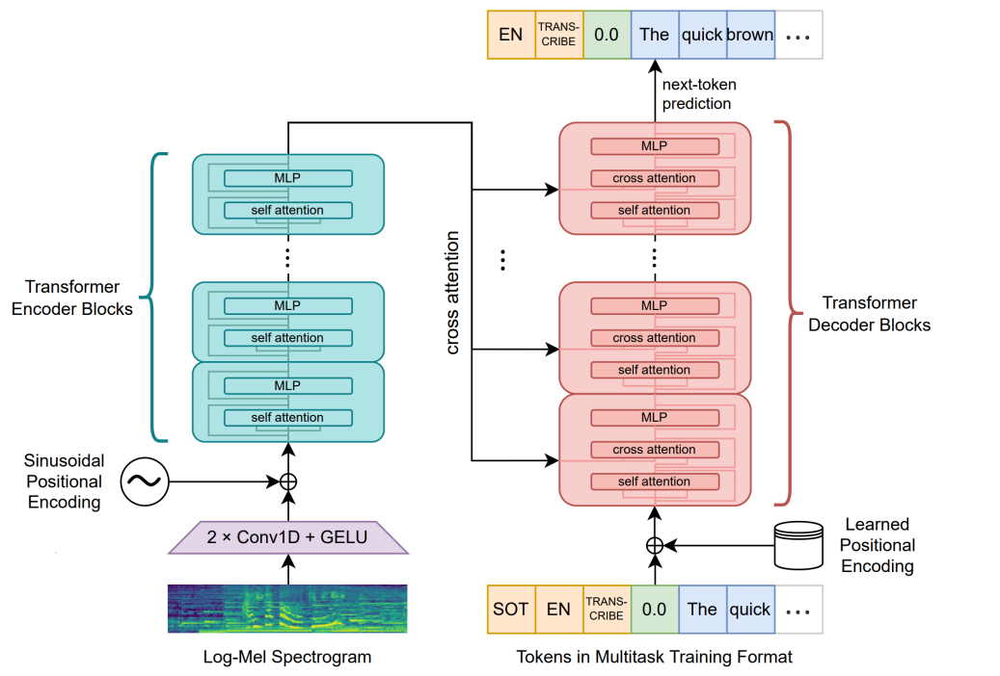

1. 输入 log-mel spectrogram。
2. 两层 Conv1D + GELU 提取特征，加入位置编码。
3. Transformer encoder 处理声音序列。
4. Transformer decoder 通过 cross-attention 读取 encoder 表征，同时根据已有 tokens 预测下一个 token。
5. 输出序列中可以包含语言、任务、时间戳和文字等信息。

这里可以看到前面的 perception、representation 和 attention 在工程系统中的对应：先把信号转换成表征，再根据输入和上下文生成结果。

### Text-to-Speech 语音合成

TTS 的任务方向与 ASR 相反：输入文字，输出语音。

一类方法把语音生成转化为离散 audio tokens 的序列建模：

1. 使用 audio codec（音频编解码器）的 encoder，把语音转换为离散 audio tokens。
2. 用 text tokenizer 得到 text tokens。
3. 训练能够处理文字和音频 tokens 的语言模型，根据文字等条件生成 audio tokens。
4. 使用 audio codec decoder，把生成的 tokens 还原为语音波形。

$$
\text{Text Tokens}
\rightarrow\text{Audio Token Generation}
\rightarrow\text{Audio Codec Decoder}
\rightarrow\text{Speech Waveform}
$$

VALL-E 还使用一小段参考录音作为 prompt，以提供说话人的声音特征，生成个性化语音。

> Q：Audio token 就是音素吗？
>
> A：不一定。这里的 token 是音频编码器学习到的离散表示，可以携带音色、韵律和声学细节，不要求与语言学中的音位逐一对应。


## Language and Syntax

词属于什么类别，如何组成有层级的句子，以及为什么有些句子虽然合乎语法，理解起来却更费力。偏向自然语言处理的内容。

### Neural Basis of Language Processing 语言加工的神经基础

#### Broca's Area 布罗卡区

Broca 通过研究 aphasia（失语症）患者，将左半球额叶下回的一部分区域与言语产生联系起来，通常对应 Brodmann areas 44、45。

主要功能：计划和执行说话（speech production）。

Expressive aphasia（表达性 / 运动性失语）表现为：

* 言语输出困难，说话缓慢、不流畅。
* 严重时只能反复说少数词语。
* 相对于言语输出，部分语言理解能力可以保留。

#### Wernicke's Area 韦尼克区

经典定位主要涉及左侧颞上回后部的 Brodmann area 22，与语言理解（comprehension）有关。

Wernicke's aphasia 属于 fluent aphasia（流利性失语）：

* 说话可以相对流畅，保留自然的节奏和部分句法形式。
* 词语选择和表达意义出现明显问题，说出的内容可能难以理解。
* 语言理解明显受损，也可能难以意识到自己说话中的问题。

#### Language Centers 语言中枢

语言加工涉及多个脑区，而不只是某一个点。相关脑区包括：

* Broca's area 布罗卡区
* Wernicke's area 韦尼克区
* Angular gyrus 角回
* Primary auditory cortex 初级听觉皮层
* Supramarginal gyrus 缘上回

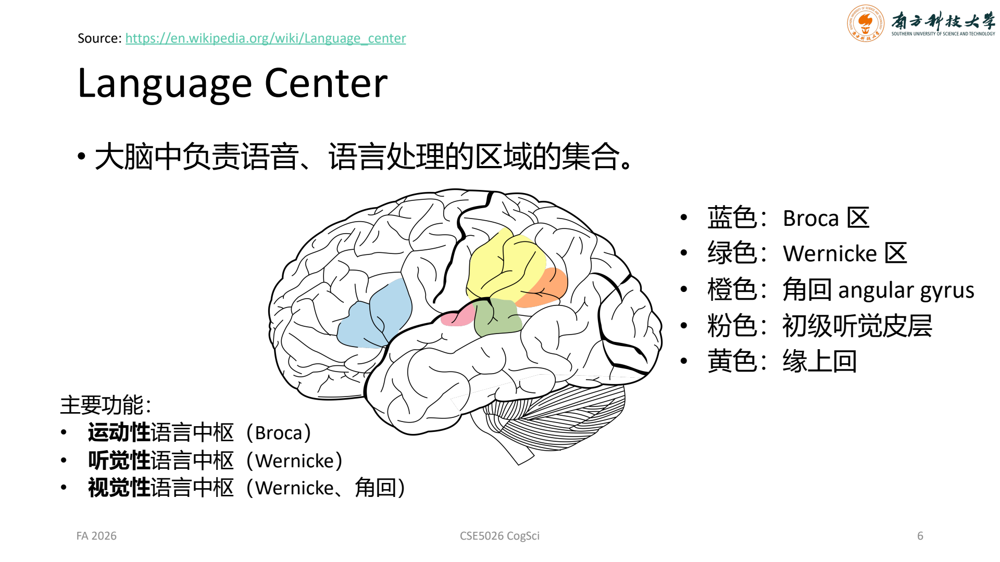

这些脑区参与运动性、听觉性和视觉性的语言功能，可以和上一节的听觉输入、语义理解、言语输出模块联系起来理解。但认知模型中的一个功能模块，不必与某一个脑区逐一对应。

> Q：能流利说话，就代表理解和表达意义都正常吗？
>
> A：不代表。流畅度、词义理解和表达内容可以发生分离，这也是失语症病例对研究语言加工的重要意义。

#### Aphasia and Syntax 失语症与句法结构

句法树可以用来比较两类患者表达中的结构差异。

Fluent aphasia 的例子：

```text
Patient: they took the time in that time here
Comparison: they took the train in that town yesterday
```

两句话可以保留相近的句法骨架：主语、动词、宾语、介词短语和状语仍然出现，但词语选择和整体意义发生变化。这说明保留一定的句法结构，不等于能够正确表达意义。

Expressive aphasia 的例子：

```text
Patient: father and Peter H. ... hospital, Monday, teeth
Comparison: father and Peter visited the hospital on Monday
```

患者的输出主要剩下分散的词或名词短语；对照句则通过 visited、the、on 等成分，把人物、地点和时间组织成完整句子。

从句法层面看，两类困难可以有所不同：一类表达仍较流畅，词语之间可以保留部分结构；另一类难以把词组组织成完整的句子。这是两个病例的对比，不表示每位患者都会出现完全相同的表现。


### Part-of-Speech Tagging 词性标注

#### Part of Speech 词性

Words 可以根据 grammatical categories（语法类别）分类，这些类别称为 part of speech，简称 POS。

POS tagging 的任务：为句子中的每个词确定在当前语境下的词性。

例句：

```text
the   Sun   rises   every   morning
DET   NOUN  VERB    DET     NOUN
```

常见类别包括：

| 类别 | 含义 | 例子 |
| --- | --- | --- |
| Noun | 名词 | cat, flight |
| Proper noun | 专有名词 | Janet, Italy |
| Verb | 动词 | eat, prefer |
| Adjective | 形容词 | green, tasty |
| Adverb | 副词 | slowly, hesitantly |
| Determiner | 限定词 | a, the, some |
| Pronoun | 代词 | I, they |
| Preposition | 介词 | on, with, from |
| Conjunction | 连词 | and, or |
| Auxiliary | 助动词 | can, had |

具体标签名取决于标注体系，例如专有名词可能写作 PROPN，不同语料库的标签不一定完全相同。

#### Open Class & Closed Class

* Open class 开放类：成员可以不断增加，通常包括名词、主要动词、形容词、副词等 content words（内容词）。新概念和借词会持续进入这些类别。
* Closed class 封闭类：成员相对固定，通常包括限定词、代词、介词、连词等 function words（功能词），主要承担语法功能。

这里的“封闭”指成员扩展相对有限，不是绝对不发生变化。

#### POS in Chinese 中文词性

中文同样有名词、动词、形容词、数词、代词、介词、连词等类别。其中还包括：

* 量词（measure words）：如“个、条、张”；动量词如“次、遍、趟”。
* 结构助词：如“的、地、得”。
* 动态助词：如“了、着、过”。
* 语气助词：如“吗、吧、呢”。

这些类别需要结合中文自身的语法理解，不能直接把英文类别逐项套过来。例：

```text
快速  的   棕色  狐狸  跳过  了  懒惰  的   狗
VA    DEC  NN    NN    VV    AS  VA    DEC  NN
```

其中 VA 表示形容词性谓词，NN 表示普通名词，VV 表示动词，AS 表示体标记；DEC 是该例所用标签集中的一种“的”字标记。这些是该标注体系中的分类，不代表每一种分析体系都会给出完全相同的结果。

#### Word Types vs. Word Tokens

对于英语的统计：

* 约 15% 的 word types 存在词性歧义。
* 约 85% 的 word types 没有词性歧义。
* 但有歧义的词往往非常常见，因此约 60% 的 word tokens 涉及词性歧义。

Type 是不同词形的种类，token 是实际文本中每一次出现的词。一个词只计为一种 type，却可以在文本中出现很多次。

例如 love 在不同句子中可以是名词或动词。“Love loves to love love.” 展示了同一词形在不同位置承担不同语法作用。

> Q：大多数词都没有歧义，为什么词性标注仍然需要上下文？
>
> A：因为高频词恰好经常有多种用法。按词典统计“有歧义的词有多少种”和按文本统计“有多少次出现需要消歧”，得到的比例不同。

#### Baseline and Tagging Accuracy

在一项英语词性标注评估中，POS tagging 的 tag accuracy 约为 97%，而 most frequent class baseline 已经约为 92%。

Baseline 的做法：

1. 每个词都标成它在训练数据中最常见的词性。
2. 不认识的词先标成名词。

补充写成：

$$
\hat t(w)=\arg\max_t\operatorname{Count}(w,t)
$$

这个方法不看当前上下文，但仍然可以取得较高准确率，因此评估模型时必须与 baseline 比较。在这项英语任务中，HMM、CRF、BERT 等方法的表现相近。

这些结果来自特定任务和数据，不是所有语言、领域或语料上的固定上限。

中文部分列出的现代汉语结果约为 94–97 F1。注意 F1 与前面的 tag accuracy 不是同一个指标，也不能直接把这些结果推广到古汉语。

“老吾老，以及人之老”和“五亩之宅，树之以桑”：古汉语存在不同的词类用法。“老吾老”中第一个“老”可按动词性用法理解，“树之以桑”的“树”表示种植，机械地全部标为名词就会出错。

### Syntactic Parsing 句法解析

从词性到成分、文法、解析算法与消歧：先描述允许的结构，再计算可能的树，最后比较候选树的概率。

#### Syntax and Constituency 句法与成分

Syntax 研究词如何排列、组合成句子。POS 只描述每个词属于什么类别，句法分析还要描述词之间如何形成结构。

##### Constituency 成分结构

一组词如果在语法上作为一个整体发挥作用，就可以构成 constituent（成分）。

Noun phrases（NP，名词短语）可以包括：

* the Broadway coppers
* three parties from Brooklyn
* they

这些表达长度不同，却都可以出现在句子的主语位置：

```text
three parties from Brooklyn arrive ...
the Broadway coppers love ...
they sit ...
```

所以句法结构不是简单的“第几个词是什么词性”，还需要识别哪些词可以组合成同一个单位。单个代词也可以占据 NP 的位置。

##### Evidence for Constituency 成分的证据

可以通过移动位置来判断 “on February 2nd” 是否构成一个 prepositional phrase（PP，介词短语）：

```text
On February 2nd, I'd like to fly from Shanghai to Osaka.
I'd like to fly on February 2nd from Shanghai to Osaka.
I'd like to fly from Shanghai to Osaka on February 2nd.
```

这段表达可以整体前置或后置，但如果随意拆开：

```text
* On February, I'd like to fly 2nd from Shanghai to Osaka.
```

就破坏了原来的结构。这里句首的 `*` 是语言学中标记不合语法表达的符号。

##### Basic Terminology

* Phrase：短语 / 词组
* Noun Phrase，NP：名词短语
* Verb Phrase，VP：动词短语
* Prepositional Phrase，PP：介词短语
* Proper Noun：专有名词
* Nominal：这套语法中用于组织名词性结构的非终结符

#### Context-Free Grammar 上下文无关文法

CFG 也称 phrase-structure grammar（短语结构文法），用一组 rules / productions（规则 / 产生式）描述符号如何组合和排列。

这一形式化方向与 Wundt、Chomsky，以及计算机科学中的 Backus、Naur 等人的工作有关。

##### Rules and Symbols

例如，基本规则可以写成：

```text
NP → Det Nominal
NP → ProperNoun
Nominal → Noun | Nominal Noun
Det → a | the
Noun → flight
```

* `→`：左边的符号可以改写为右边的序列。
* `|`：有多种可选规则，相当于“或者”。
* Terminal 终结符：实际出现的词，例如 a、the、flight。
* Non-terminal 非终结符：抽象的结构类别，例如 NP、Det、Nominal、Noun。

Noun 虽然描述名词类别，但在这里仍然是非终结符，因为它还需要进一步展开成实际的词。

补充形式化表示：

$$
G=(N,\Sigma,R,S)
$$

* $N$：非终结符集合
* $\Sigma$：终结符集合
* $R$：产生式集合
* $S$：指定的起始符号（start symbol），句子语法通常使用 S

> Q：为什么叫 context-free？
>
> A：每条产生式的左侧是一个非终结符，对它的改写不要求检查左右相邻符号。例如只要使用 `NP → Det Nominal`，就可以展开 NP。“上下文无关”说的是规则形式，不是说理解自然语言不需要语境。

##### Hierarchical Embedding & Recursion

一个非终结符可以展开成其他非终结符，因此规则可以层层嵌套。

`Nominal → Nominal Noun` 还可以递归应用，最终用 `Nominal → Noun` 结束：

```text
Nominal
→ Nominal Noun
→ Noun Noun
→ morning flight
```

这里还需要词汇规则 `Noun → morning | flight`。有限的规则通过递归可以描述长度不断增加的结构，但并不保证每一种生成结果在语义上都自然。

##### Generating a Phrase

从 NP 开始，可以生成 a flight：

$$
\mathrm{NP}
\Rightarrow\mathrm{Det\ Nominal}
\Rightarrow\mathrm{a\ Nominal}
\Rightarrow\mathrm{a\ Noun}
\Rightarrow\mathrm{a\ flight}
$$

整个推导过程可以表示成 parse tree（句法树）。树中的父节点支配其下方的后代节点，这种关系称为 domination。

##### Sentence-level Rules

进一步加入句子级的规则：

```text
S → NP VP
NP → Pronoun | ProperNoun | Det Nominal
Nominal → Noun | Nominal Noun
VP → Verb | Verb NP | Verb NP PP | Verb PP
PP → Preposition NP
```

* `S → NP VP`：句子由名词短语和动词短语组成。
* `VP → Verb NP`：动词后接名词短语，如 prefer a morning flight。
* `VP → Verb PP`：动词后接介词短语，如 leaving on Thursday。
* `PP → Preposition NP`：介词后接名词短语，如 from Los Angeles。

ATIS（Air Travel Information System）语料中的例子主要围绕航空出行请求。这套简化语法可以生成：

```text
I prefer a morning flight
```

生成时从 S 出发，逐步选择规则、展开非终结符，直到只剩下终结符。Parsing 则从给定句子出发，寻找符合语法的结构分析。

##### Parse Tree & Bracketed Notation

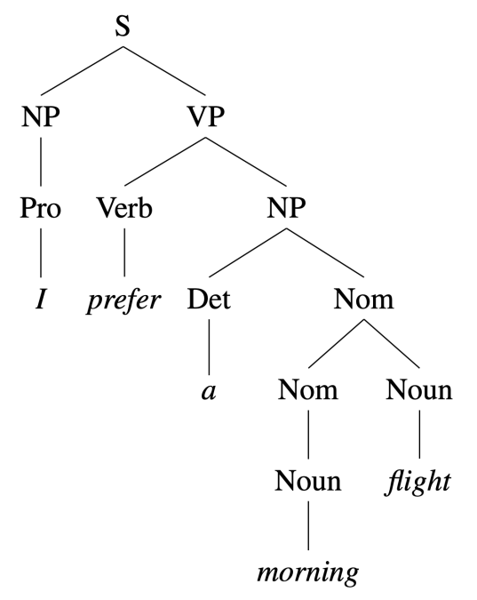

同一棵树可以用嵌套括号表达。下面沿用前面的标签，把 Nominal 的递归层次写完整：

```text
(S
  (NP (Pronoun I))
  (VP
    (Verb prefer)
    (NP
      (Det a)
      (Nominal
        (Nominal (Noun morning))
        (Noun flight)))))
```

* 整句是 S。
* 主语 I 构成一个 NP。
* prefer a morning flight 构成 VP。
* a morning flight 是 VP 内部的 NP。

因此，句子既有线性顺序，也有层级结构。

##### Grammaticality 语法性

相对于一套指定语法：

* 能够由起始符号推导出来的句子属于该语法生成的语言。
* 不能推导出来的句子不属于该语法生成的语言。

但一套教学用 CFG 只覆盖自然语言的一小部分。不能由这套规则生成，不等于真实语言中一定不合语法；能够生成，也不代表意义合理或表达自然。

#### Chomsky Normal Form 乔姆斯基标准形式

CFG 描述哪些句子可以被生成，但为了让解析算法更容易实现，可以先统一产生式的形式。

CNF（Chomsky normal form）要求每条规则具有以下两种形式之一：

$$
A\rightarrow BC
\qquad\text{or}\qquad
A\rightarrow a
$$

* $A,B,C$：非终结符。
* $a$：终结符，即实际的词。
* 结构展开时，每个节点分成两个非终结符；词汇展开时，直接得到一个词。

因此，非词汇部分的解析树成为 binary branching tree（二叉分支树），这正好适合后面 CKY 的“两部分合并”。

普通 CFG 可以转换成弱等价（weakly equivalent）的 CNF：生成的字符串集合保持一致，但树形和中间节点可以变化。若文法包含空串，还需要单独处理起始符号生成空串的情况。

##### Conversion to CNF

转换时需要处理三类产生式。

1. **终结符与非终结符混合**：给终结符增加一个中间类别。

```text
Before:
INF-VP → to VP

After:
INF-VP → TO VP
TO → to
```

2. **右侧超过两个符号**：引入新的非终结符，把长规则拆成二叉结构。

```text
Before:
A → B C D

After:
A → B X
X → C D
```

句子规则也可以这样转换：

```text
S → Aux NP VP

S → X1 VP
X1 → Aux NP
```

3. **右侧只有一个非终结符**：消除 unit productions（单元产生式），把最终能得到的非单元展开直接接过来。

```text
Before:
Nominal → Noun
Noun → book | flight

After:
Nominal → book | flight
Noun → book | flight
```

这里 `Nominal → Noun` 不符合 CNF，而 `Nominal → flight` 符合：前者右侧是一个非终结符，后者右侧是一个终结符。

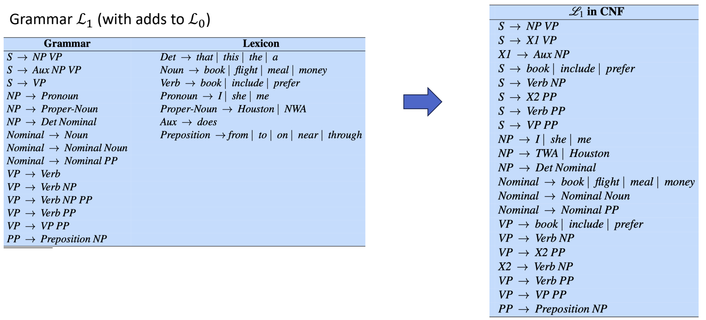

转换后的文法中，`S → book`、`VP → book` 等词汇规则可能来自 `S → VP → Verb → book` 这样的单元规则链，并不是把 book 的词性直接认定为“句子”。

还可以用 `VP → VP PP` 的递归形式替代不断列举多个 PP 的规则，说明文法可以紧凑地表示重复结构。但递归规则本身不等于 CNF 转换，“转为 CNF”也不保证规则总数一定更少。

#### Structural Ambiguity 结构歧义

同一个句子可能对应不止一棵解析树。Structural ambiguity 指的是结构分析有多种可能，而不只是某个词有多个词义。例：

```text
I shot an elephant in my pajamas.
```

其中 `in my pajamas` 是 PP，可以附着在不同位置：

* NP attachment：修饰 elephant，表示“大象穿着我的睡衣”。
* VP attachment：修饰 shot，表示“我穿着睡衣射击大象”。

```text
NP attachment:
[VP shot [NP an elephant [PP in my pajamas]]]

VP attachment:
[VP [VP shot [NP an elephant]] [PP in my pajamas]]
```

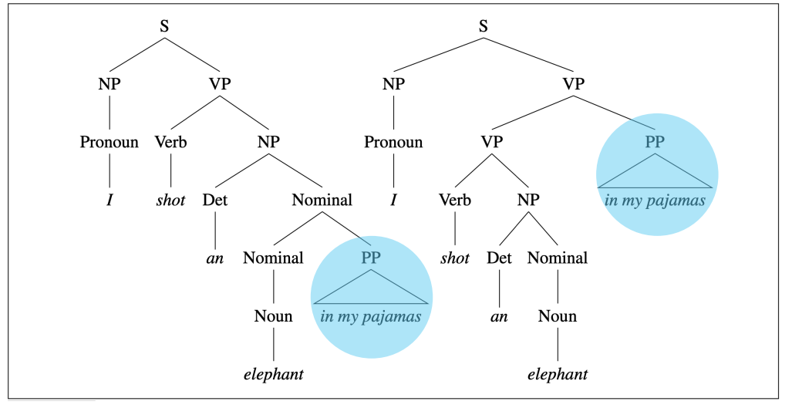

这些词的顺序、词性都可以相同，但结构和意义不同。因此，只完成 POS tagging 还不能解决句法歧义，需要找到候选树，并进一步决定哪种分析更合理。

#### Dynamic Programming for Parsing

如果对每一种规则选择都重新展开整棵树，会反复计算相同的局部结构。

Dynamic programming（DP，动态规划）的思路：

1. 先求较短片段可以构成哪些成分。
2. 把结果存入 parse table（解析表）。
3. 在更长片段的分析中复用这些结果。

这里依赖 CFG 的 context-free 性质：某个片段已经被识别为某类成分后，后续规则需要这一类别时，就可以使用该结果，不必重新分析该片段内部。

CKY（Cocke–Kasami–Younger）算法就是基于这一思路的自底向上方法，基础版本要求输入文法先转为 CNF。

> Q：动态规划是不是已经解决了歧义，选出了唯一的正确树？
>
> A：还没有。它主要解决重复计算，使多个可能结构可以共享局部结果。保留哪些候选结构与最后选哪棵树，是两个问题。

#### CKY Recognition 句法识别

##### Parse Table and Spans

长度为 $n$ 的句子有 $n+1$ 个词边界。使用 $(n+1)\times(n+1)$ 的表格，只填写上三角部分。

下面统一用半开区间 $[i,j)$ 表示边界 i 到 j 之间的词。表格格子记作 `m[i,j]`，其中 i、j 是词边界；半开区间用于明确词的范围。

```text
0  Book  1  the  2  flight  3  through  4  Houston  5
```

* $m[0,1]$：Book。
* $m[1,3]$：the flight。
* $m[0,3]$：Book the flight。
* $m[0,5]$：整个句子。

每个格子保存该片段能够构成的非终结符集合，而不是只保存一个标签：

$$
m[i,j]=\{A\mid A\Rightarrow^*w_i\cdots w_{j-1}\}
$$

##### Base Case: Single Words

先处理长度为 1 的片段，查找所有词汇规则 $A\rightarrow w_i$：

$$
m[i,i+1]=\{A\mid A\rightarrow w_i\in R\}
$$

一个词可以匹配多个类别，这些类别都要保留，不能在初始化阶段随意选定一个。

##### Combining Two Smaller Spans

对于较长片段 $[i,j)$，枚举切分点 $k$：

$$
[i,j)=[i,k)+[k,j),\qquad i<k<j
$$

如果文法中有 $A\rightarrow BC$，且 $B\in m[i,k]$、$C\in m[k,j]$，就将 A 加入 $m[i,j]$：

$$
m[i,j]=\bigcup_{k=i+1}^{j-1}
\{A\mid A\rightarrow BC\in R,\ B\in m[i,k],\ C\in m[k,j]\}
$$

这正是需要 CNF 的原因：一个较长成分总能按二叉规则拆成左右两个更小的成分。

##### Example: Book the flight

使用转换后的文法，按片段长度填写：

| Span | 词串 | 格子中的非终结符 |
| --- | --- | --- |
| [0,1) | Book | S, VP, Verb, Nominal, Noun |
| [1,2) | the | Det |
| [2,3) | flight | Nominal, Noun |
| [0,2) | Book the | 空集 |
| [1,3) | the flight | NP |
| [0,3) | Book the flight | S, VP, X2 |

* `Book the`：没有规则能把两个子片段中的类别组合起来，因此 $m[0,2]=\varnothing$。
* `the flight`：通过 `NP → Det Nominal` 得到 $m[1,3]=\{NP\}$。
* `Book the flight`：先枚举两个切分点。

```text
k = 1: Book | the flight
k = 2: Book the | flight
```

第二种切分因为 $m[0,2]$ 为空而不可用。第一种切分可以使用：

```text
S → Verb NP
VP → Verb NP
X2 → Verb NP
```

所以最终 $m[0,3]=\{S,VP,X2\}$。

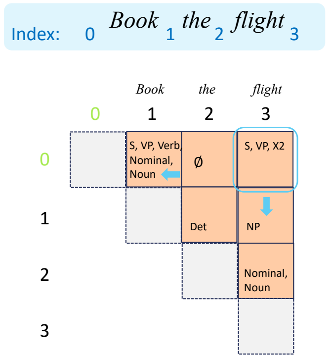

其中 S 表示完整句子，VP 是动词短语类别，X2 是 CNF 转换引入的中间符号。$S\in m[0,n]$ 时，说明这套文法能够接受整句。

注意区间下标：`Book the` 对应 $m[0,2]$，`the flight` 对应 $m[1,3]$。

##### CKY Algorithm

按右边界 j 逐列填写，伪代码可以写成：

```text
initialize every m[i,j] as an empty set

for j = 1, ..., n:
    add all A with A → words[j-1] to m[j-1,j]
    for i = j-2, ..., 0:
        for k = i+1, ..., j-1:
            for each rule A → B C:
                if B in m[i,k] and C in m[k,j]:
                    add A to m[i,j]

accept if S in m[0,n]
```

* j：确定当前处理的右边界。
* i：从短片段到长片段确定左边界。
* k：枚举当前片段的切分位置。
* 最内层：检查哪些规则可以合并左右成分。

这样，当前格子需要的左侧和下方格子都已经算好。

补充复杂度：直接逐条检查二叉规则时，时间复杂度为 $O(n^3|R_{\mathrm{binary}}|)$；固定文法下通常简写为 $O(n^3)$。只存类别集合时，空间为 $O(n^2|N|)$。

#### CKY Parsing 从识别到解析树

前面的 recognizer 只能回答“这个片段能否属于某个类别”。如果同一个类别由多种推导得到，只存集合会丢失它们之间的区别。

Parser 则需要恢复具体的 parse trees，因此需要做两处修改：

1. 为每种推导保存 backpointers（回溯指针），记录使用的规则、切分点和左右子成分。
2. 同一个格子里的同一个非终结符，允许保存多个推导版本。

例如某个 A 可以保存：

```text
A at [i,j):
    rule: A → B C
    split: k
    left child:  B at [i,k)
    right child: C at [k,j)
```

如果还有另一种规则或另一种 k 也得到 A，必须把这条推导也留下，而不是覆盖前一条。

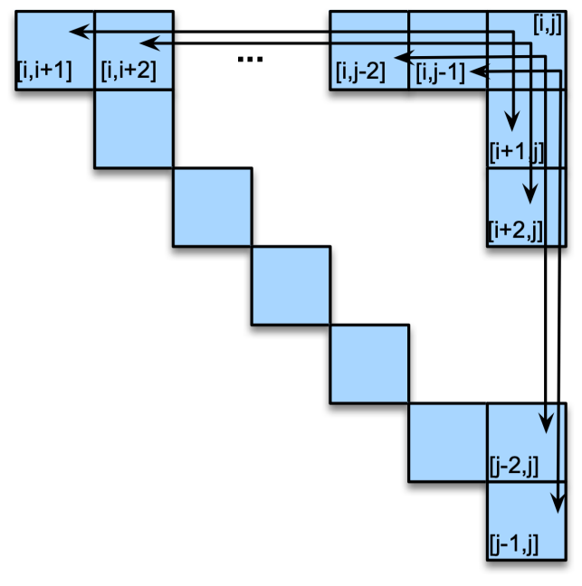

##### Recovering a Tree

例如：

```text
Book the flight through Houston
```

在 $m[0,5]$ 中保存了三种 S 推导：

```text
S1 → Verb NP
S2 → VP PP
S3 → X2 PP
```

这里 $S_1,S_2,S_3$ 是同一个类别 S 的不同推导记录，不是三种新的文法类别。

选择第一种之后，按指针递归恢复：

```text
S[0,5) → Verb[0,1) NP[1,5)
Verb[0,1) → Book
NP[1,5) → Det[1,2) Nominal[2,5)
Det[1,2) → the
Nominal[2,5) → Nominal[2,3) PP[3,5)
Nominal[2,3) → flight
PP[3,5) → Preposition[3,4) NP[4,5)
Preposition[3,4) → through
NP[4,5) → Houston
```

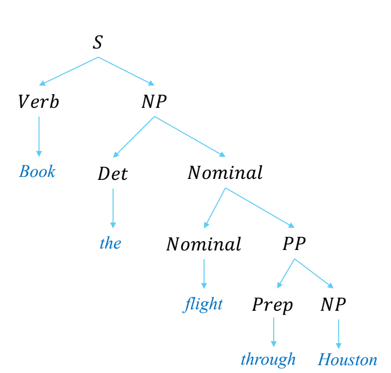

这里 `through Houston` 被分析为名词短语内部的一部分。选择另外的 S 推导，就会沿不同指针构建另一种结构。

DP 表格可以共享局部子树的计算，但不意味着完整候选树的数量很少。如果要把所有树逐一输出，总开销仍可能随歧义数量迅速增长。

> Q：为什么表格里已经有一个 S，还需要保留更多 S？
>
> A：S 只说明“整段可以构成句子”，没有说明内部结构。多个 S 可能使用不同规则、切分点和子树；只保留类别名，就无法还原这些不同分析。

#### Probabilistic CFG 概率上下文无关文法

基础 CKY 可以返回所有符合文法的树，却没有告诉我们哪一棵更可能。PCFG 在 CFG 的每条产生式上加入概率，用来对候选树排序。

##### Rule Probabilities

对同一个左侧非终结符 A，它的所有展开概率之和为 1：

$$
\sum_{\beta:\,A\rightarrow\beta\in R}p(A\rightarrow\beta)=1
$$

例：

```text
S → NP VP       0.80
S → Aux NP VP   0.15
S → VP          0.05
```

词汇展开也有概率，例如：

```text
Verb → book     0.30
Verb → include  0.30
Verb → prefer   0.40
```

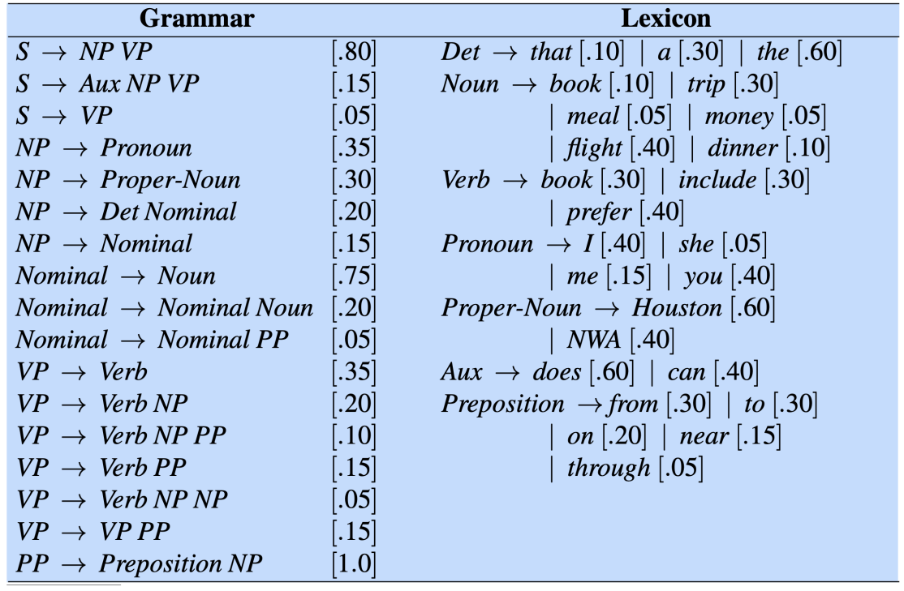

实际概率需要根据语料估计；补充一个常用的相对频数估计：

$$
\hat p(A\rightarrow\beta)=
\frac{\operatorname{Count}(A\rightarrow\beta)}
{\sum_{\gamma}\operatorname{Count}(A\rightarrow\gamma)}
$$

分母统计的是同一个左侧类别 A 的全部展开次数，而不是语料中的所有规则总数。

##### Probability of a Parse Tree

PCFG 假定每次展开的概率由当前非终结符及其所选规则决定。一棵树的概率为各次规则展开概率的乘积：

$$
p(T)=\prod_{v\in\operatorname{Nonterminals}(T)}
p\bigl(A_v\rightarrow\beta_v\bigr)
$$

词汇规则也要乘进去；同一条规则在树中使用多次，就要重复相乘。

对同一个句子 w，从候选树集合 $\mathcal T(w)$ 中选择：

$$
T^*=\arg\max_{T\in\mathcal T(w)}p(T)
$$

这里求的是最佳树。补充区分：句子整体的概率需要对所有能生成它的树求和，$p(w)=\sum_{T\in\mathcal T(w)}p(T)$，不是只取最大的那棵。

##### Example: Book the dinner flight

同一句话：

```text
Book the dinner flight
```

可能有两种分析：

* 左树：`dinner flight` 是一个名词性结构，表示“预订提供晚餐的航班”。
* 右树：通过 `VP → Verb NP NP` 把 the dinner 和 flight 分成两个 NP，将其解释为“替 the dinner 预订航班”，结构上允许，但语义很不自然。

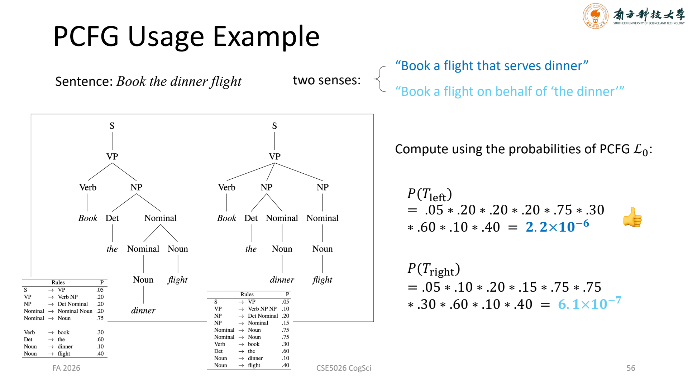

按算例采用的各项概率：

$$
\begin{aligned}
p(T_{\mathrm{left}})
&=0.05\times0.20\times0.20\times0.20\times0.75\\
&\quad\times0.30\times0.60\times0.10\times0.40\\
&=2.16\times10^{-6}
\end{aligned}
$$

$$
\begin{aligned}
p(T_{\mathrm{right}})
&=0.05\times0.10\times0.20\times0.15\times0.75\times0.75\\
&\quad\times0.30\times0.60\times0.10\times0.40\\
&=6.075\times10^{-7}
\end{aligned}
$$

所以该算例中左树的概率更高，PCFG 会优先选择左树。

注意两处取值不一致：前面的规则表把 `VP → Verb NP NP` 列为 0.05，右树算例却使用 0.10。上面为便于对照保留算例取值；如果严格按规则表的 0.05 计算，右树概率应为 $3.0375\times10^{-7}$，两棵树的排序不变。

##### Connecting PCFG with CKY

补充把概率评分与动态规划连接起来：若只需要最佳树，可以在格子中为每个类别保存最高概率和相应回溯指针。

设 $V[A,i,j]$ 为 A 生成片段 $[i,j)$ 的最高概率，则二叉规则的递推为：

$$
V[A,i,j]=\max_{\substack{A\rightarrow BC\in R\\i<k<j}}
p(A\rightarrow BC)\,V[B,i,k]\,V[C,k,j]
$$

* Recognition：记录某个类别是否可能出现。
* Parsing：保存不同推导和指针，恢复候选树。
* Best-parse search：比较概率，保存最高分的推导。

实际计算时也可以把概率取对数，将连乘改成相加，避免很小的概率不断相乘导致数值下溢。


#### Dependency Grammar 依存语法

Constituency 描述词如何组成短语；dependency grammar 直接用词之间的有向语法关系描述句子结构。

##### Head and Dependent

* Head 中心词：支配某个依存关系的词。
* Dependent 依存词：依附于中心词的词。
* Labeled arc：带有关系标签、从 head 指向 dependent 的有向弧。

例句：

```text
I prefer the morning flight through Denver
```

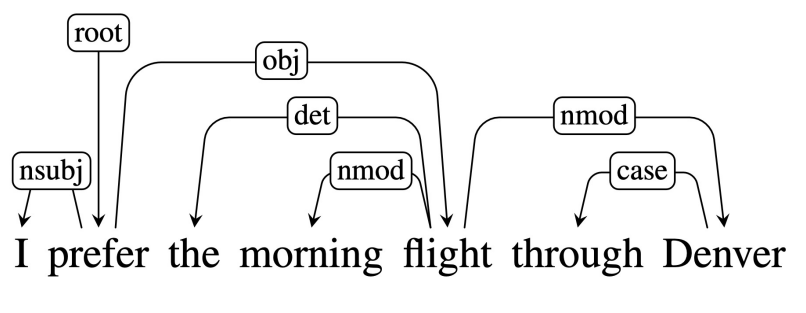

其中：

* `prefer → I`：nsubj，主语关系。
* `prefer → flight`：obj，宾语关系。
* `flight → the`：det，限定关系。
* `ROOT → prefer`：把句子的核心动词连接到虚拟根节点。

ROOT 不是真实发出的词，而是表示整棵依存树起点的符号。具体关系标签和附着方式也与分析体系有关。

| 表示方式 | 核心问题 | 主要节点 |
| --- | --- | --- |
| Constituency | 哪些词组成一个短语，短语如何嵌套？ | 词以及 NP、VP、S 等结构类别 |
| Dependency | 哪个词依赖哪个词，是什么关系？ | 句子中的词，通常另设虚拟 ROOT |

> Q：词性标注和句法分析有什么区别？
>
> A：词性标注给每个词分配类别；成分句法分析组织短语的层级；依存分析确定词与词之间的关系。知道每个词的类别，还没有完整描述句子的结构。

### Cognitive Effort in Processing Language

同样合乎语法的句子，理解难度可能不同。可以从 locality 和 uniform information density 两个角度来解释。

#### Locality of Syntactic Dependencies 句法依赖的局部性

先看简单句：

```text
The reporter admitted the error.
```

再加入 relative clause（RC，关系从句）：

```text
1a. The reporter who the senator attacked admitted the error.
1b. The reporter who attacked the senator admitted the error.
```

* 1a：记者是 attacked 的宾语，意思是“被参议员攻击的记者承认了错误”，属于 object relative clause（宾语关系从句）。
* 1b：记者是 attacked 的主语，意思是“攻击了参议员的记者承认了错误”，属于 subject relative clause（主语关系从句）。

在这类英语例子中，1a 通常比 1b 更难处理。

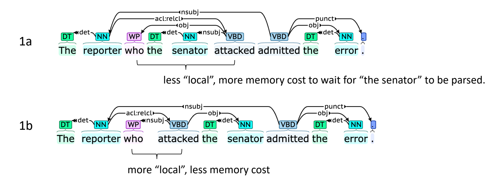

Locality 的解释：

* 1a 中，读到 who 后，要经过 the senator，才到 attacked，才能建立相关依赖。
* 1b 中，who 后紧接 attacked，依赖关系更局部。
* 等待期间需要保持尚未完成的结构信息；距离更长、同时未完成的依赖更多时，记忆和整合负担可能更大。

这里的 distance 不是简单地把整句单词数相加，而是关注有依赖关系的成分之间隔了什么，以及哪些结构还没有完成。

> Q：这两个句子几乎使用相同的词，为什么理解难度不同？
>
> A：词汇相同不代表结构相同。reporter 在关系从句中充当主语还是宾语，会改变依赖关系及其建立时机，因此改变加工负担。

#### Uniform Information Density 均匀信息密度

UID 假说认为，说话者倾向于让信息在表达过程中较均匀地分布，避免局部突然出现过高的信息负荷。

例如：

```text
1a. My boss confirmed we were absolutely crazy.
1b. My boss confirmed that we were absolutely crazy.
```

两句都可以成立，但 that 的出现可以提前提示后面是一个从句，改变后续信息的可预测性。

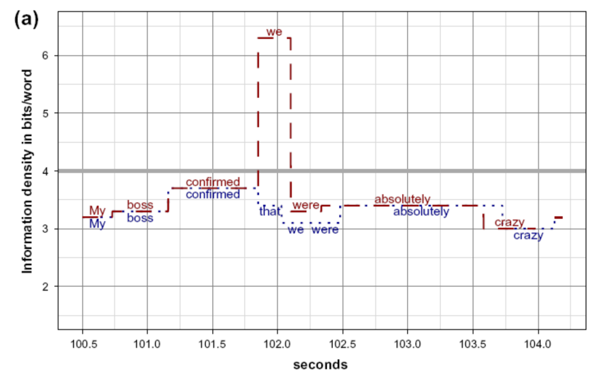

上图中，不带 that 的版本在 we 附近出现明显的信息峰值；带 that 的版本把部分结构信息提前表达，使信息分布更平滑。

补充用 surprisal（惊异度）描述一个词带来的信息量：

$$
I(w_t)=-\log_2P(w_t\mid w_{<t})
$$

* 上下文中越可预测的词，surprisal 越小。
* 越出乎预期的词，surprisal 越大。
* 单位为 bit；图中纵轴以 bits/word 表示信息密度。

增加一个功能词虽然让句子变长，却可能降低后面某个位置的信息峰值。UID 因此不等于“越短越好”，也不要求每个词的信息量严格相等。

#### Locality vs. UID

| 理论 | 主要关注 | 例子 |
| --- | --- | --- |
| Locality | 依赖之间的距离、尚未完成结构的记忆负担 | 主语 / 宾语关系从句 |
| UID | 预测难度和信息量是否出现突然的峰值 | 是否加入 that |

二者关注的是不同方面：一个强调结构依赖如何保存在记忆中，另一个强调信息如何随表达展开。它们提供理解加工难度的不同视角，不必视为互斥解释。


## Language and Syntax II

上一节用 constituency 和 dependency 两种方式表示句法结构。这一节主要讨论：如何把依存树形式化，以及如何通过一系列 transition actions，从一个句子逐步构建依存树。

### Dependency Relations 依存关系

#### Dependency vs. Constituency

依存语法直接表示词与词之间的 head–dependent relations，不需要先建立 NP、VP 等短语节点。

例如 prefer 和宾语 flight 的关系：

* 在依存树中，可以直接用 `prefer → flight` 表示。
* 在成分树中，需要经过若干词类和短语节点，才能从 prefer 到达 flight。

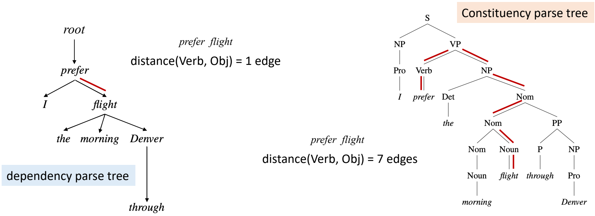

上图中，两词之间的树上路径分别为 1 条边和 7 条边。这是在比较两种表征的结构，不是说两词在原句中的线性距离发生了变化。

#### Modifier Relations 修饰关系

Head 是组织某个局部结构的中心词，dependent 可以承担修饰、主语、宾语等不同功能，并不都只是日常意义上的“修饰语”。

例如：

```text
the morning flights to Houston
```

* `flights → the`：det，限定关系。
* `flights → morning`：这里标作 nmod，名词修饰关系。
* `flights → Houston`：nmod，表示航班与目的地之间的修饰关系。
* `Houston → to`：case，介词作为关系标记依附于 Houston。

注意，这种分析中不是 `to → Houston`。介词如何处理取决于依存标注体系，这里采用这种方向和标签。

#### Clausal Relations 从句层面的关系

Clausal relations 描述一个成分相对于 predicate（谓词，常为动词）的句法角色，不一定要求句子中另有一个嵌套从句。

```text
United canceled the morning flights to Houston
```

* `canceled → United`：nsubj，主语。
* `canceled → flights`：obj，直接宾语。

因此，依存弧不仅说明“谁和谁连接”，还需要用 relation label 说明“是什么关系”。

### Graph Formalization of Dependency

#### Directed Graph 有向图

依存结构可以表示为：

$$
G=(V,A)
$$

* $V$：节点集合，包括句子中的词以及虚拟 ROOT。
* $A$：有向弧的集合，方向从 head 指向 dependent。

例如 `ROOT → canceled`、`canceled → United`、`canceled → flights`。

为了同时记录关系标签，下面把一条弧写作 $(h,r,d)$：$h$ 是 head，$r$ 是 relation label，$d$ 是 dependent。

#### Constraints of a Dependency Tree

依存树需要满足：

1. 有一个没有入边的根节点。
2. 除根节点外，每个节点恰好有一条入边。
3. 从根节点到其他每个节点都存在唯一的有向路径。

因此：

* 每个词只能有一个 head。
* 一个词可以有多个 dependents。
* 所有节点连通，不能形成有向环。

ROOT 是为了表示整棵树而加入的虚拟节点，句子的核心词通过一条弧连接到它。

> Q：有了“每个词一个 head”，是否就一定是一棵树？
>
> A：还不够。几个词可以互相连接成环，也可能形成与 ROOT 不连通的部分。还需要从 ROOT 可达、无环等整体约束。

#### Dependency Treebanks 依存树库

Treebank 是带有句法结构标注的语料库，可以用于训练、评估 parser，也可以用于语言学研究。

构建方式包括：

* 人工直接标注。
* 先由 parser 自动分析，再人工修正。
* 从 constituency treebank 转换得到 dependency treebank。

Universal Dependencies（UD）是一个跨语言的依存标注项目，包含覆盖 100 多种语言的 200 多个 treebanks。

### Transition-Based Dependency Parsing

这个方法借鉴 shift-reduce parsing：不一次性预测整棵树，而是维护当前状态，每次选择一个动作，逐步构建依存关系。

#### Stack, Buffer and Arcs

用 configuration（配置 / 当前状态）表示解析过程：

$$
c=(S,B,A)
$$

* Stack $S$：已经读入、尚未完成归约的词。
* Buffer $B$：还没有移入栈的词。
* Arcs $A$：已经建立的依存关系。

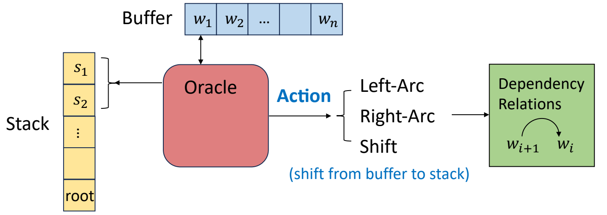

初始状态：

```text
S = [ROOT]
B = [w1, w2, ..., wn]
A = {}
```

这个 Arc-standard 系统的终止状态：

```text
S = [ROOT]
B = []
```

一个词从栈中移除后，它与已连接的子树仍保留在 $A$ 中，不是把这些信息从结果里删除。

#### Three Transition Actions

为了避免方向混淆，下面统一把栈写成 `[..., i, j]`，**最右侧的 j 是栈顶，i 是栈顶下面的词**。上图中的 $s_1$ 对应栈顶 j，$s_2$ 对应 i。

| Action | 建立的关系 | 栈的变化 |
| --- | --- | --- |
| Shift | 暂不建立弧 | 把 buffer 首词移到栈顶 |
| Left-Arc(r) | `j → i`，标签为 r | 删除 i，保留 j |
| Right-Arc(r) | `i → j`，标签为 r | 删除 j，保留 i |

这里的 left / right 是依存弧指向原句左侧还是右侧的词，不是箭头在竖直栈图中朝上还是朝下。

##### Shift 移进

从 buffer 头部取出一个词，压入 stack：

```text
Before: S = [...],    B = [b, ...]
After:  S = [..., b], B = [...]
```

它让解析器继续读词，暂时不决定新的依存关系。

##### Left-Arc 左弧

当前栈顶 j 成为 i 的 head，建立 `j → i`，移除 i：

```text
Before: [..., the, flight]
Arc:    flight → the
After:  [..., flight]
```

注意删除的是栈顶下面的 dependent，而不是 head。

##### Right-Arc 右弧

i 成为栈顶 j 的 head，建立 `i → j`，移除 j：

```text
Before: [..., book, me]
Arc:    book → me
After:  [..., book]
```

Left-Arc 和 Right-Arc 都属于 reduce operations（归约操作）：合并栈上的结构，把 dependent 从活动栈中移除。

> Q：为什么连接以后要把 dependent 移除？
>
> A：它的 head 已经确定，完成的子树可以归约到 head 上。关键是不能在它还需要连接其他 dependents 时过早移除，否则后续就没有机会完成这些关系。

### Parsing Example: Book me the morning flight

例如：

```text
Book me the morning flight
```

目标关系为：

```text
ROOT → book
book → me
book → flight
flight → the
flight → morning
```

下面省略关系标签，集中看动作和状态变化。每一行先给出当前状态，再执行该行的 action：

| Step | Stack | Buffer | Action | Relation Added |
| --- | --- | --- | --- | --- |
| 0 | [ROOT] | [book, me, the, morning, flight] | Shift | — |
| 1 | [ROOT, book] | [me, the, morning, flight] | Shift | — |
| 2 | [ROOT, book, me] | [the, morning, flight] | Right-Arc | book → me |
| 3 | [ROOT, book] | [the, morning, flight] | Shift | — |
| 4 | [ROOT, book, the] | [morning, flight] | Shift | — |
| 5 | [ROOT, book, the, morning] | [flight] | Shift | — |
| 6 | [ROOT, book, the, morning, flight] | [] | Left-Arc | flight → morning |
| 7 | [ROOT, book, the, flight] | [] | Left-Arc | flight → the |
| 8 | [ROOT, book, flight] | [] | Right-Arc | book → flight |
| 9 | [ROOT, book] | [] | Right-Arc | ROOT → book |
| 10 | [ROOT] | [] | Done | — |

最重要的是 Step 6、7：flight 读入以后，先成为 morning 的 head，再成为 the 的 head。两个修饰词都接好后，才把 flight 连接到 book。

补充计算：在这个包含 $n$ 个词的完整解析中，每个词 Shift 一次、作为 dependent 被归约一次，因此共有 $n$ 次 Shift 和 $n$ 次建弧归约，总计 $2n$ 个动作。这里 $n=5$，所以是 10 个动作。

### Training Data from Dependency Trees

#### Oracle 的任务

Oracle 根据当前 configuration 选择下一步动作。可以用监督学习训练一个分类器来实现这一决策模块：

$$
x=c=(S,B,A),\qquad y=\text{correct transition action}
$$

训练数据不是只有“句子 $\rightarrow$ 整棵树”，而是要转换为一系列“当前状态 $\rightarrow$ 正确动作”的样本。

需要区分两个阶段：

* 生成训练数据：已知 gold-standard tree，用参考树确定正确动作。
* 实际解析新句子：不知道正确树，由训练好的模型预测动作。

因此，训练时用于产生标准答案的 oracle 规则，与推理时学习到的决策模型，作用不同。

#### Choosing the Gold Action

设参考树的关系集合为 $A_{\mathrm{gold}}$，当前已经建立的关系为 $A$，栈顶仍写作 `[..., i, j]`。

可以按以下顺序选择：

1. 如果 `j → i` 是参考树中的正确关系，选择 Left-Arc，并使用该关系的标签。
2. 否则，如果 `i → j` 是正确关系，而且 **j 的所有 dependents 都已经接好**，选择 Right-Arc。
3. 否则，选择 Shift。

Right-Arc 的第二个条件可以写成：

$$
\forall(j,r,w)\in A_{\mathrm{gold}},\quad(j,r,w)\in A
$$

也就是：参考树中由 j 指向子节点的每一条弧，都已经出现在当前关系集合里。

#### Why Not Reduce Too Early?

再用另一个句子说明训练数据的生成过程：

```text
Book the flight through Houston
```

参考关系：

```text
ROOT → book
book → flight
flight → the
flight → Houston
Houston → through
```

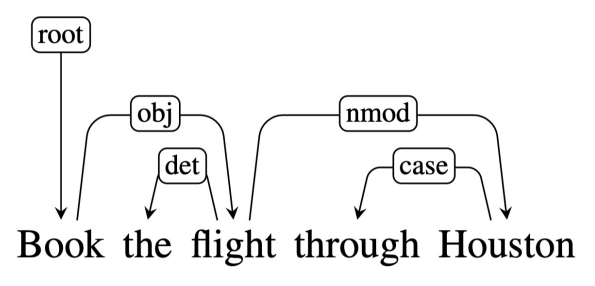

当状态变成：

```text
S = [ROOT, book, flight]
B = [through, Houston]
```

虽然 `book → flight` 已经是参考树中的正确弧，但此时 **不能立刻 Right-Arc**：flight 的 dependent Houston 还没有连接。

正确做法是继续 Shift，读入 through 和 Houston，先建立 `Houston → through`，再建立 `flight → Houston`。等 flight 的子节点都接好，才建立 `book → flight` 并移除 flight。

该例的完整动作序列：

```text
Shift book
Shift the
Shift flight
Left-Arc:  flight → the
Shift through
Shift Houston
Left-Arc:  Houston → through
Right-Arc: flight → Houston
Right-Arc: book → flight
Right-Arc: ROOT → book
```

> Q：既然一条弧是正确的，为什么还不能马上建立？
>
> A：因为建弧同时伴随归约。判断动作是否正确，不只看这条弧本身，还要看移除 dependent 后，是否仍能完成剩余的整棵树。

### Implementing the Oracle: A Neural Classifier

#### Encoder and Configuration Features

一个基本架构：

1. 用 neural encoder 为句子中的词产生向量表征。
2. 取栈顶两个词和 buffer 首词的表征。
3. 拼接这些向量。
4. 用 feedforward network（前馈网络）预测动作。

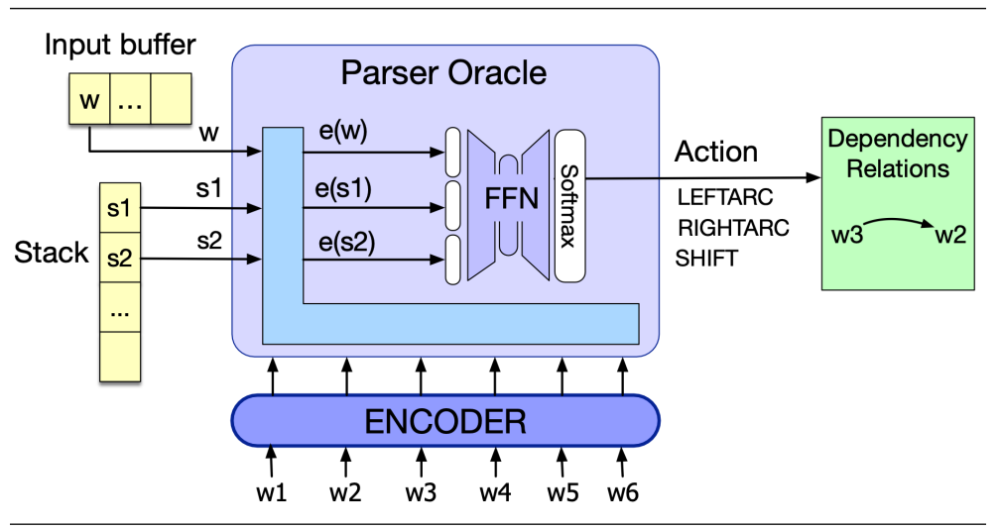

补充用公式串起这一过程：

$$
h_1,\ldots,h_n=\operatorname{Encoder}(w_1,\ldots,w_n)
$$

$$
z_c=[h_i;h_j;h_b]
$$

$$
p_\theta(a\mid c)=\operatorname{softmax}\bigl(\operatorname{FFN}(z_c)\bigr)_a
$$

* $i,j$：栈顶下面的词与栈顶词
* $b$：buffer 首词
* $[\ ;\ ;\ ]$：向量拼接
* $a$：候选 transition action

栈或 buffer 中相应位置为空时，需要使用空位置的特殊表征。

#### Features in the Feed-forward Parser

Chen & Manning（2014）的前馈网络中，输入包含 word、POS tag 和 arc label 等特征的表示。

可使用的特征不只三个词，例如：

* 栈顶三个位置的词。
* Buffer 前三个位置的词。
* 这些词的 POS tags。
* 已建立的依存关系及相关节点的信息。

所以模型看到的不只是当前某个词的词义，还包括“解析进行到哪里、哪些结构已经建好”的状态信息。

#### Supervised Objective

训练时可以采用 cross-entropy loss。对于第 $k$ 个配置 $c_k$ 及其正确动作 $a_k^*$：

$$
\mathcal L(\theta)=-\sum_k\log p_\theta(a_k^*\mid c_k)
$$

如果同时预测依存标签，输出类别需要区分 `Left-Arc(r)`、`Right-Arc(r)` 和 Shift，而不只是无标签的三个名称。

### Decoding / Inference: Greedy Parsing

推理时从初始 configuration 开始，每一步选择当前得分最高的合法动作：

$$
\hat a=\arg\max_{a\in\operatorname{LEGAL}(c)}
\operatorname{Score}_\theta(c,a)
$$

```text
c = initial_configuration(sentence)
while not terminal(c):
    a = highest_scoring_legal_action(c)
    c = apply(a, c)
return dependency_tree(c)
```

#### Legal Actions 合法动作

模型输出高分，不意味着动作一定可以执行。例如：

* Buffer 为空时不能 Shift。
* 栈中没有两个可供连接的节点时，不能 Left-Arc / Right-Arc。
* ROOT 不能作为 dependent 被移除。

因此，`LEGAL(c)` 根据状态约束屏蔽非法动作；模型负责在合法候选中打分选择。

终止条件也由解析系统定义，而不是让模型猜测“是否结束”。在这个解析系统中，buffer 为空且 stack 只剩 ROOT 时结束。

#### Greedy 的含义

每一步只保留当前选择的一条路径，不回头枚举其他动作序列。

* 好处：过程直接，动作数随句长线性增长。
* 局限：局部最高分不保证整棵树最好，早期错误还会影响后续配置和预测。

补充区分：前面的 $2n$ 是动作数量。如果 encoder 会一次性处理完整句子，它本身的计算开销需要另外考虑，不能只凭动作数就断言整个神经网络计算都是线性的。

### Relation to Cognitive Measures

联系上一节的 locality：句法结构可以为语言理解中的认知负担提供线索。

```text
1a. The reporter who the senator attacked admitted the error.
1b. The reporter who attacked the senator admitted the error.
```

* 1a：宾语关系从句，who 与 attacked 之间隔着 the senator，通常更难处理。
* 1b：主语关系从句，who 后紧接 attacked，依赖更局部。

从增量加工的角度看，尚未完成的关系需要暂时保留。依赖越不局部，等待期间需要处理的其他内容越多，记忆与整合负担就可能更大。

这也帮助理解 stack / buffer 的计算类比：已经读入不等于已经完成全部结构分析，有些关系需要等后面的词出现后才能确定。

> Q：Transition-based parser 就是人脑实际使用的语言解析算法吗？
>
> A：不能直接这样等同。它提供了描述增量处理和未完成依赖的计算模型；真实语言加工是否采用相同的状态、动作和决策机制，还需要行为和神经证据支持。
