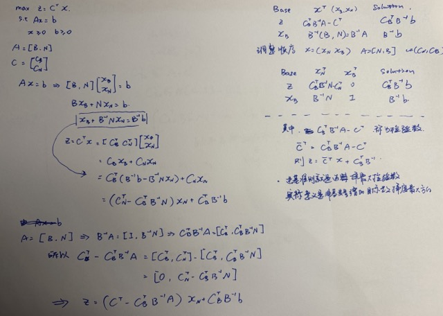
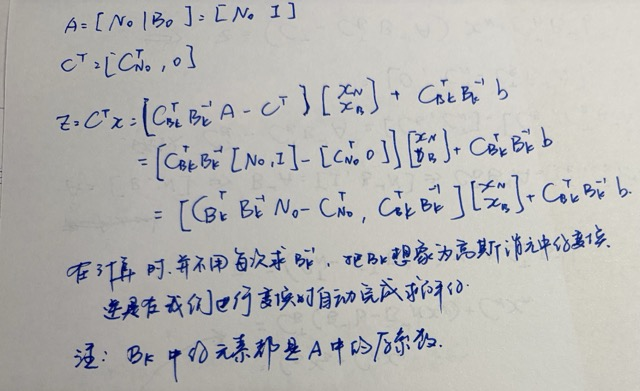
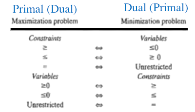

## INTRO

运筹学（Operations Research, OR）利用数学方法对决策问题建模，在资源约束下寻找最优或较优方案。

$$
\min_{{x}} \text{ or } \max_{{x}} \; f({x})
$$
$$
\text{s.t.}
\begin{cases}
g_i({x}) \le 0, & i=1,2,\dots,m \\
h_j({x}) = 0, & j=1,2,\dots,p \\
{x} \in X
\end{cases}
$$

- ${x}$：决策变量向量
- $f({x})$：目标函数
- $g_i({x}) \le 0$：不等式约束
- $h_j({x}) = 0$：等式约束
- $\text{s.t.}$ = subject to，受约束于
- $X$：决策变量的可行集合

运筹学模型的最优解仅对这个特定的模型有效。对问题的抽象简化能力是建模的关键

### 解决问题的步骤

1. 定义问题并收集数据
2. 构造运筹学数学模型
3. 模型求解
4. 模型验证
5. 应用准备和具体措施

## Linear Programming (线性规划)

可行解：满足约束条件
最优解：最好的可行解

线性规划总可以在可行解空间的角点处找到最优解

### LPM 线性规划（标准型）

$$
\max \quad {c}^T {x}  \ 
$$

$$
\text{s.t.}
\begin{cases}
A{x} = {b} \ \text{ where }A \in \mathbb{R}^{m\times n} \\
{x} \ge {0}
\end{cases}
$$

- ${c}$：价值系数向量
- ${x}$：决策变量向量
- $A$：约束系数矩阵，一个良好的模型还会满足 $rank(A) = m$（保证约束唯一）
- ${b}$：右端常数向量，要求 ${b}\ge {0}$
- ${x}\ge {0}$：变量非负约束

例子可以是网络的最大流问题

#### 等式约束

如果碰到不等式，使用：
1. 松弛变量
2. 剩余变量
规划为等式

#### 决策变量

单纯形法要求所有决策变量非负，定义：
$$
x = x^+ - x^-
$$
其中右侧变量均大于等于0，但是不能同时取正值，也就是至少一个为0

### Simplex method 单纯形法

一般线性问题规划问题的代数方法，方法的几何解释是发现最优的角点

$A{x}={b}$ 的解 $x$ 至少有 $n-m$ 个零变量 (非基变量)，剩下需要求解的变量叫做基变量（**基变量最多有N个**），如果基变量没有唯一解，则需要重新选择非基变量（$A$ 满秩的情况下总有唯一解）。

如果有唯一解，则称解为基解(basic solution), basic solution 是corner point的代数表示。基解（角点）的最大数目是$\binom{n}{m}$

**单纯形法之需要考察部分基解，就能找到问题的最优解**

> Q: 为什么我们认为线性规划求出来的是全局最优而不是局部呢？

> A：LP 可行域是有限个半空间的交集；每一个半空间都是凸集；凸集相交仍然是凸集，所以最后得到的集合是凸集。而且目标是线性的。（凸集定义：如果 $ x_1,x_2\in C$ 那么 $\lambda x_1+(1-\lambda)x_2\in C $ 其中：$ 0\leq\lambda\leq1$）（更多知识可以去学习凸优化，线性规划其实是凸优化的一种特殊情况。）

#### 单纯形法的迭代本质

单纯形法要求每次增加一个变量的值（一次只增加一个变量的值），并且选择让目标函数改善最快的变量。每次移动中，非基变量变为基变量是进基变量反之是离基变量。从一个角点移动到另一个是等价于从一个基解转化为另一个基解。

- entering variable (进基变量)
- leaving variable (离基变量)

#### 单纯形法的计算细节

单纯形表：
- 行是目标等式方程(z)和约束等式方程(s)
- 列是z在目标函数等式方程，约束等式方程的系数
- 列解是当前目标函数值 $z=0$ 和基变量值

根据进基准则来选择进基变量，通常又称 $z$ 行系数为检验数。

单纯形表中进基变量所在的列为主列(pivot column)，离基变量所在的行为主行(pivot row)，主列与主行交叉处为主元(pivot element)

离离基准则中比值的意义是直线的截距

#### 单纯形法的总结

**进基准则**　在极大值（极小值）问题中，进基变量是单纯形表 $z$ 行中具有最负（最正）系数的非基变量。如果有多个可任选其一。进基变量是table中z行最负系数的非基变量，当没有符合要求的，达到最优

**最优性检验**　当 $z$ 行中所有非基变量的系数是非负（非正）时，迭代达到最优。“所有非基变量的 $z$行系数是非负（非正）”称为单纯形法求解极大值（极小值）线性规划问题的最优性条件。

**离基准则**　对于极大值和极小值问题，离基变量是具有严格正分母的且有最小非负比的基变量。如果有多个可任选其一。

**无界解检验**　如果无法选取离基变量，即在主列不存在具有严格正分母的基变量，则问题有无界解。

**单纯形法的计算步骤**

1. 确定初始基可行解，构造初始单纯形表。

2. 用进基准则选择一个非基变量作为进基变量。如果无法选取进基变量，则停止计算，当前解为最优解。

3. 用离基准则选择一个基变量作为离基变量。如果无法选取离基变量，则停止计算，问题有无界解。

4. 用初等行运算计算出新的单纯形表（让pivot的系数 = 1, 高斯消元），转到第 2 步。

> Q：进基，离基为什么这样选择，主元是什么意义，为什么在消元的时候要更新“行最前面的那个变量”

>  A：进基是为了选择一个对于z来说“梯度”最大的方向，比如 $z-3x_1-7x_2+3x_3=z_0$这样的，选择$x_2$作为进基，每增加一个单位大7个单位。离基准则考虑的是在保证非负的约束下，最远能走多少。消元的时候，更改变量其实是在标记目前这一行到底是来解哪一个变量的，在最终消元结束后，等于最后一列的解值。本质就是高斯消元加上换基元，书上写的过于复杂。

**注：严格来说，退化情况下可能出现 cycling，所以实际还会使用 Bland's rule 等防循环规则。**

### Artificial starting solution (人工初始解)

右端项非负，当约束是 "$=$" 和 "$\ge$" 的时候，初始解全为0是不可行的，所以我们引入人工变量

### 大M法

适用于等式约束
1. 在约束条件中引入人工变量（artificial variables）$R_1,R_2$。
2. 在目标函数里加入惩罚项，使用一个非常大的常数 $M$。
3. 第一次消元通过行变化让 $z$ 行中 $R$ 的系数等于0（使用行变化修正单纯形表），然后正常使用单纯形法

$$
\min Z = \dots + M R_1 + M R_2
$$

- 新问题中可以直接取 $x_1=0,x_2=0$ 作为初始可行解，给单纯形法提供一个起点。
- 如果人工变量 $R_1,R_2>0$，目标函数就会受到很重的惩罚。
- 如果原问题本身是可行的，优化结束后人工变量 $R_1,R_2$ 会变成 0，此时新问题等价于原问题，我们就得到原问题解。

### 两阶段法 (Two‑phase method)
大M法在目标函数中使用的惩罚系数 $M$ 比其他变量系数大很多，可能会导致严重的舍入误差，降低计算精度。

拆成先后两个线性规划问题，分两步求解：
1. 得到初始基可行解
    1. 约束里面加入人工变量 $R_1,R_2...$，约束条件完全相同。
    2. 最小化所有人工变量之和，如果 $w = 0$ 进入第二阶段（修正单纯形表，不断替换人工变量，当$w = 0$时要求基变量里面没有人工变量）

$$
{\min \ w = R_1+R_2}
$$

2. 退化情况：$w_{min}=0$，但是有部分人工变量依旧是基变量，取值等于 0.
    1. 选一个取值等于 0 的人工变量作为离基变量，它所在行作为主行；从主行里面挑任意一个系数非零的非基变量做进基变量，做一次单纯形转轴迭代。
    2. 这一列直接从单纯形表里删掉。检查是不是所有人工变量全部变成非基变量并且全部删掉。

3. 求解原问题

### 单纯形法中的特殊情况 (Special cases in the simplex method)

1. **Degeneracy（退化）**

    一个基可行解 (basic feasible solution) 中，至少有一个基变量取值等于 0。

    产生原因：单纯形表右端项 b 有等于 0 的元素。可能出现循环，可以用布兰德法则 (Bland’s rule) 规避循环

    实际意义：角点是超定的(多条直线通过一个角点)，这说明约束条件冗余。

2. **Alternative optima /multiple optimal solutions（多重最优解）**

    问题存在无穷多个最优解，目标函数最优值唯一，但最优解不唯一

    单纯形判据：已经达到最优，存在某个非基变量的检验数 = 0：把这个非基变量进基做转轴，目标函数值保持不变，可以得到另一个不同最优顶点解；两个顶点连线上所有点全部都是最优解，无穷多最优解

    实际意义：目标函数等高线和可行域某一条边完全重合，边上每一点都是最优。

>Q:退化解第一次出现的时候，是否可以停止计算，即使最优性条件尚未满足？
>A:退化有可能只是暂时现象。

3. **Unbounded solutions（无界解）**

    可行域朝着某个方向无限延伸，目标函数可以无限变好（最大化可以无限大；最小化可以无限小），没有有限最优值。

    单纯形判据：选好了进基变量（检验数指示可以改善目标），但是进基那一列所有系数全部 ≤0。

    最小比值法则找不到任何有效的比值，没有变量可以离基。可以无限增大这个进基变量，仍然满足全部约束，目标持续优化。

4. **Non‑existing (infeasible) solutions（不可行解，不存在可行解）**

    可行域是空集，不存在任何点同时满足全部约束条件。没有可行解，自然也就没有最优解。
    
    - 两阶段法判据：阶段 I 最优 $w_{min}>0$。至少一个人工变量 > 0。
    - 大 M 法判据：最优解里面仍然人工变量 $R>0$。

### 单纯形法的原理 (Principles of simplex method)

从单纯形法的矩阵表示找到一些规律
1. 单纯形法由基矩阵的逆唯一确定
2. 单纯形法能够找到线性规划问题的最优基可行解 (appendix)

#### 矩阵表示

$$
\begin{aligned}
\max \quad z &=  c^\mathrm T  x \\
\text{s.t.} \quad A x &=  b \\
 x &\ge  0,\quad  b \ge  0
\end{aligned}
$$

$ x\in \mathbb R^n,\ A\in\mathbb R^{m\times n},\  b\in\mathbb R^m,\  c\in\mathbb R^n,\ \mathrm{rank}(A)=m$。

将变量拆分为基变量 $ x_B\in\mathbb R^{m}$ 和非基变量 $ x_N\in\mathbb R^{n-m}$，矩阵 $A$ 按列拆分：
$$
A=\begin{bmatrix}B & N\end{bmatrix}
$$
- $B\in\mathbb R^{m\times m}$：**基矩阵**，取 $A$ 中基变量对应的列，$B$ 可逆；
- $N\in\mathbb R^{m\times(n-m)}$：非基变量对应的子矩阵。

目标系数向量拆分：
$$
 c=\begin{bmatrix} c_B \\  c_N\end{bmatrix}
$$
- $ c_B$：基变量的目标系数向量；
- $ c_N$：非基变量的目标系数向量。

约束 $A x= b$，即 $B x_B+N x_N= b$，两边左乘 $B^{-1}$：
$$
B^{-1}A x = B^{-1}N x_N+ x_B = B^{-1} b
$$
得到基变量显式表达式：
$$
 x_B = -B^{-1}N x_N + B^{-1} b
$$

目标函数展开变形：
$$
\begin{aligned}
z &=  c^\mathrm T  x
= c_B^\mathrm T  x_B+ c_N^\mathrm T  x_N \\
&= \big( c_N^\mathrm T- c_B^\mathrm T B^{-1}N\big) x_N+ c_B^\mathrm T B^{-1} b \\
&= \big( c^\mathrm T- c_B^\mathrm T B^{-1}A\big) x+ c_B^\mathrm T B^{-1} b
\end{aligned}
$$

#### 基解、基可行解
令非基变量 $ x_N= 0$，得到**基解**：
$$
 x_N= 0,\quad  x_B = B^{-1} b
$$
若满足 $B^{-1} b \ge  0$，该解称为**基可行解**，此时目标值：
$$
z= c_B^\mathrm T B^{-1} b
$$

#### 单纯形表矩阵形式

整体单纯形表：

|基|$ x^\mathrm T$|解|
|---|---|---|
|$z$|$ c_B^\mathrm T B^{-1}A- c^\mathrm T$|$ c_B^\mathrm T B^{-1} b$|
|$ x_B$|$B^{-1}A$|$B^{-1} b$|

#### 检验数定义
设 $ a_j$ 为矩阵 $A$ 的第 $j$ 列，定义
$$
z_j \triangleq  c_B^\mathrm T B^{-1} a_j
$$
变量 $x_j$ 的检验数：
$$
\sigma_j = z_j - c_j
$$
最大化问题最优条件：全部检验数 $z_j-c_j \ge 0$。

> 检验数（reduced cost）意义是：在当前基可行解附近，改变一个非基变量，目标函数值会改变多少。单纯性法选择的就是最大检验数作为入基

调整顺序 $ x=( x_N, x_B),\ A=[N\ \ B], c=( c_N, c_B)$：

|基|$ x_N^\mathrm T$|$ x_B^\mathrm T$|解|
|---|---|---|---|
|$z$|$ c_B^\mathrm T B^{-1}N- c_N^\mathrm T$|$ 0$|$ c_B^\mathrm T B^{-1} b$|
|$ x_B$|$B^{-1}N$|$I$|$B^{-1} b$|

>性质：基变量在目标行($z$ 行)系数为 $0$ （**检验数= 0**）；约束行中基变量部分构成单位矩阵 $I$。$B^{-1} b$ 直接算出基变量取值

#### 单纯形表中的逆矩阵

变量拆分 $ x=\begin{bmatrix} x_{N_0}\\ x_{B_0}\end{bmatrix},\ A=\begin{bmatrix}N_0 & I\end{bmatrix},\  c=\begin{bmatrix} c_{N_0}\\ 0\end{bmatrix}$

|基|$ x_{N_0}^\mathrm T$|$ x_{B_0}^\mathrm T$|解|
|---|---|---|---|
|$z$|$- c_{N_0}^\mathrm T$|$ 0$|$0$|
|$ x_{B_0}$|$N_0$|$I$|$ b$|

需修正的初始单纯形表：若初始基变量在原目标函数中的系数$c_{B_0}\neq0$，则直接写出的目标函数行还不是相对于初始基 $B_0$ 的检验数行。需要利用约束行消去目标行中的基变量，将目标行化为检验数形式。大 $M$ 法是典型情形。

>上面的性质已经推导过为什么检验数=0

修正后的初始单纯形表中$z$可能是非0值，在随后的单纯形法迭代中，基变量的组成不断变化。第 $k$ 次迭代，当前基矩阵 $B_k$，单纯形表（每次迭代将基的系数化为单位矩阵）：

|基|$ x_{N_0}^\mathrm T$|$ x_{B_0}^\mathrm T$|解|
|---|---|---|---|
|$z$|$ c_{B_k}^\mathrm T B_k^{-1}N_0- c_{N_0}^\mathrm T$|$ c_{B_k}^\mathrm T B_k^{-1}$|$ c_{B_k}^\mathrm T B_k^{-1} b$|
|$ x_{B_k}$|$B_k^{-1}N_0$|$B_k^{-1}$|$B_k^{-1} b$|

>重要结论：迭代后的逆矩阵 $B_k^{-1}$ 直接体现在单纯形表里；转轴操作本质就是更新 $B^{-1}$，不需要反复做矩阵求逆。
>迭代后的逆矩阵 $B_k^{-1}$ 仍然可以表示整张单纯形表， $B_k$中的系数仍然是从原始$A$中取的

当 $ c_B^\mathrm T B^{-1}N- c_N^\mathrm T \ge  0$（全部非基变量检验数 $\ge 0$），此时这套表格才是最优单纯形表，此时 $B=B^*$（最优基）。

> 补充单纯形法相关定理（证明见附录“单纯形法相关定理证明”）
> 1. 线性规划基本定理：最优一定出现在顶点（基可行解），单纯形只搜索顶点是合理。
> 2. 迭代改善定理，非退化情形：不满足最优条件时，可以进一步改善目标（或者遇到无界解），应当继续迭代。
> 3. 最优性判定定理：满足最优条件时，已经达到最优，可以停止迭代。

### Sensitivity analysis

敏感性分析（Sensitivity Analysis）研究的是：当线性规划模型中的参数发生变化时，原来的最优解、最优基和最优目标值会如何变化。其核心思想不是重新求解整个线性规划，而是判断当前的 optimal basis 在参数变化后是否仍然有效。

对于标准形式
$$
\max \; c^T x,\qquad Ax\le b,\qquad x\ge 0,
$$
敏感性分析主要关注两类参数：约束右端项 $b$ 和目标函数系数 $c$。

当 $b$ 变化时，表示资源数量发生变化，因此可行域会发生移动，(还在同一份直线)。若当前基矩阵为 $B$，则基本变量满足
$$
x_B=B^{-1}b.
$$
当 $b$ 变为 $b+\Delta b$ 时，
$$
x_B'=B^{-1}(b+\Delta b).
$$
只要 $x_B'\ge 0$，当前基仍然可行，因此不需要更换 basis。

资源 $b_i$ 每增加一个单位所引起的最优目标值变化称为 **shadow price（影子价格）**。若
$$
y^T=c_B^TB^{-1},
$$
则
$$
y_i=\frac{\partial z^*}{\partial b_i}.
$$
因此 $y_i$ 可以理解为第 $i$ 种资源的边际价值。但是 shadow price 只在当前 optimal basis 不发生变化的范围内有效，超过允许范围后需要重新确定最优基。

当目标函数系数 $c$ 变化时，可行域不变，但目标函数直线的方向(斜率)会改变。此时主要判断当前 basis 是否仍然满足最优性条件。对于非基变量 $x_j$，其 reduced cost 为
$$
\bar c_j=c_j-c_B^TB^{-1}A_j.
$$
对于最大化问题，在这种定义下，如果所有非基变量满足
$$
\bar c_j\le 0,
$$
则当前 basis 仍然最优。若某个 reduced cost 变为 \(0\)，通常对应 alternative optima 的临界情况；若继续变化使其大于 \(0\)，则该变量可以进基，原来的 optimal basis 将发生改变。

因此可以概括为：
$$
\boxed{
b\text{ 变化：检查 feasibility},\qquad
c\text{ 变化：检查 optimality}.
}
$$

敏感性分析的本质可以理解为：研究当前最优 basis 在参数变化时能够保持有效的范围。在线性规划中，最优目标值通常关于参数呈现分段线性（piecewise linear）的变化。

### application

主要解决满足守恒关系的约束问题
- 最大流

    在一个有向网络里，从起点 \(s\) 往终点 \(t\) 输送“流量”，每条边都有容量上限。问：最多能从 \(s\) 送多少流量到 \(t\)？

    约束：每个节点的输入量 = 输出量

- 最短路
    1. 最大流问题，额外约束是这样的：起点的输出量是1,终点输入量是1，最终我们求解后 = 1的边是最短路
    2. 定义 $x_{i}$ 是从起点到 $i$ 的最小距离，所以我们可以产生的约束是在每一个节点的动态规划：$x_{i} = x_{i-1} + s_{i-1,i}$ ，所以 $x_{i}$ 的最大值一定比其他到节点 $i$ 的路径短，最终求 $\max x_t$
    3. replacement policy 可以转化为最短路，most reliable / safest path取负对数之后转化为最短路问题
    4. dijkatra：松弛
- 投资问题
- 排班问题

## advanced Linear Programming (高级线性规划)

主要内容为对偶理论，对偶单纯形法，后最优分析和内点法
承接基本线性规划和原始单纯形法，讨论四个问题：如何从另一个角度证明最优；已有解失去可行性时怎样继续迭代；模型参数变化后能否复用旧解；以及如何在可行域内部寻找最优解。

### 1. 对偶：为原问题建立另一种描述

对偶问题是原始问题按某种方式直接构造出来的一个新的线性规划问题。可以从原始问题的最优解推出另一个问题的最优解
该模型解决的问题是如何进行资源最小化定价（竞争性原则），使得资源售卖的收益不低于自己生产所获的最大收益（不吃亏原则）
可以想象成原问题是生产商，主要的角度如何用有限资源如何生产产品来卖更多的钱，而对偶是原料厂家角度，在不吃亏（自己投入的生产力可以获得应有汇报）的前提下如何给原材料定价，使总成本最低这样更有竞争力

如果原问题是求最小，则可以理解为采购商和批发商，采购商想要用最少的价格采购到符合要求的原材料，而批发商想在提出对方能接受的价格的前提下获得最高定价

#### 1.1 从原问题构造对偶问题

先考虑等式标准型的极大化问题：

$$
\begin{aligned}
(P)\quad \max_x\quad &c^\mathsf T x\\
\text{s.t.}\quad &Ax=b,\\
&x\geq 0,
\end{aligned}
\qquad
\begin{aligned}
(D)\quad \min_y\quad &b^\mathsf T y\\
\text{s.t.}\quad &A^\mathsf T y\geq c,\\
&y\in\mathbb R^m.
\end{aligned}
$$

这里 $A\in\mathbb R^{m\times n}$。

$P$ 中每一条等式约束对应 $D$ 中的一个变量 $y_i$；$P$ 中每个非负变量 $x_j$ 对应 $D$ 中的一条不等式 $a_j^\mathsf T y\geq c_j$，其中 $a_j$ 是 $A$ 的第 $j$ 列。**等式对应无符号限制的对偶变量**，因为等式两侧乘正数或负数都不会改变它成立这一事实。

若原问题的约束并非全为等式，可按下表直接判断（各行分别针对原问题的极大化或极小化目标）：

| 原问题 | 对偶目标 | 原问题的一条约束 | 对应的对偶变量 | 原问题的一个变量 | 对应的对偶约束 |
| --- | --- | --- | --- | --- | --- |
| 极大化 | 极小化 | $\leq$ / $=$ / $\geq$ | $\geq0$ / 自由 / $\leq0$ | $x_j\geq0$ / 自由 / $x_j\leq0$ | $\geq$ / $=$ / $\leq$ |
| 极小化 | 极大化 | $\geq$ / $=$ / $\leq$ | $\geq0$ / 自由 / $\leq0$ | $x_j\geq0$ / 自由 / $x_j\leq0$ | $\leq$ / $=$ / $\geq$ |

交换“变量”和“约束”，把系数矩阵 $A$ 转置，再检查目标方向、每个约束的方向和变量的符号。无符号限制变量 $x_j$ 也可拆为 $x_j=x_j^+-x_j^-$，其中 $x_j^+,x_j^-\geq0$；其对应的两条反向不等式共同构成对偶等式。

**例：**

$$
\begin{aligned}
\max\quad &5x_1+12x_2+4x_3\\
\text{s.t.}\quad &x_1+2x_2+x_3\leq10,\\
&2x_1-x_2+3x_3=8,\\
&x_1,x_2,x_3\geq0.
\end{aligned}
$$

第一个约束对应 $y_1\geq0$，第二个等式对应自由变量 $y_2$，所以对偶为

$$
\begin{aligned}
\min\quad &10y_1+8y_2\\
\text{s.t.}\quad &y_1+2y_2\geq5,\\
&2y_1-y_2\geq12,\\
&y_1+3y_2\geq4,\\
&y_1\geq0,\quad y_2\text{ 自由}.
\end{aligned}
$$

对于对偶变量的符号限制：根据原问题是极大值或是极小值，每个约束要构造一个上界或者下界，对偶变量的符号约束主要是为了让原问题的约束等式构造有界条件，比如极大值，原问题约束是大于等于，那么为了求极大值，我们要构造原问题x的方程小于等于什么，这个时候y需要小于0来构造x方程的上界。

#### 1.2 对偶定理

如果 $x$ 是极大化原问题的可行解，$y$ 是对应极小化对偶问题的可行解，那么

$$
\underbrace{c^\mathsf Tx}_{\text{原问题的值}}
\leq x^\mathsf TA^\mathsf Ty
=y^\mathsf TAx
=\underbrace{b^\mathsf Ty}_{\text{对偶问题的值}}.
$$

这就是弱对偶定理。任何一个对偶可行解都为原问题的最优值提供上界；任何一个原问题可行解都为对偶问题的最优值提供下界。若找到一对可行解，有且只有 $c^\mathsf Tx=b^\mathsf Ty$，两同时最优。

在线性规划中，只要存在有限最优解（$y=B^{-\mathsf T}c_B,$），强对偶定理保证另一侧也存在最优解，且两个最优值相等。由弱对偶还可推出：若一侧无界，则另一侧不可行；但一侧不可行时，另一侧可能无界，也可能同样不可行，不能直接下结论。

Properties
- **弱对偶性（Weak Duality）**：对于任意可行解 $(x,y)$，都有 $z\leq w$。
- **强对偶性（Strong Duality）**：最优解 $(x^*,y^*)$ 当且仅当 $z=w=z^*=w^*$。
- **可行性与有界性（Feasibility and Boundedness）**：如果对偶问题（原问题）无界（$w=-\infty$ 或 $z=+\infty$），那么原问题（对偶问题）不可行。
- **对偶的对偶（Dual of the Dual）**：一个对偶问题的对偶问题，就是原问题。

> 对偶为什么这么构造：用原约束的非负线性组合，构造出一个“至少比目标函数系数 \($c$\) 更大”的系数向量。这样我们能得到约束上界 $b^\mathsf Ty$，当 $c^\mathsf Tx = b^\mathsf Ty = x^\mathsf TA^\mathsf Ty$ 时取等，即 $\sum_j \big((A^\mathsf T y)_j-c_j\big)x_j = 0$，即 $x_j\big((A^\mathsf T y)_j-c_j\big)=0\quad\forall j.$

#### 1.3 互补松弛与影子价格

在上述等式标准型中，原问题可行解 $x$ 与对偶可行解 $y$ 同时最优，当且仅当

$$
x_j\bigl(y^\mathsf Ta_j-c_j\bigr)=0\qquad(j=1,\ldots,n).
$$

因此 $x_j>0$ 时，第 $j$ 条对偶约束必须取等号；若该对偶约束严格松弛，则 $x_j=0$。

如果原问题还有 $a_i^\mathsf Tx\leq b_i$ 且 $y_i\geq0$，还应检查 $y_i(b_i-a_i^\mathsf Tx)=0$：
资源未用尽时，其影子价格为零；影子价格为正时，该资源约束紧束。逆命题并不总成立，紧束约束也可能有零影子价格。这其实是原问题的约束。

>但是我们通常都写成等式，只有原始约束是不等式才需要检查这个约束，因为 $c^\mathsf Tx = b^\mathsf Ty = x^\mathsf TA^\mathsf Ty$ 不成立无法推出第一个条件只能
>$$
>w-z=b^Ty-c^Tx=b^Ty-y^TAx+y^TAx-c^Tx=y^T(b-Ax)+x^T(A^Ty-c)
>$$

若最优基在 $b\mapsto b+\Delta b$ 后仍可行，目标系数又保持不变，则

$$
\Delta z^*= c_B^\mathsf T\Delta x_B = c_B^\mathsf T B^{-1}\Delta b = y^\mathsf T\Delta b.
$$

这给出 $y_i$ 的经济意义：在当前最优基有效的范围内，资源 $b_i$ 增加一个单位给最优目标值带来的变化。影子价格是局部的；变化太大、最优基改变后，不应继续用同一个 $y_i$ 线性外推。

对偶的几何意义：用原问题各个约束超平面的法向量做非负线性组合，来表示目标函数的方向，并寻找其中代价最小的组合。

#### 1.4 由最优基读出对偶解

设 $B$ 是原问题的一个最优基矩阵，$c_B$ 是基变量的目标系数，$x_B=B^{-1}b$。相应的对偶解由

$$
y=B^{-\mathsf T}c_B,
\qquad
 y^\mathsf T=c_B^\mathsf TB^{-1} 
$$

给出(最优价格)。

为什么是这个式子？当原式子有最优解 $x_B\geq0$，于是由约束：
$$
x_j\big((A^\mathsf T y)_j-c_j\big)=0\quad\forall j.
$$
得到：
$$
(A^\mathsf T y)_j=c_j
$$
对于基变量部分有:
$$
y=B^{-\mathsf T}c_B
$$
对于非基变量部分有:
$$
N^\mathsf T y\ge c_N.
$$
代入得到
$$
N^\mathsf T B^{-\mathsf T}c_B\ge c_N.
$$
定义
$$
\bar c_N
=
c_N-N^\mathsf T B^{-\mathsf T}c_B,
$$
于是最优性条件(最大化问题)就是
$$
\bar c_N\le0.
$$

第 $j$ 个变量的约化成本（reduced cost：把基变量从目标函数里消掉以后，某个非基变量 \($x_j$\) 前面剩下的系数。就是检验数）为

$$
\rho_j=y^\mathsf Ta_j-c_j
=c_B^\mathsf TB^{-1}a_j-c_j.=z_j - c_j
$$
$$
\rho_j=-\bar c_j
$$
对当前基而言，$x_B\geq0$ 表示原问题可行；$\rho_j\geq0$ 对所有 $j$ 成立表示对偶可行。两者同时成立，当前基就最优。

> 单纯形表和对偶的联系：极大化问题的 $z$ 行系数 $c_B^\mathsf TB^{-1}a_j-c_j$，恰好就是对偶约束 $y^\mathsf Ta_j\geq c_j$ 的松弛量。如果原始问题的最优性条件不成立，意味着对应的这个对偶约束不成立。原始问题成立的时候，意味着相应对偶解 $y=B^{-\mathsf T}c_B$ 成为满足约束的可行解，因此可以设计出对偶单纯形法。原始单纯形法在修复这个松弛量的负值；对偶单纯形法在保持它非负的同时修复原问题的负基变量。

## Integer Linear Programming

对于变量 $x$ 新增整数约束 $x\in\mathbb Z^n$。如果只有部分变量需要是整数，其他变量仍然可以是连续的，就称为Mixed Integer Linear Programming（MILP，混合整数线性规划）。

### 1. ILP Modeling

**Binary Integer Programming**：对于 Yes/No 决策，引入二元变量：

$$
x_j\in\{0,1\}
$$

典型问题：

- **Capital Budgeting**：在预算约束下选择项目，最大化收益。
- **Set Covering**：选择最少的设施，使所有区域至少被覆盖一次。

### 2. ILP Algorithm

**LP Relaxation**：放松整数约束，将 ILP 转换为 LP。由于 ILP 可行域是 LP 可行域的子集：

$$
S_{ILP}\subseteq S_{LP}
$$

因此：
- Maximization：LP 最优值是 ILP 的 **Upper Bound (UB)**。
- Minimization：LP 最优值是 ILP 的 **Lower Bound (LB)**。

#### Branch and Bound (B&B)

核心思想：利用 LP Relaxation 获得界限，通过分支逐渐缩小可行域，找到最优整数解。

1. **Relaxation**：求解当前子问题的 LP。
2. **Branching**：选择一个非整数变量 $x_j^*$，建立两个分支：

$$
x_j\leq\lfloor x_j^*\rfloor
\quad\text{or}\quad
x_j\geq\lceil x_j^*\rceil
$$

3. **Bounding**：利用 LP 最优值更新界限。
4. **Pruning**：满足以下条件之一时剪枝：
   - LP 不可行。
   - LP 最优解已经是整数解。
   - 当前分支不可能改善已知最优整数解。

对于最大化问题：

$$
LB\leq z_{ILP}^*\leq UB
$$

当所有分支都被处理后，得到全局最优解。

B&B 保证最优性，但最坏情况下具有指数级搜索复杂度。

### 3. Traveling Salesman Problem (TSP)

目标：找到经过所有城市恰好一次、最终回到起点的最短回路。

定义 $x_{ij}\in\{0,1\}$ 表示是否选择边 $i\rightarrow j$。

$$
\min \sum_{i=1}^n\sum_{j=1}^n d_{ij}x_{ij}
$$

$$
\begin{aligned}
\text{s.t.}\quad
&\sum_j x_{ij}=1,\quad\forall i\\
&\sum_i x_{ij}=1,\quad\forall j\\
&x_{ii}=0
\end{aligned}
$$

**Subtour Problem**：每个城市恰好进出一次，仍可能形成多个独立回路。

**Subtour Elimination Constraints**：

$$
\sum_{i\in S}\sum_{j\in S}x_{ij}\leq |S|-1,
\quad\forall S\subsetneq V,\ |S|\geq2
$$

用于排除子回路，保证所有城市形成一个完整回路。

### 4. Totally Unimodular Matrix (TU)

某些 ILP 的 LP Relaxation 可以直接得到整数最优解，即 **LP Relaxation is Exact**。原因是 LP 可行域的极点都是整数点

**Unimodular Matrix**：整数方阵 $A$ 满足：

$$
\det(A)=\pm1
$$

**Totally Unimodular Matrix (TU)**：矩阵 $A$ 的所有方形子矩阵 $B$ （基矩阵）都满足：

$$
\det(B)\in\{-1,0,1\}
$$

**重要定理**：若 $A$ 为 TU，且 $b$ 为整数向量，则：

$$
P=\{x\geq0:Ax=b\}
$$

的所有极点都是整数点。

**证明思路**：LP 的基本解为：

$$
x_B=B^{-1}b
$$

因为 $B$ 是 TU 矩阵的可逆方形子矩阵：

$$
\det(B)=\pm1
\Rightarrow B^{-1}\in\mathbb Z^{m\times m}
\Rightarrow x_B\in\mathbb Z^m
$$

矩阵公式：
$$
B^{-1}=\frac{\operatorname{adj}(B)}{\det(B)}
$$
因为 $B$ 是整数矩阵，所以 $\operatorname{adj}(B)$ 也是整数矩阵。
因此 LP 存在有限最优解时，可以直接获得整数最优解，不需要 B&B。

#### TU Characterizations
判断矩阵是不是 TU 的三个充要条件
- **Camion**：利用特定方形子矩阵的元素和判定 TU。
- **Ghouila-Houri**：任意行子集均可分为两组，使各列的带符号和属于 $\{-1,0,1\}$。
- **Hoffman**：利用矩阵每列的非零元素及行划分给出 TU 的充分条件。

一个常用的充分条件：

$$
\text{每列最多一个 }+1\text{ 和一个 }-1
\Rightarrow A\text{ 是 TU}
$$

#### Network Flow

有向图的 **Node-Arc Incidence Matrix** 每列恰好包含一个 $+1$ 和一个 $-1$，因此是 TU。

所以许多网络流问题（如 Shortest Path、Minimum Cost Flow）在整数流量需求和容量下，可以直接通过 LP 得到整数最优解。

## Nonlinear Programming

目标函数或约束中存在非线性函数。一般 NLP 可能有多个局部最优解，最优点也不一定在可行域的角点。

### 1. Unconstrained problem 无约束问题

#### Gradient 和 Hessian

对于 $f:\mathbb R^n\to\mathbb R$，一阶导数是梯度向量，二阶导数是 Hessian 矩阵：

$$
\nabla f(x)=\begin{bmatrix}
\frac{\partial f}{\partial x_1}\\\vdots\\\frac{\partial f}{\partial x_n}
\end{bmatrix},\qquad
\nabla^2f(x)=\left[\frac{\partial^2f}{\partial x_i\partial x_j}\right].
$$

若 $f$ 二阶连续可微，混合偏导相等，因此 Hessian 是对称矩阵。

**正定性**：对实对称矩阵 $A$，看二次型 $d^TAd$ 的符号：

- **正定（positive definite）**：任意 $d\ne0$，$d^TAd>0$，记为 $A\succ0$。
- **半正定（positive semidefinite）**：任意 $d$，$d^TAd\ge0$，记为 $A\succeq0$。
- 负定、半负定分别将不等号反向。不定矩阵存在使二次型为正和为负的不同方向。

判断方法：

1. **特征值**：全部为正则正定，全部非负则半正定；负定与半负定类似。
2. **主子式**：令 $\Delta_k$ 为左上角 $k$ 阶顺序主子式，正定当且仅当所有 $\Delta_k>0$；负定当且仅当 $(-1)^k\Delta_k>0$。

**注意：半正定需要所有主子式非负，不能只检查顺序主子式。**

#### Taylor theorem 与方向导数

$$
f(x+d)=f(x)+\nabla f(x)^Td+
\frac12d^T\nabla^2f(x)d+o(\|d\|^2).
$$

一阶近似保留线性项，二阶近似再保留二次项。沿方向 $u$ （向量）移动，令 $F(t)=f(x+tu)$：

$$
F'(0)=\nabla f(x)^Tu,\qquad
F''(0)=u^T\nabla^2f(x)u.
$$

因此 $\nabla f(x)^Tu<0$ 时，$u$ 是下降方向，充分小的正步长可以降低目标值。单位方向中负梯度方向的一阶下降最快，得到 **gradient descent**：

$$
x^{k+1}=x^k-\alpha_k\nabla f(x^k),\qquad\alpha_k>0.
$$

极大化时使用加号。步长过大不一定改善目标值。

#### Stationary point、extreme point 和 saddle point

- **平稳点（stationary point）**：$\nabla f(x^*)=0$。
- **局部极小点**：在 $x^*$ 的某个邻域内，$f(x)\ge f(x^*)$；若对 $x\ne x^*$ 严格大于，则为严格局部极小点。极大点反向定义。
- **全局极小点**：比较范围扩大到整个可行域。
- **鞍点（saddle point）**：平稳但不是极值点，附近有比它更大和更小的函数值。

对于定义域内部的点，假设 $f$ 二阶连续可微：

| 条件 | 极小值 | 极大值 |
| --- | --- | --- |
| 一阶必要条件 | $\nabla f(x^*)=0$ | $\nabla f(x^*)=0$ |
| 二阶必要条件 | $\nabla^2f(x^*)\succeq0$ | $\nabla^2f(x^*)\preceq0$ |
| 二阶充分条件 | 梯度为零且 Hessian 正定 | 梯度为零且 Hessian 负定 |

解 $\nabla f=0$ 找到候选点，再判断 Hessian。不定时为鞍点；仅半正定或半负定时，二阶条件无法确定，需要继续考察。

> 原因：平稳点处 Taylor 展开的一阶项为零，$f(x^*+d)-f(x^*)$ 的符号主要由 $d^T\nabla^2f(x^*)d$ 决定。正定保证所有方向上升，但极小点也可能出现 Hessian 为零，例如 $f(x)=x^4$ 在原点。

**一元函数的高阶判定**：若前 $r-1$ 阶导数均为零，第 $r$ 阶导数非零：

- $r$ 为偶数：该导数为正则严格极小，为负则严格极大。
- $r$ 为奇数：不是极值点。例如 $x^3$ 在原点是平稳拐点。

### 2. Constrained problem 约束问题

约束非线性规划（Constrained NLP）主要分为两类：等式约束优化与不等式约束优化。等式约束优化是核心思想是将等式约束优化转化为无约束优化，对于不等式约束优化，可以先转化为等式约束优化，再进一步转化为无约束优化。

#### Jacobian 与隐函数定理

对于向量函数 $g:\mathbb R^n\to\mathbb R^m$，Jacobian（雅可比矩阵）为：

$$
J(x)=\frac{\partial g}{\partial x}
=\begin{bmatrix}\nabla g_1(x)^T\\\vdots\\\nabla g_m(x)^T\end{bmatrix}
\in\mathbb R^{m\times n},\qquad dg=J(x)dx.
$$

梯度描述一个函数的变化，Jacobian 描述多个函数同时如何变化。
**链式法则**：若 $h(x)=a(g(x))$，则 $J_h(x)=J_a(g(x))J_g(x)$。

对于约束 $g(x)=0$，将变量分成 $x=(y,z)$，其中 $y\in\mathbb R^m$（由约束决定）、$z\in\mathbb R^{n-m}$（也就是希望把约束 $g(y,z)=0$ 变成 $y=\phi(z)$）：

$$
J=[J_y\ J_z],\qquad J_y\,dy+J_z\,dz=0.
$$

若 $g$ 连续可微，且可行点处 $J_y$ 可逆，则该点附近可以唯一地写成 $y=\phi(z)$，并且：

$$
\frac{\partial\phi}{\partial z}=-J_y^{-1}J_z.
$$

于是用 $m$ 个独立等式消去 $m$ 个自由度，目标函数变为 $F(z)=f(\phi(z),z)$，局部转化为无约束问题。

> $J$ 满行秩就能选出可逆的 $J_y$，但消元只在局部成立。例如圆上的 $x_1=\pm\sqrt{1-x_2^2}$ 有不同分支，不能只取正号表示整个圆。

#### Equality constrained NLP 等式约束

怎么消除等式约束：利用隐函数定理：m个等式可以消除m个自由度

$$
\min\text{ 或 }\max\ f(x),\qquad
\text{s.t. }g_i(x)=0,\quad i=1,\ldots,m.
$$

定义 **Lagrangian（拉格朗日函数）**：

$$
L(x,\lambda)=f(x)-\sum_{i=1}^m\lambda_i g_i(x).
$$

**一阶必要条件**：若约束梯度 $\nabla g_i(x^*)$ 线性无关，则极值点存在拉格朗日乘子 $\lambda^*$，满足：

$$
\begin{cases}
\nabla_xL=\nabla f(x^*)-J(x^*)^T\lambda^*=0,\\
\nabla_\lambda L=-g(x^*)=0.
\end{cases}
$$

等式乘子没有符号限制。目标梯度是约束梯度的线性组合。

> 为什么不要求 $\nabla f=0$？约束限制了移动方向。沿约束曲面的切向量 $d$ 满足 $Jd=0$，因此极值点只要求 $\nabla f^Td=\lambda^TJd=0$。所以这样构造拉格朗日函数是为了在求梯度后满足1.沿着曲线移动时约束保持不变 2.取到f(x)的极值

**二阶条件**：固定 $\lambda^*$，只对 $x$ 求 Hessian：

$$
H_L=\nabla^2_{xx}L(x^*,\lambda^*)
=\nabla^2f(x^*)-\sum_i\lambda_i^*\nabla^2g_i(x^*).
$$

令 $D=\{d:J(x^*)d=0\}$。在满足一阶条件及上述正则性条件时：

- 极小值的必要条件：任意 $d\in D$，$d^TH_Ld\ge0$；若对所有非零 $d\in D$ 严格大于零，则是严格局部极小点。
- 极大值对应小于等于零与严格小于零。

**只检查切空间上的曲率**，不需要 $H_L$ 在整个空间正定。拉格朗日乘子的意义是在最优点，目标函数的梯度必须落在约束梯度张成的空间中。$\nabla g(x)^Td=0$
这个公式非常重要。允许移动的方向 $d$，必须与约束梯度 $\nabla g$ 正交。换句话说，$\nabla g$ 是约束曲面的法向量，限制了梯度的方向。因为这个方向 $\nabla f(x^*)^Td=0$ 无法判断一阶项，否则一阶项就能直接判断。

> 二阶条件为什么还要使用 Lagrangian 的 Hessian，而不能直接使用 f(x) 的 Hessian？约束不仅限制了你可以移动的方向，还可能改变可行路径的曲率。重要的是我们需要理解为什么这里有d：在一元方程的时候没有这个d，是因为我们只有一个方向，用正负就可以表示，我们默认了导数大于0就是变量正方向变化函数值会变大，
> 但是现在多元函数中，我们必须有d才能表示具体的函数变化。比如$f(x,y) = x$我们需要区别于$f(x) = x$,认为他是一个在z方向的函数值，这样我们的约束画出的东西就不是一个线被圆框住，而是一个“斜面”被圆柱框住，我们就可以理解为什么只有原函数的二阶是不够的了。

对于非线性约束，$Jd=0$ 是一阶切向条件，直线 $x^*+td$ 未必始终可行。

**例：**

$$
\min\ (x_1-2)^2+(x_2-2)^2,
\qquad x_1+x_2-6=0.
$$

乘子方程为 $2(x_1-2)=\lambda$、$2(x_2-2)=\lambda$、$x_1+x_2=6$，得到 $x^*=(3,3)$、$\lambda^*=2$。$H_L=2I\succ0$，因此为严格极小点，目标值为 $2$。

#### Sensitivity analysis 乘子的意义

将约束改为 $g(x)=b$，定义：

$$
L(x,\lambda;b)=f(x)-\lambda^T(g(x)-b),\qquad
V(b)=f(x^*(b)).
$$

若最优解随 $b$ 光滑变化，则：

$$
\nabla_bV=\lambda^*,\qquad
\Delta V\approx\lambda^{*T}\Delta b.
$$

因为 $dV=\nabla f^Tdx=\lambda^{*T}Jdx$，而约束微分给出 $Jdx=db$，所以 $dV=\lambda^{*T}db$。

乘子表示约束右端项每变化一个单位，对最优目标值的边际影响，与 LP 的影子价格类似。上例若改为 $x_1+x_2-6=0.01$，则 $\Delta V\approx2\times0.01=0.02$。

#### Inequality constrained NLP 不等式约束

等式约束要求你始终待在一条线上，而不等式约束允许你在一个区域内自由移动，只是不允许越过边界。正是这个区别，导致了三个新概念：
1. 活跃约束（Active Constraint）：哪些约束真正限制了最优解？
2. 互补松弛（Complementary Slackness）：为什么约束没起作用时，乘子必须为零？
3. 乘子符号（Sign of Multiplier）：为什么最小化问题的乘子必须小于等于零？

考虑 $g_i(x)\le0$，引入平方松弛变量（用一个平方项表达约束距离边界还有多少空间。$s = 0$是活跃约束 $s \ne 0$是非活跃）：

$$
g_i(x)+s_i^2=0,\qquad s_i\in\mathbb R.
$$

平方保证松弛量非负，不需要另外约束 $s_i$。定义：

$$
\widetilde L(x,s,\lambda)=f(x)-\sum_i\lambda_i(g_i(x)+s_i^2).
$$

由 $\partial\widetilde L/\partial s_i=-2\lambda_i s_i=0$ 与 $g_i+s_i^2=0$，消去 $s_i$，得到：

$$
\lambda_i g_i(x)=0,\qquad g_i(x)\le0.
$$

这就是 **complementary slackness（互补松弛）**。

**活跃约束（active constraint）**：在当前点 $g_i(x^*)=0$。不活跃约束满足 $g_i(x^*)<0$，其乘子必须为零。活跃约束的乘子也可能为零。

#### KKT conditions

仍取 $L=f-\sum_i\lambda_i g_i$。若活跃约束梯度线性无关，局部极值点必须满足：

$$
\begin{cases}
g_i(x^*)\le0, &\text{可行性}\\
\nabla f(x^*)-\sum_i\lambda_i^*\nabla g_i(x^*)=0, &\text{平稳性:目标函数梯度与活跃约束的梯度达到平衡。}\\
\lambda_i^*g_i(x^*)=0, &\text{互补松弛：如果某个约束没有达到边界，那么它的乘子必须为0。}\\
\lambda_i^*\le0\ (\min),\quad\lambda_i^*\ge0\ (\max). &\text{乘子符号（对偶可行性）}
\end{cases}
$$

> 解释1:乘子为什么有正负限制：放宽 $g_i(x)\le b_i$ 的右端项，可行域扩大，最小值不会增大，最大值不会减小，而 $\lambda_i$ 表示目标最优值对 $b_i$ 的变化率。

> 解释2:在最优点，我们有$\nabla f=\lambda\nabla g$，而允许的方向满足$\nabla g^Td\leq0$，对于极小值，沿着允许方向的一阶变化不能为负，$\nabla f^Td\geq0$代入梯度关系$\nabla f^Td=\lambda\nabla g^Td$。由于$\nabla g^Td\leq0$为了保证乘积不小于零，活跃约束的乘子就应该满足$\lambda\leq0$

若使用 $L=f+\sum_i\mu_i g_i$，极小化时对应 $\mu_i\ge0$，只需令 $\mu_i=-\lambda_i$。如果还有等式约束，则加入相应梯度项与可行性条件，等式乘子仍无符号限制。

**二阶充分条件**：所求出的极值点无法判断是极大还是极小，需要通过二阶导数判断，需要对每个极值点做检查，可以利用活跃约束排除其中一些方向。

记活跃集 $I=\{i:g_i(x^*)=0\}$，分成 $I_1=\{i\in I:\lambda_i^*\ne0\}$ 和 $I_0=\{i\in I:\lambda_i^*=0\}$。需要检查的方向集合是：

$$
D=\{d:\nabla g_i(x^*)^Td=0\ (i\in I_1),\quad
\nabla g_i(x^*)^Td\le0\ (i\in I_0)\}.
$$

存在等式约束时，再加入对应的切向条件。固定乘子求 $H_L=\nabla^2_{xx}L(x^*,\lambda^*)$：

- 满足 KKT，且对所有非零 $d\in D$ 有 $d^TH_Ld>0$，则为严格局部极小点。
- 极大值将条件改为 $d^TH_Ld<0$。

> 非零乘子的活跃约束按等式处理；零乘子的活跃约束仍保留向可行域内部移动的方向。二阶判定用 $L$ 对 $x$ 的 Hessian，而不是只用 $f$ 的 Hessian。

**求解顺序**：利用互补松弛讨论活跃约束，解平稳方程，再检查可行性、乘子符号和二阶条件。一般 NLP 的 KKT 点只是候选点，不保证全局最优；约束梯度不独立时，极值点也可能不满足 KKT，需要单独检查。

### 3. Convex programming problem 凸规划

一般 NLP 中，KKT 只能帮我们找到候选点，还需要继续检查二阶条件，最终也只能得到局部最优。凸规划进一步要求目标函数和可行域具有凸性，使得**局部最优就是全局最优**，满足 KKT 的点也可以直接判定为全局最优。

对于极小化问题，需要两个条件：可行域是凸集，目标函数是凸函数。极大化问题则要求在凸集上最大化凹函数。

#### Convex set 凸集

若集合 $S\subseteq\mathbb R^n$ 中任意两点之间的整条线段仍在 $S$ 内，则称 $S$ 为**凸集（convex set）**：

$$
x_1,x_2\in S,\quad\alpha\in[0,1]
\quad\Rightarrow\quad
\alpha x_1+(1-\alpha)x_2\in S.
$$

**常见例子**：$\mathbb R^n$、单点集、空集、超平面、半空间、射线、球和多面体都是凸集。

$$
\begin{aligned}
\text{超平面： }&\{x:a^Tx=b\},\qquad a\ne0,\\
\text{半空间： }&\{x:a^Tx\le b\},\\
\text{射线： }&\{x_0+tu:t\ge0\},\\
\text{球： }&\{x:\|x-x_0\|_2\le r\},\qquad r\ge0,\\
\text{多面体： }&\{x:Ax\le b\}.
\end{aligned}
$$

球包含内部，球面一般不是凸集。例如圆盘是凸集，圆周上两点的连线通常会离开圆周。

**保凸运算**：若 $S_1,S_2$ 是凸集，则以下集合仍为凸集：

$$
\begin{aligned}
\beta S_1&=\{\beta x:x\in S_1\},\qquad\beta\in\mathbb R,\\
S_1\cap S_2&=\{x:x\in S_1,\ x\in S_2\},\\
S_1+S_2&=\{x_1+x_2:x_1\in S_1,\ x_2\in S_2\},\\
S_1-S_2&=\{x_1-x_2:x_1\in S_1,\ x_2\in S_2\}.
\end{aligned}
$$

这里 $S_1-S_2$ 表示两集合中向量的差组成的集合，不是集合差 $S_1\setminus S_2$。任意多个凸集的交集仍为凸集，并集一般不保持凸性。

**Convex combination（凸组合）**：给定 $k$ 个点，若

$$
x=\sum_{i=1}^k\alpha_i x_i,\qquad
\alpha_i\ge0,\qquad\sum_{i=1}^k\alpha_i=1,
$$

则称 $x$ 为这些点的凸组合。凸集包含其中任意有限个点的全部凸组合。

**Extreme point（极点）**：若 $x\in S$ 不能写成 $S$ 中两个不同点的非平凡凸组合，即不存在 $y\ne z$、$\alpha\in(0,1)$ 使 $x=\alpha y+(1-\alpha)z$，则称 $x$ 为极点。多面体的极点就是前面 LP 中的顶点。

> 极点描述集合的几何结构，极值点描述目标函数的取值。凸规划的最优解可以在内部，例如 $\min_{-1\le x\le1}x^2$ 的最优解是 $x=0$，所以一般凸规划不能只搜索顶点。

#### Convex function 凸函数

设 $f:S\to\mathbb R$，且定义域 $S$ 是凸集。若对任意 $x_1,x_2\in S$ 和 $\alpha\in[0,1]$ 都有：

$$
f(\alpha x_1+(1-\alpha)x_2)
\le\alpha f(x_1)+(1-\alpha)f(x_2),
$$

则称 $f$ 为**凸函数（convex function）**。几何意义是：函数图像位于任意两点连成的弦的下方。

- **严格凸（strictly convex）**：当 $x_1\ne x_2$、$\alpha\in(0,1)$ 时，上式严格小于。
- **凹函数（concave function）**：$-f$ 是凸函数，也就是将上式改为大于等于。严格凹同理。
- **仿射函数（affine function）**：$f(x)=a^Tx+b$，在上述不等式中总取等号，因此既凸又凹。

**一阶判定：任意一点的切平面都是全局下界**

若 $S$ 是非空开凸集，$f$ 可微，则：

$$
f\text{ 凸}\quad\Longleftrightarrow\quad
f(y)\ge f(x)+\nabla f(x)^T(y-x),\qquad\forall x,y\in S.
$$

先理解右边的各项。固定一个点 $x$，把 $y$ 看成任意另一个点：

- $f(x)$：在出发点的函数值。
- $y-x$：从 $x$ 到 $y$ 的位移。
- $\nabla f(x)^T(y-x)$：用 $x$ 处的梯度预测这段位移引起的一阶变化。

因此 $f(x)+\nabla f(x)^T(y-x)$ 就是在 $x$ 处对 $f(y)$ 做的一阶 Taylor 近似。一元时对应切线，多元时对应函数图像的切平面。判定条件要求：**真实函数值始终不低于这个一阶预测值，而且对所有出发点和终点都成立。**

例如 $f(x)=x^2$，在 $x$ 处对 $f(y)$ 的一阶预测是 $x^2+2x(y-x)$，两者之差为：

$$
f(y)-[f(x)+f'(x)(y-x)]
=y^2-x^2-2x(y-x)=(y-x)^2\ge0.
$$

所以抛物线在每一条切线上方。凸函数的定义说图像在两点的**弦下方**，一阶判定说图像在每一点的**切平面上方**，这两个说法等价。

> “一阶”表示只用到一阶导数，不表示只检查很小的邻域。一般函数的 Taylor 一阶近似只描述局部变化；凸函数的一阶近似还能给出整个定义域上的下界。

**证明：凸函数必然满足一阶不等式**

任取 $x,y\in S$，记 $d=y-x$。由于 $S$ 凸，线段上的点 $x+td=(1-t)x+ty$ 仍在 $S$ 内。由凸函数定义，对 $0<t<1$：

$$
f(x+td)\le(1-t)f(x)+tf(y).
$$

$$
\frac{f(x+td)-f(x)}{t}\le f(y)-f(x).
$$

令 $t\to0^+$。左边是沿 $d$ 的方向导数，等于 $\nabla f(x)^Td$，于是：

$$
\nabla f(x)^T(y-x)\le f(y)-f(x).
$$

移项就是所需的一阶不等式。直观上，把弦的一个端点不断移近 $x$，弦的斜率趋近于切线的斜率。

**证明：一阶不等式成立，就能推出凸性**

任取 $x,y\in S$，令 $z=(1-t)x+ty$，其中 $0<t<1$。在同一个点 $z$ 做一阶近似，分别预测 $f(x)$ 和 $f(y)$：

$$
\begin{aligned}
f(x)&\ge f(z)+\nabla f(z)^T(x-z),\\
f(y)&\ge f(z)+\nabla f(z)^T(y-z).
\end{aligned}
$$

第一式乘 $1-t$，第二式乘 $t$，再相加。因为：

$$
(1-t)(x-z)+t(y-z)=(1-t)x+ty-z=0,
$$

梯度项恰好抵消，得到：

$$
(1-t)f(x)+tf(y)\ge f(z)
=f((1-t)x+ty).
$$

这就是凸函数的定义，端点 $t=0,1$ 时自然取等号。

**严格凸的一阶判定**：在同样的可微和定义域条件下，$f$ 严格凸，当且仅当对任意 $x\ne y$ 都有：

$$
f(y)>f(x)+\nabla f(x)^T(y-x).
$$

反向证明只需把上面在 $z$ 处的两条不等式改为严格不等式。正向证明则取中点 $z=(x+y)/2$，结合已证的一阶不等式与严格凸性：

$$
f(x)+\frac12\nabla f(x)^T(y-x)
\le f(z)<\frac12 f(x)+\frac12 f(y),
$$

整理后即得严格的一阶不等式。

> **与最优化的联系**：若 $\nabla f(x^*)=0$，一阶下界变成水平面 $f(y)\ge f(x^*)$，所以这个平稳点是全局极小点。严格凸时，对其他点都有 $f(y)>f(x^*)$，因此最优解唯一。

**二阶判定：每一点沿每个方向的曲率都非负**

若 $f$ 在非空开凸集 $S$ 上二阶连续可微，则：

$$
f\text{ 凸}\quad\Longleftrightarrow\quad
\nabla^2f(x)\succeq0,\qquad\forall x\in S.
$$

一元时，这就是熟悉的 $f''(x)\ge0$：导数 $f'(x)$ 单调不减，函数图像不会向下弯。多元时，Hessian 是矩阵，需要指定一个方向 $d$，才能讨论沿这个方向的弯曲情况。

固定 $x$ 和方向 $d$，把多元函数限制到一条直线上，得到一元函数：

$$
\phi(t)=f(x+td).
$$

由链式法则：

$$
\phi'(t)=\nabla f(x+td)^Td,\qquad
\phi''(t)=d^T\nabla^2f(x+td)d.
$$

所以 **$d^T\nabla^2f(x)d$ 就是沿方向 $d$ 的二阶导数**。半正定的含义是：

$$
\nabla^2f(x)\succeq0
\quad\Longleftrightarrow\quad
 d^T\nabla^2f(x)d\ge0,\qquad\forall d\in\mathbb R^n.
$$

这要求所有方向的曲率都非负，并不是要求 Hessian 的每个元素非负。例如 $f(x_1,x_2)=(x_1-x_2)^2$ 的 Hessian 为 $\begin{bmatrix}2&-2\\-2&2\end{bmatrix}$，虽然包含负元素，但其二次型为 $2(d_1-d_2)^2\ge0$，因此函数仍然凸。

**证明：凸函数的 Hessian 必须处处半正定**

任取 $x\in S$ 和方向 $d$。因为 $S$ 是开集，充分小的位移 $x+td$ 仍在定义域内。由刚才的一阶判定：

$$
f(x+td)-f(x)-t\nabla f(x)^Td\ge0.
$$

对左侧做二阶 Taylor 展开：

$$
\frac12t^2d^T\nabla^2f(x)d+o(t^2)\ge0.
$$

其中 $o(t^2)$ 表示除以 $t^2$ 后趋于零的余项。两边除以 $t^2/2>0$，令 $t\to0$，得到：

$$
d^T\nabla^2f(x)d\ge0.
$$

由于 $x,d$ 任意，Hessian 在所有点都半正定。

**证明：Hessian 处处半正定，就能推出凸性**

任取 $x,y\in S$，令 $d=y-x$，考察连接两点的线段：

$$
\phi(t)=f(x+td),\qquad t\in[0,1].
$$

若 Hessian 处处半正定，则：

$$
\phi''(t)=d^T\nabla^2f(x+td)d\ge0.
$$

因此 $\phi'$ 单调不减，对 $t\in[0,1]$ 有 $\phi'(t)\ge\phi'(0)$。积分得到：

$$
\begin{aligned}
f(y)-f(x)
&=\phi(1)-\phi(0)\\
&=\int_0^1\phi'(t)\,dt\\
&\ge\int_0^1\phi'(0)\,dt
=\nabla f(x)^T(y-x).
\end{aligned}
$$

这正是一阶判定中的不等式，所以 $f$ 凸。也就是说，把多元函数沿任意线段看成一元函数后，所有这些一元函数都有非负二阶导数。

**正定与严格凸**：若每一点的 Hessian 都正定，则对非零 $d$ 有 $\phi''(t)>0$，上面的积分不等式对 $x\ne y$ 严格成立，因此 $f$ 严格凸。反过来，严格凸不要求 Hessian 处处正定。例如 $f(x)=x^4$ 的导数 $4x^3$ 严格递增，可推出切线严格位于其余图像下方，所以函数严格凸，但 $f''(0)=0$。凹函数对应 Hessian 半负定，处处负定可保证严格凹。

> 两条判定都需要在整个定义域上检查：一阶判定检查所有 $x,y$，二阶判定检查所有 $x$ 和所有方向 $d$。前面的二阶极值判定是在一个候选点检查曲率，用来判断局部极值；这里检查的是整个函数的凸性。凸集保证连接两点的线段始终在定义域内，开集保证每一点附近都能沿任意方向做微分。

**例：**

$$
f(x)=2x_1^2+x_2^2-2x_1x_2+x_1+1,\qquad
\nabla^2f=\begin{bmatrix}4&-2\\-2&2\end{bmatrix}.
$$

Hessian 的顺序主子式为 $4>0$、$4\times2-(-2)^2=4>0$，因此正定，$f$ 严格凸。解 $\nabla f=0$ 得 $x^*=(-1/2,-1/2)$，这是唯一的全局极小点，$f(x^*)=3/4$。

#### 常见函数与保凸运算

下表中的 $\log$ 取自然对数。

| 函数 | 定义域及条件 | 凸性 |
| --- | --- | --- |
| $a^Tx+b$ | $x\in\mathbb R^n$ | 既凸又凹 |
| $e^{ax}$ | $x\in\mathbb R$，$a\in\mathbb R$ | 凸 |
| $x^\alpha$ | $x>0$，$\alpha\ge1$ 或 $\alpha\le0$ | 凸 |
| $x^\alpha$ | $x>0$，$0\le\alpha\le1$ | 凹 |
| $\lvert x\rvert^p$ | $x\in\mathbb R$，$p\ge1$ | 凸 |
| $x\log x$ | $x>0$ | 凸（负熵） |
| $\log x$ | $x>0$ | 凹 |
| $\lVert x\rVert_p$ | $x\in\mathbb R^n$，$p\ge1$，也包括 $p=\infty$ | 凸 |

其中：

$$
\|x\|_p=\left(\sum_{i=1}^n|x_i|^p\right)^{1/p},\qquad
\|x\|_\infty=\max_i|x_i|.
$$

矩阵也可以作为变量。矩阵仿射函数 $f(X)=\operatorname{tr}(A^TX)+b=\sum_{i,j}A_{ij}X_{ij}+b$ 既凸又凹；谱范数是凸函数：

$$
\|X\|_2=\sigma_{\max}(X)
=\sqrt{\lambda_{\max}(X^TX)}.
$$

> 谱定理与谱范数
>
> **谱定理**：实对称矩阵可以写成 $A=Q\Lambda Q^T$，其中 $Q$ 的列是相互正交的单位特征向量，$\Lambda$ 的对角元素是特征值。可以理解为换一组正交坐标后，沿各个坐标方向分别缩放。对称矩阵半正定，等价于所有特征值非负。
>
> **谱范数**：$\|X\|_2=\max_{v\ne0}\frac{\|Xv\|_2}{\|v\|_2}$，表示矩阵最多能把向量长度放大多少倍，等于最大奇异值 $\sigma_{\max}(X)$，也等于 $\sqrt{\lambda_{\max}(X^TX)}$，长方形矩阵也适用。
>
> 一般矩阵看最大奇异值；实对称矩阵可直接看特征值的最大绝对值，即 $\|A\|_2=\max_i|\lambda_i(A)|$；若还半正定，则就是最大特征值。例如 $A=\operatorname{diag}(3,-5)$ 的谱范数是 $5$。

**常用保凸规则**（在相应定义域上）：

1. 非负加权和：若 $f_i$ 凸、$\alpha_i\ge0$，则 $\sum_i\alpha_i f_i$ 凸。这里权重之和不必等于 $1$。
2. 逐点最大值：若 $f_i$ 凸，则 $\max_i f_i(x)$ 凸，但可能不可微。（最大值保持凸性，最小值一般不保持。例如 $\min\{x,-x\}=-|x|$ 不是凸函数。）
3. 仿射复合：若 $f$ 凸，则 $f(Ax+b)$ 凸。

$$
A((1-t)x+ty)+b=(1-t)(Ax+b)+t(Ay+b).
$$

4. 单调复合：若 $g$ 凸且单调不减，$h$ 凸，则 
    
    $g(h(x))$ 凸。$g(h((1-t)x+ty))\le g((1-t)h(x)+th(y))\le(1-t)g(h(x))+tg(h(y))$
5. 正凹函数的倒数：若 $h$ 凹且 $h(x)>0$，则 $1/h(x)$ 凸。

    令 $z=(1-t)x+ty$，由凹性及正性，再用一元函数 $1/u$ 在 $u>0$ 上的凸性：
$$
\frac1{g(z)}
\le\frac1{(1-t)g(x)+tg(y)}
\le\frac{1-t}{g(x)}+\frac{t}{g(y)}.
$$
6. 求和：若 $f_1,f_2$ 凸，则 $f_1+f_2$ 凸。

绝对值和范数在某些点不可微，但仍然是凸函数。前面的梯度形式 KKT 适用于可微问题，不可微问题需要使用次梯度，或引入辅助变量改写。

#### Sublevel set theorem 下水平集

若 $f$ 在凸集 $S$ 上为凸函数，则任意下水平集都是凸集：

$$
S_\gamma=\{x\in S:f(x)\le\gamma\},\qquad\gamma\in\mathbb R.
$$

**证明**：取 $x_1,x_2\in S_\gamma$，则：

$$
f(\alpha x_1+(1-\alpha)x_2)
\le\alpha f(x_1)+(1-\alpha)f(x_2)
\le\gamma.
$$

所以线段上的点仍在 $S_\gamma$ 内。

这个结论说明了为什么凸规划要求不等式约束写成**凸函数小于等于零**：每条 $g_i(x)\le0$ 都定义一个凸集，取交集后可行域仍然凸。等式约束采用仿射函数 $h_j(x)=a_j^Tx+b_j=0$，定义的超平面也是凸集。

> **凸函数的等式约束不一定给出凸集**，例如 $x_1^2+x_2^2-1=0$ 是圆周。下水平集凸也不能反推函数凸，例如 $x^3$ 在 $\mathbb R$ 上的下水平集都是区间，但函数本身不是凸函数。

#### Standard form 凸规划标准型

$$
\begin{aligned}
\min_x\quad &f(x)\\
\text{s.t.}\quad &g_i(x)\le0,\qquad i=1,\ldots,m,\\
&h_j(x)=a_j^Tx+b_j=0,\qquad j=1,\ldots,p.
\end{aligned}
$$

其中 $f,g_i$ 是凸函数，共同定义域为凸集，$h_j$ 是仿射函数。极大化时将目标换成凹函数，约束的要求保持不变。LP 的目标和约束都是仿射的，因此是凸规划的特例。线性目标 $c^Tx$ 是仿射函数，所以是凸函数。线性不等式 $a_i^Tx\le b_i$ 移项为 $g_i(x)=a_i^Tx-b_i\le0$，其中 $g_i$ 凸。线性等式 $a_j^Tx=b_j$ 本来就是仿射等式。

**局部最优就是全局最优**：假设局部极小点 $x^*$ 不是全局极小点，则存在可行点 $y$ 使 $f(y)<f(x^*)$。对任意充分小的 $t\in(0,1)$，点 $x_t=(1-t)x^*+ty$ 仍然可行，并且：

$$
f(x_t)\le(1-t)f(x^*)+tf(y)<f(x^*).
$$

但 $x_t$ 可以任意靠近 $x^*$，与局部最优矛盾。

**唯一性**：凸规划的最优解集合是凸集，可能包含多个点。若目标严格凸且最优解存在，则最优解唯一，因为两个不同最优解的中点会产生更小的目标值。凸性本身也不保证最优解存在，例如 $\min_{x\in\mathbb R}e^x$ 的下确界为 $0$，却无法取到。

#### KKT 与全局最优的关系

沿用前面的符号约定：

$$
L(x,\lambda,\nu)=f(x)-\sum_i\lambda_i g_i(x)-\sum_j\nu_j h_j(x),
\qquad\lambda_i\le0,\quad\nu_j\in\mathbb R.
$$

对于可微凸规划，**满足 KKT 是全局最优的充分条件**。固定 KKT 乘子 $(\lambda^*,\nu^*)$ 后，$-\lambda_i^*\ge0$，所以 $L$ 关于 $x$ 是凸函数。由平稳性($\nabla_xL(x^*,\lambda^*,\nu^*)=0$)，$x^*$ 全局最小化这个 $L$；再由可行性和互补松弛，对任意可行点 $x$：

$$
f(x)\ge L(x,\lambda^*,\nu^*)
\ge L(x^*,\lambda^*,\nu^*)=f(x^*).
$$

因此不需要再用二阶条件筛选这个 KKT 点。

**必要性仍需要约束资格条件（constraint qualification）**。例如，若 $f,g_i$ 在 $\mathbb R^n$ 上凸且可微，并存在严格可行点：

$$
g_i(\bar x)<0,\qquad h_j(\bar x)=0,
$$

即满足 **Slater condition（Slater 条件）**，则每个最优解都存在满足 KKT 的乘子。此时 KKT 才是全局最优的充要条件。一般定义域下，严格可行点应在共同定义域的相对内部寻找。

> 为什么不能省略正则性？考虑 $\min x$，约束 $x^2\le0$。唯一可行点 $x=0$ 当然最优，但约束梯度为 $0$，平稳方程 $1-\lambda\cdot0=0$ 无解。这个问题是凸规划，却不满足 Slater 条件，也不存在 KKT 乘子。

#### Convex programming applications 凸规划应用

一些凸规划的例子，主要是如何把实际的问题变成凸规划

##### Optimal input design 最优输入设计

线性动态系统的输出由输入与冲激响应的卷积给出：

$$
y(t)=\sum_{\tau=0}^t h(\tau)u(t-\tau),\qquad t=0,\ldots,N.
$$

给定 $h$ 和期望输出 $y_{\rm des}$，选择输入 $u(0),\ldots,u(N)$，同时考虑跟踪误差、输入大小和输入变化：

$$
\begin{aligned}
J_{\rm track}&=\sum_{t=0}^N(y(t)-y_{\rm des}(t))^2,\\
J_{\rm mag}&=\sum_{t=0}^Nu(t)^2,\\
J_{\rm der}&=\sum_{t=0}^{N-1}(u(t+1)-u(t))^2.
\end{aligned}
$$

用非负权重把多个目标合成一个目标：

$$
\min_u\ J_{\rm track}+\delta J_{\rm der}+\eta J_{\rm mag},
\qquad\delta,\eta\ge0.
$$

输出关于输入线性，各项都是仿射函数的平方和，所以这是凸二次问题，也可以写成正则化最小二乘。增大 $\eta$ 会更重视减小输入能量，增大 $\delta$ 会更重视输入平滑，需要在跟踪精度和输入代价之间做权衡（trade-off）。

##### Signal reconstruction 信号重建

已知带噪观测 $x_{\rm cor}=x+v$，希望估计原信号 $x$。重建变量记为 $\hat x$，一方面要接近观测，另一方面要满足平滑等先验要求：

$$
\min_{\hat x}\ \|\hat x-x_{\rm cor}\|_2^2+\rho\phi(\hat x),
\qquad\rho\ge0.
$$

这里用平方误差衡量与观测的偏差，用正则项表达平滑要求。若 $\phi$ 凸，则整个问题凸。常用两种正则项：

$$
\phi_{\rm quad}(\hat x)=\sum_{i=1}^{n-1}(\hat x_{i+1}-\hat x_i)^2,
\qquad
\phi_{\rm tv}(\hat x)=\sum_{i=1}^{n-1}|\hat x_{i+1}-\hat x_i|.
$$

- **Quadratic smoothing（二次平滑）**：对相邻差分取平方，会较重地惩罚大跳变，去噪时也容易把真实的突变抹平。
- **Total variation（TV，全变差）**：惩罚差分的绝对值，更容易得到分段平坦、保留明显边缘的信号。

$\rho$ 越大越重视正则项，但不代表越接近真实信号。正则项表达的是我们对信号结构的假设。

##### Robust approximation 鲁棒逼近

普通逼近问题 $\min_x\|Ax-b\|$ 假设 $A$ 已知。若 $A$ 本身有误差，可以采用两种模型：

$$
\begin{aligned}
\text{随机模型： }&\min_x\ \mathbb E\|Ax-b\|,\\
\text{最坏情形： }&\min_x\ \sup_{A\in\mathcal A}\|Ax-b\|.
\end{aligned}
$$

前者优化平均表现，后者优化给定不确定集合 $\mathcal A$ 内的最坏表现。对固定 $A$，范数关于 $x$ 凸，期望和逐点上确界也保持凸性。不过，能否高效计算还取决于概率分布和不确定集合的结构。

**Stochastic robust LS（随机鲁棒最小二乘）**：设

$$
A=\bar A+U,\qquad\mathbb E[U]=0,\qquad
P=\mathbb E[U^TU]\succeq0.
$$

展开平方，交叉项的期望为零：

$$
\begin{aligned}
\mathbb E\|Ax-b\|_2^2
&=\|\bar Ax-b\|_2^2+x^TPx\\
&=\|\bar Ax-b\|_2^2+\|P^{1/2}x\|_2^2.
\end{aligned}
$$

因此可以转化为确定性的正则化最小二乘。当 $P=\delta I$ 时：

$$
\min_x\ \|\bar Ax-b\|_2^2+\delta\|x\|_2^2,
\qquad\delta\ge0,
$$

这就是 Tikhonov 正则化。不确定性越大的方向，会受到越大的惩罚。

**Worst-case robust LS（最坏情形鲁棒最小二乘）**：考虑球形参数不确定集：

$$
\mathcal A=\left\{\bar A+\sum_{k=1}^p u_kA_k:\|u\|_2\le1\right\}.
$$

记 $M(x)=[A_1x\ \cdots\ A_px]$、$q(x)=\bar Ax-b$，则模型为：

$$
\min_x\ \sup_{\|u\|_2\le1}\|M(x)u+q(x)\|_2^2.
$$

利用这个球约束二次子问题的强对偶性，可以等价写成 **semidefinite programming（SDP，半定规划）**：

$$
\begin{aligned}
\min_{x,t,\beta}\quad &t+\beta\\
\text{s.t.}\quad &
\begin{bmatrix}
I&M(x)&q(x)\\
M(x)^T&\beta I&0\\
q(x)^T&0&t
\end{bmatrix}\succeq0.
\end{aligned}
$$

这里 $\succeq0$ 表示整个对称矩阵半正定，不是逐个元素非负。矩阵各项关于决策变量仿射，因此这是凸约束。这个等价形式依赖于上述不确定集，不能直接套到任意鲁棒模型上。

##### Maximum likelihood estimation 最大似然估计

给定观测 $y$，从参数化概率密度族 $p_x(y)$ 中估计参数 $x$：

$$
\max_{x\in C}\ l(x),\qquad l(x)=\log p_x(y).
$$

若参数集合 $C$ 是凸集，且固定 $y$ 后 $l(x)$ 关于 $x$ 是凹函数，则最大似然估计是凸优化问题。

对于线性测量模型：

$$
y_i=a_i^Tx+v_i,\qquad i=1,\ldots,m,
$$

若噪声 $v_i$ 独立同分布（IID），密度为 $p(z)$，则：

$$
p_x(y)=\prod_{i=1}^m p(y_i-a_i^Tx),\qquad
l(x)=\sum_{i=1}^m\log p(y_i-a_i^Tx).
$$

因此，噪声分布决定了应当最小化哪一种残差损失。记 $A$ 的第 $i$ 行为 $a_i^T$：

| 噪声模型 | 最大似然对应的问题 |
| --- | --- |
| Gaussian：$v_i\sim\mathcal N(0,\sigma^2)$，$\sigma>0$ 已知 | $\min_x\lVert Ax-y\rVert_2^2$，最小二乘 |
| Laplace：$p(z)=\frac1{2a}e^{-\lvert z\rvert/a}$，$a>0$ 已知 | $\min_x\lVert Ax-y\rVert_1$，绝对误差之和 |
| Uniform：$v_i\sim U[-a,a]$，$a>0$ 已知 | 找到满足 $\lvert a_i^Tx-y_i\rvert\le a$ 的任意可行点 |

高斯噪声的对数似然去掉常数后为 $-\frac1{2\sigma^2}\sum_i(a_i^Tx-y_i)^2$；Laplace 噪声则为 $-\frac1a\sum_i|a_i^Tx-y_i|$。均匀噪声在可行域内的似然相同，在域外为零，所以不需要在可行点之间继续比较大小。

##### Placement and facility location 布局与设施选址

设节点位置 $x_i\in\mathbb R^2$ 或 $\mathbb R^3$，部分位置固定，其余位置作为决策变量。对连接集合 $\mathcal E$，最小化总连接代价：

$$
\min_{\{x_i:\ i\text{ 为自由节点}\}}\quad
\sum_{(i,j)\in\mathcal E}h(\|x_i-x_j\|_2).
$$

若 $h$ 在 $[0,\infty)$ 上凸且单调不减，则每一项都是凸函数，固定部分节点位置又是仿射约束，因此整个布局问题是凸规划。

取 $h(z)=z,z^2,z^4$，分别最小化总长度、长度平方和、长度四次方和。高次幂对长连接施加更重的惩罚，会改变最优布局。节点可以代表工厂、仓库，也可以代表芯片中的单元，连接代价分别对应运输费用或布线长度。

## Nonlinear Programming Algorithms 非线性规划算法

当面对一个非线性函数时，怎样通过迭代算法找到它的最大值或最小值

这些算法的意义是：当原优化问题或最优性方程（如 $\nabla f(x)=0$）难以解析求解时，通过数值迭代逐步逼近解，在达到所需精度时停止，得到可用的近似解。收敛速度取决于函数性质、初始点与算法；一般非凸问题不保证找到全局最优解。

### 1. Unconstrained programming algorithms 无约束优化算法

通过迭代寻找最优点，一般形式为：

$$
x^{k+1}=x^k+\alpha_kd^k.
$$

每一步需要决定两个量：**搜索方向** $d^k$ 和 **步长** $\alpha_k$。以下主要考虑极小化，极大化可以转为最小化 $-f$。

#### One-dimensional search 一维搜索

给定方向 $d^k$，令 $h(\alpha)=f(x^k+\alpha d^k)$，多元问题沿这个方向变成一元问题：

$$
\min_{\alpha\ge0}\ h(\alpha).
$$

先确定包含最优步长的搜索区间，再通过函数值比较不断缩小区间，不需要计算导数。

**Unimodal function（单峰函数）**：在搜索区间内，极小化时先严格下降、再严格上升；极大化时相反。下面用 $t$ 表示一维搜索的迭代次数，与外层优化的 $k$ 区分。

**二分法与黄金分割法的计算步骤**：

1. **初始化**：给定包含最优点的区间 $I^{(0)}=[a,b]$、精度 $\varepsilon>0$，令 $t=0$。记当前区间为 $I^{(t)}=[x_L^{(t)},x_R^{(t)}]$。二分法另取固定间距 $0<\Delta<\varepsilon$；黄金分割法取 $\tau=(\sqrt5-1)/2\approx0.618$。
2. **停止检验**：若 $x_R^{(t)}-x_L^{(t)}\le\varepsilon$，停止，返回区间中点作为近似最优步长。否则继续。
3. **选取试探点**：按所选方法计算 $x_1^{(t+1)}$ 和 $x_2^{(t+1)}$，并计算对应函数值。

| 方法 | 左试探点 $x_1^{(t+1)}$ | 右试探点 $x_2^{(t+1)}$ |
| --- | --- | --- |
| Dichotomy（二分法） | $\frac12(x_L^{(t)}+x_R^{(t)}-\Delta)$ | $\frac12(x_L^{(t)}+x_R^{(t)}+\Delta)$ |
| Golden section（黄金分割法） | $x_R^{(t)}-\tau(x_R^{(t)}-x_L^{(t)})$ | $x_L^{(t)}+\tau(x_R^{(t)}-x_L^{(t)})$ |

两种方法都要满足 $x_L^{(t)}<x_1^{(t+1)}<x_2^{(t+1)}<x_R^{(t)}$。

4. **更新区间**：比较两个试探点的函数值，保留包含最优点的部分。以下简记 $x_1=x_1^{(t+1)}$、$x_2=x_2^{(t+1)}$：

| 函数值比较 | 极小化保留的 $I^{(t+1)}$ | 极大化保留的 $I^{(t+1)}$ |
| --- | --- | --- |
| $h(x_1)<h(x_2)$ | $[x_L^{(t)},x_2]$ | $[x_1,x_R^{(t)}]$ |
| $h(x_1)>h(x_2)$ | $[x_1,x_R^{(t)}]$ | $[x_L^{(t)},x_2]$ |
| $h(x_1)=h(x_2)$ | $[x_1,x_2]$ | $[x_1,x_2]$ |

5. **继续迭代**：将新区间的两端作为 $x_L^{(t+1)},x_R^{(t+1)}$，令 $t\leftarrow t+1$，返回第 2 步。

**Dichotomy method（二分搜索法）**：每轮重新在当前区间中点两侧取点，通常需要计算两个函数值。若不是相等分支，区间长度满足：

$$
l_{t+1}=\frac{l_t+\Delta}{2},\qquad
l_t=\Delta+\frac{l_0-\Delta}{2^t}.
$$

所以固定 $\Delta$ 时，区间长度只能趋于 $\Delta$，必须取 $\Delta<\varepsilon$，不能把 $\Delta$ 本身当作最终停止精度。

**Golden section method（黄金分割法）**：更新后区间长度至多为原来的 $\tau$ 倍。利用 $\tau^2=1-\tau$，通常可以复用一个旧试探点和函数值。

用 $[a,b]$、$u<v$ 表示当前区间和试探点，更新时：

- **保留左侧 $[a,v]$**：先令 $b\leftarrow v$，旧的左试探点成为新的右试探点，$v\leftarrow u$，并保留它的函数值；再计算新的 $u=b-\tau(b-a)$ 及 $h(u)$。
- **保留右侧 $[u,b]$**：先令 $a\leftarrow u$，旧的右试探点成为新的左试探点，$u\leftarrow v$，并保留它的函数值；再计算新的 $v=a+\tau(b-a)$ 及 $h(v)$。
- **两点函数值相等**：令新区间为 $[u,v]$，重新生成区间内的两个试探点及函数值。

第一轮计算两个函数值，之后不相等的分支每轮只需新增一次函数计算。

> 二分法单次缩区间接近一半，黄金分割法约保留 $0.618$；但黄金分割法可以复用计算结果，不能只比较区间缩小的比例。

#### Gradient method 梯度法

记 $g_k=\nabla f(x^k)$，取负梯度作为下降方向：

$$
d^k=-g_k,\qquad x^{k+1}=x^k-\alpha_kg_k.
$$

因为 $g_k^Td^k=-\|g_k\|^2<0$，当 $g_k\ne0$ 时，足够小的正步长可以降低目标值。极大化时沿正梯度移动。

**最优步长（exact line search）**：

$$
\alpha_k=\arg\min_{\alpha\ge0}f(x^k-\alpha g_k).
$$

梯度只提供当前点的局部方向信息；精确线搜索比较的是沿途真实的 $f$，所以 $\alpha_k$ 可以对应有限距离。求出的只是当前方向上的最小点，移动后还要重新计算梯度。实际移动距离为 $\alpha_k\|g_k\|$。

可用一维搜索求解。若利用二阶近似，记 $H_k=\nabla^2f(x^k)$：

$$
f(x^k-\alpha g_k)\approx
f(x^k)-\alpha g_k^Tg_k+\frac12\alpha^2g_k^TH_kg_k.
$$

令近似函数对 $\alpha$ 的导数为零，得到：

$$
\alpha_k\approx\frac{g_k^Tg_k}{g_k^TH_kg_k},\qquad g_k^TH_kg_k>0.
$$

对于正定二次函数，这是精确最优步长；一般函数中只是局部近似。极大化且 Hessian 负定时，沿正梯度的对应步长为 $-g_k^Tg_k/(g_k^TH_kg_k)$。这里只计算二次型，不涉及矩阵求逆。

**计算步骤**：

1. **初始化**：选初始点 $x^0$、梯度精度 $\varepsilon_g$，令 $k=0$。
2. **计算梯度并检查停止条件**：求 $g_k=\nabla f(x^k)$。若 $\|g_k\|\le\varepsilon_g$，停止，返回 $x^k$。
3. **确定方向**：极小化取 $d^k=-g_k$，极大化取 $d^k=g_k$。
4. **确定步长**：构造一元函数 $h_k(\alpha)=f(x^k+\alpha d^k)$。先确定包含所需极小／极大点的搜索区间，再用二分法、黄金分割法或直接解 $h_k'(\alpha)=0$，求出合适的 $\alpha_k>0$。使用上面的二阶近似步长时，要满足相应的曲率条件，并检查实际目标是否改善。
5. **更新**：令 $x^{k+1}=x^k+\alpha_kd^k$。若采用相邻点或目标值变化的停止条件，在这里检查；否则令 $k\leftarrow k+1$，返回第 2 步。

常用停止条件：

$$
\|\nabla f(x^k)\|\le\varepsilon_g,
$$

或相邻点、目标值的变化足够小：

$$
\frac{\|x^{k+1}-x^k\|}{\max\{1,\|x^k\|\}}\le\varepsilon_x,
\qquad
\frac{|f(x^{k+1})-f(x^k)|}{\max\{1,|f(x^k)|\}}\le\varepsilon_f.
$$

> 梯度很小只说明接近平稳点，仍需判断极值类型。步长太小也会使相邻点几乎不变，所以不能只凭移动距离很小就认定已经最优。

**Convergence rate（收敛速度）**：令误差 $e_k=\|x^k-x^*\|$，对充分大的 $k$：

- **线性收敛**：$e_{k+1}\le\beta e_k$，其中 $0<\beta<1$。
- **超线性收敛**：$e_{k+1}/e_k\to0$。
- **二次收敛**：$e_{k+1}\le Ce_k^2$，其中 $C>0$。二次收敛也是超线性收敛。

#### Newton method 牛顿法

在当前点建立一个二次模型，再用模型给出的平稳点决定下一步。记 $g_k=\nabla f(x^k)$、$H_k=\nabla^2f(x^k)$：

$$
m_k(d)=f(x^k)+g_k^Td+\frac12d^TH_kd.
$$

> **为什么对 $d$ 求导？** 当前点 $x^k$ 已固定，未知量是移动量 $d$。选新位置 $x=x^k+d$ 等价于选 $d$，因此把模型看成关于 $d$ 的函数，求它的平稳点。对新位置 $x$ 求导也会得到相同结果。

x固定，求移动多少函数最小。令模型对 $d$ 的梯度为零，得到 $g_k+H_kd=0$。当 $H_k$ 可逆时：

$$
d^k=-H_k^{-1}g_k,\qquad
x^{k+1}=x^k-H_k^{-1}g_k.
$$

实际计算可直接解线性方程组 $H_kd^k=-g_k$，不必显式求逆。

**计算步骤**：

1. **初始化**：选初始点 $x^0$、精度 $\varepsilon_g$，令 $k=0$。
2. **计算梯度并检查停止条件**：求 $g_k=\nabla f(x^k)$。若 $\|g_k\|\le\varepsilon_g$，停止，返回 $x^k$。
3. **计算牛顿方向**：求 $H_k=\nabla^2f(x^k)$，解 $H_kd^k=-g_k$。一元时直接计算 $d^k=-f'(x^k)/f''(x^k)$。若 Hessian 奇异，原始牛顿步可能无解或不唯一，需要修正模型。
4. **更新迭代点**：原始牛顿法取完整步长 $\alpha_k=1$，令 $x^{k+1}=x^k+d^k$。若采用带线搜索的牛顿法，则先沿 $d^k$ 选取步长，再令 $x^{k+1}=x^k+\alpha_kd^k$；极小化时需先保证 $g_k^Td^k<0$。
5. **继续迭代**：检查所选的相邻点或目标值变化条件；若未停止，令 $k\leftarrow k+1$，返回第 2 步。

> 梯度法只决定最陡的方向，再沿该方向找步长；牛顿法同时利用各方向的曲率，直接求二次模型的平稳点。若 $H_k\succ0$，该点就是模型的最小点，牛顿方向也是下降方向。

**一元情况**：

$$
x^{k+1}=x^k-\frac{f'(x^k)}{f''(x^k)}.
$$

这个公式来自对一元二次模型求平稳点：

$$
m_k(d)=f(x^k)+f'(x^k)d+\frac12f''(x^k)d^2,
$$

$$
m_k'(d)=f'(x^k)+f''(x^k)d=0
\quad\Rightarrow\quad d^k=-\frac{f'(x^k)}{f''(x^k)}.
$$

一阶导数给出当前斜率，二阶导数描述斜率随位置怎样变化。若曲率为正，模型向上弯曲，上式找到模型的最低点；若曲率为负，找到的是模型的最高点。

**为什么本质是求 $f'(x)=0$？** 希望新点的导数为零，但直接解非线性方程可能很难，所以先线性化：$f'(x^k+d)\approx f'(x^k)+f''(x^k)d$，令右边为零，就得到牛顿步。近似 $f$ 后求模型的平稳点，与近似 $f'$ 后求它的零点，是同一个过程。几何上就是取 $f'$ 的切线与横轴的交点作为下一点。

> 牛顿步优化的是当前的二次模型，原函数一般不会在新点恰好达到极值。因此每次移动后都要重新计算梯度和 Hessian，重建模型。原始牛顿法取 $\alpha_k=1$，表示采用模型给出的完整位移，不代表实际移动距离是 $1$。

**例：** 对

$$
\max\ f(x)=4x_1+6x_2-2x_1^2-2x_1x_2-2x_2^2,
$$

从 $x^0=(1,1)^T$ 出发，$g_0=(-2,0)^T$，$H=\begin{bmatrix}-4&-2\\-2&-4\end{bmatrix}$：

$$
d^0=-H^{-1}g_0=\begin{bmatrix}-2/3\\1/3\end{bmatrix},\qquad
x^1=\begin{bmatrix}1/3\\4/3\end{bmatrix}=x^*.
$$

> **为什么这里牛顿法一步到位，梯度法却需要多步？** 二次函数没有被忽略的高阶项，因此 $m_k(d)=f(x^k+d)$，模型与真实函数完全相同；Hessian 可逆时，一次求出模型的平稳点，也就求出了原函数的平稳点。本例 Hessian 负定，因此该点就是全局最大点。梯度法只能沿当前梯度方向调节一个步长，这条直线未必经过最优点，牛顿法则利用曲率调整整个移动向量。一般非二次函数仍需多次更新；一元二次函数用精确线搜索的梯度法也可以一步到位。

**收敛性**：初始点足够接近解、解处 Hessian 非奇异，且 Hessian 在附近满足 Lipschitz 条件时，牛顿法具有局部二次收敛性。但远离解时可能发散，Hessian 不定时方向也未必下降。可引入步长 $\alpha_k$ 或限制移动范围来改善稳定性。

#### Trust region method 信赖域法

一阶与二阶 Taylor 近似通常都只在当前点附近可靠。梯度法用局部导数选方向，线搜索再根据真实函数值选择步长；原始牛顿法直接采用二次模型给出的完整步，可能走到模型已经失真的位置。信赖域法先限制使用模型的范围，在范围内求候选步，再用真实目标值检查预测效果、调整范围：

$$
\begin{aligned}
\min_d\quad&m_k(d)=f(x^k)+g_k^Td+\frac12d^TH_kd\\
\text{s.t.}\quad&\|d\|_2\le r_k.
\end{aligned}
$$

$r_k$ 是信赖域半径。即使 $H_k$ 不正定，二次模型在这个有界闭球上仍有最小值。

得到候选步 $d^k$ 后，比较**实际下降量**和**预测下降量**：

$$
\rho_k=\frac{f(x^k)-f(x^k+d^k)}{m_k(0)-m_k(d^k)}.
$$

分母需要为正。$\rho_k$ 接近 $1$ 表示模型预测准确；接近零或为负，说明实际改善很小，甚至目标变差。

取 $0<\mu<\eta<1$，例如 $\mu=1/4$、$\eta=3/4$，一种更新规则是：

| 比值 | 是否接受 $x^k+d^k$ | 新半径 |
| --- | --- | --- |
| $\rho_k\le\mu$ | 拒绝，$x^{k+1}=x^k$ | $r_{k+1}=r_k/2$ |
| $\mu<\rho_k<\eta$ | 接受 | $r_{k+1}=r_k$ |
| $\rho_k\ge\eta$ | 接受 | $r_{k+1}=2r_k$ |

**计算步骤**：

1. **初始化**：给定 $x^0$、半径 $r_0>0$、参数 $0<\mu<\eta<1$ 与精度 $\varepsilon_g$，令 $k=0$。
2. **计算梯度并检查停止条件**：求 $f(x^k)$ 和 $g_k$。若 $\|g_k\|\le\varepsilon_g$，停止；否则求 $H_k$ 并构造二次模型 $m_k(d)$。
3. **求解信赖域子问题**：在 $\|d\|_2\le r_k$ 内最小化 $m_k(d)$，得到候选步 $d^k$。若 $H_k\succ0$ 且牛顿步满足半径限制，可直接采用；否则需求解球内的二次规划，不能简单地使用完整牛顿步。
4. **检查模型预测**：计算预测下降量 $p_k=m_k(0)-m_k(d^k)$。若 $p_k>0$，再计算试探点的真实目标值 $f(x^k+d^k)$ 和 $\rho_k$；若 $p_k\le0$，该步没有预测下降，不能直接计算比值，应重新检查子问题解或终止状态。
5. **接受或拒绝候选步**：若 $\rho_k>\mu$，令 $x^{k+1}=x^k+d^k$；否则令 $x^{k+1}=x^k$。
6. **更新半径**：按上表缩小、保持或扩大 $r_k$。候选步被拒绝时，也要缩小半径；下一轮仍从原点 $x^k$ 出发，用较小范围重新求解子问题。
7. **继续迭代**：令 $k\leftarrow k+1$，返回第 2 步。

> 拒绝步时 $x^{k+1}=x^k$，相邻点之差为零只是因为本轮没有移动，不能据此停止。还要检查梯度或重新求解子问题。

> 线搜索先选方向，再决定沿该方向走多远；信赖域法先确定模型可信的范围，再在范围内同时选择方向和距离。若 Hessian 正定且完整牛顿步落在信赖域内，子问题解就是牛顿步。

**例：**

$$
\min\ f(x)=x_1^4+x_1^2+x_2^2-4x_2+5,
\qquad x^0=(0,0)^T,\quad r_0=1.
$$

$g_0=(0,-4)^T$、$H_0=2I$，第一次子问题为：

$$
\min\ 5-4d_2+d_1^2+d_2^2,
\qquad d_1^2+d_2^2\le1.
$$

由 KKT 得 $d^0=(0,1)^T$，真实值与模型值均由 $5$ 降到 $2$，因此 $\rho_0=1$，接受 $x^1=(0,1)^T$，半径增至 $2$。

第二次子问题为 $\min\ 2-2d_2+d_1^2+d_2^2$，约束 $\|d\|\le2$，得到 $d^1=(0,1)^T$。真实值与模型值均由 $2$ 降到 $1$，所以 $\rho_1=1$。新点 $x^2=(0,2)^T$ 的梯度为零，且：

$$
f(x)=x_1^4+x_1^2+(x_2-2)^2+1\ge1,
$$

因此它是唯一的全局最小点。

### 2. Constrained programming algorithms 约束优化算法

## Appendix
### A 单纯形法定理证明

考虑极小值线性规划问题
$$
\min  c^\mathrm T  x,\quad \text{s.t. } A x= b,\  x\ge  0
$$
其中 $ x\in \mathbb R^n, c\in\mathbb R^n, b\in\mathbb R^m,A\in\mathbb R^{m\times n},\mathrm{rank}(A)=m$。

**定理 2.1（线性规划基本定理）**

1. 若线性规划问题存在可行解，则它存在基可行解。

2. 若线性规划问题存在最优可行解，则它存在最优基可行解。

**证明1**

令 $ a_1, a_2,\dots, a_n$ 为矩阵 $A$ 的列向量。
若 $ x= 0$ 是可行解，则零解本身就是基可行解。
设 $ x=(x_1,x_2,\dots,x_n)$ 为一个非零可行解，则
$$
A x = x_1 a_1+x_2 a_2+\dots+x_n a_n= b
$$
假设 $ x$ 中有 $p$ 个严格大于零的分量，不妨设前 $p$ 个：
$$
 x=(x_1,x_2,\dots,x_p,0,\dots,0),\quad x_j>0,\ j=1,2,\dots,p
$$
于是
$$
x_1 a_1+x_2 a_2+\dots+x_p a_p= b
$$

- 情况1：向量组 $\{ a_1, a_2,\dots, a_p\}$ 线性无关

    由于 $\mathrm{rank}(A)=m$，所以 $p\le m$。
    - 如果 $p=m$，则 $ x$ 就是基可行解，证毕。
    - 如果 $p<m$，可以从剩余列选出 $m-p$ 个向量与前面向量构成极大线性无关组，令对应变量取0，得到一组退化基可行解，证毕。

- 情况2：向量组 $\{ a_1, a_2,\dots, a_p\}$ 线性相关

    存在不全为零常数 $y_1,y_2,\dots,y_p$，至少一个 $y_j>0$，使得
    
    $$
    y_1 a_1+y_2 a_2+\dots+y_p a_p= 0
    $$

    对任意实数$\varepsilon$ 
    
    $$
    (x_1-\varepsilon y_1) a_1+(x_2-\varepsilon y_2) a_2+\dots+(x_p-\varepsilon y_p) a_p= b
    $$

    令 $ y=(y_1,y_2,\dots,y_p,0,\dots,0)$，则  $ x-\varepsilon  y$ 满足等式约束 $A( x-\varepsilon y)= b$。取

    $$
    \varepsilon^*=\min\left\{\frac{x_j}{y_j}\mid y_j>0\right\}
    $$
    当 $\varepsilon=\varepsilon^*$，$ x-\varepsilon^* y$ 仍然可行，但正分量个数至少减少一个。重复该过程，直到正分量对应的列向量线性无关，回到情况1，得到基可行解。

**证明2**

设 $ x$ 是最优可行解，有 $p$ 个正分量 $x_1,\dots,x_p$。
- 情况1：$\{ a_1,\dots, a_p\}$ 线性无关，则 $ x$ 本身就是基可行解，且为最优。
- 情况2：$\{ a_1,\dots, a_p\}$ 线性相关。

    构造向量 $ y$。反证法证明 $ c^\mathrm T y=0$：
    
    假设 $ c^\mathrm T y\neq 0$，取充分小 $\delta>0$，$ x-\delta  y$ 可行。由最优性 $ c^\mathrm T( x-\delta  y)\ge  c^\mathrm T x$，推出 $-\delta( c^\mathrm T y)\ge 0$，得到矛盾。故 $ c^\mathrm T y=0$，于是 $ c^\mathrm T( x-\varepsilon  y)= c^\mathrm T x$。选择 $\varepsilon^*$ 减少正分量数目，反复操作得到最优基可行解。

**定理 2.2（非退化情形迭代改善定理）**

给定一个非退化的基可行解以及相应目标函数值 $z_0$，假设存在检验数 $z_j-c_j>0$，最优性条件不满足。
1. 选取 $x_j$ 作为进基变量。若存在离基变量，则单纯形迭代产生新基可行解，新目标 $z<z_0$；若不存在离基变量，则目标函数可以任意小（无界解）。

2. 存在可行解使得目标函数 $z<z_0$。

**证明**

设 $ x=(x_1,\dots,x_m,0,\dots,0)$ 为基可行解，目标值 $z_0$。目标函数写成
$$
z=z_0-(z_{m+1}-c_{m+1})x_{m+1}-\dots-(z_n-c_n)x_n
$$
不妨 $j=m+1$，$z_{m+1}-c_{m+1}>0$，选 $x_{m+1}$ 进基。

- 情况1：进基对应的主列存在正数元素，可以选出离基变量。迭代后 $x_{m+1}>0$。
    $$
    z-z_0=-(z_{m+1}-c_{m+1})x_{m+1}<0 \Rightarrow z<z_0
    $$
- 情况2：主列所有元素均 $\le 0$。$x_{m+1}$ 可以无限增大，保持可行性，目标值不断减小，问题无界。
**2**由**1**直接可得。

**定理 2.3（最优性判定定理）**

若某基可行解满足单纯形法最优性条件，则该解是最优解。

**证明**

最优条件：对所有下标 $j$，$z_j-c_j\le 0$。
$$
z=z_0-\sum_{j=m+1}^{n}(z_j-c_j)x_j
$$
因为 $x_j\ge 0$，$-(z_j-c_j)x_j\ge 0$，于是 $z\ge z_0$。
$z_0$ 为当前解目标值，任意可行解目标都大于等于 $z_0$，当前基可行解为最优解。

### ALP 

#### 2. 其他单纯形法 （课程不涉及）

先固定约定：以下用 $\max\{c^\mathsf Tx:Ax=b,\ x\geq0\}$，并使用 $\rho_j=c_B^\mathsf TB^{-1}a_j-c_j$。基矩阵必须可逆，但一个基对应的基解不一定可行。

| 方法 | 开始时已经满足 | 迭代中保持 | 最终修复 |
| --- | --- | --- | --- |
| 原始单纯形法 | $B^{-1}b\geq0$ | 原问题可行 | $\rho_j\geq0$（最优性） |
| 对偶单纯形法 | $\rho_j\geq0$ | 对偶可行 | $B^{-1}b\geq0$（原问题可行） |
| 广义单纯形法 | 两者都可能不满足 | 交替采用上述步骤 | 原问题可行且对偶可行 |

##### 2.1 对偶单纯形法如何选枢轴

写出当前基所对应的约束行：

$$
x_{B_i}+\sum_{j\in N}\bar a_{ij}x_j=\bar b_i,
\qquad \bar A=B^{-1}A_N,\quad \bar b=B^{-1}b.
$$

1. **离基变量**
    
    找 $\bar b_r<0$ 的基变量，可优先选最负的一行。如果所有 $\bar b_i\geq0$，原问题也可行，此时已经最优。
2. **进基变量**
    在第 $r$ 行找 $\bar a_{rj}<0$ 的非基变量；它增加时，才可能把负的 $x_{B_r}$ 修复为零。按保持对偶可行的比值规则，选使
   $$\frac{\rho_j}{-\bar a_{rj}}$$
   最小的候选变量，随后做枢轴运算。
3. **判定不可行**
    若选中的负值行对所有非基变量都满足 $\bar a_{rj}\geq0$，该行左侧不可能等于负的 $\bar b_r$ 且所有变量非负，原问题不可行。

该过程允许原问题的目标值在中间迭代下降，因为中间的基解尚不可行；全程维护的是对偶界。它尤其适合**右端项改变后原最优基失去可行性**或**新增约束切掉原最优解**的情况。

##### 2.2 广义单纯形法的出发点

普通单纯形法从“可行但未必最优”出发；对偶单纯形法从“满足最优性条件但不可行”出发。若初始基两类条件均不满足，必须先构造能够合法启动相应步骤的辅助条件：例如借助人工变量／人工约束建立可行的起点，再依次恢复所需的可行性和最优性。课件称结合原始与对偶步骤的这一思路为**广义单纯形法**。关键是选择枢轴时明确自己正在维护哪一个条件，不能把原始或对偶单纯形规则直接套在两者均不满足的任意表上。

#### 3. 后最优分析 （课程不涉及）

已经找到最优基 $B$ 后，模型从 $(A,b,c)$ 变成 $(A',b',c')$，不必一开始就重新求解。先分别检查**可行性**和**最优性**：

$$
\text{可行性： }x'_B=(B')^{-1}b'\geq0;
\qquad
\text{最优性： }(c'_B)^\mathsf T(B')^{-1}a'_j-c'_j\geq0.
$$

只改变 $b$ 或 $c$ 时通常有 $B'=B$；若改变 $A$ 的某列且它属于基，需要同步更新 $B'$，不能沿用旧的逆矩阵。

| 参数变化后的状态 | 下一步 |
| --- | --- |
| 可行且最优 | 直接复用当前基，计算新的变量值和目标值 |
| 不可行但仍满足最优性条件 | 用对偶单纯形法恢复可行性 |
| 可行但不满足最优性条件 | 用原始单纯形法恢复最优性 |
| 两者均不满足 | 重新构造合适的起点，或采用两阶段／广义单纯形方法 |

##### 3.1 右端项 $b$ 改变

保持 $A,c$ 不变时，旧基的约化成本不变，最优性条件自动保留。只需计算

$$
x_B^{\rm new}=B^{-1}(b+\Delta b)=x_B+B^{-1}\Delta b.
$$

如果各分量仍非负，旧基仍最优，且 $z_{\rm new}=z_{\rm old}+y^\mathsf T\Delta b$。否则用对偶单纯形法求新解。

**单一资源的允许变动区间**

若 $b_i$ 改为 $b_i+\delta$，记 $d=B^{-1}e_i$，则只需联立检查 $x_{B_k}+\delta d_k\geq0$。这给出旧基保持可行、影子价格仍适用的 $\delta$ 区间。不能只看“资源增加了多少”，还要检查原基是否仍可行。

#### 3.2 新增一条约束

先把当前最优解代入新约束：

- **满足新约束**
    旧解仍可行；因为可行域缩小且目标不变，旧解仍最优。
- **违反新约束**
    把新约束及其松弛变量加入表中，再用对偶单纯形法修复可行性。新最优值通常变差，也可能原问题变得不可行。

**次要约束**：先解主要约束形成的模型，再逐条检查新增约束；若旧最优解满足它，暂时无需加入求解；若不满足，则加入并重新优化。这个做法在约束很多、但真正起作用的约束较少时很有用。

##### 3.3 目标系数 $c$ 改变

保持 $A,b$ 不变时，旧基的 $x_B=B^{-1}b$ 不变，因此可行性保留；但必须重新检查所有约化成本：

$$
\rho_j^{\rm new}=(c_B^{\rm new})^\mathsf TB^{-1}a_j-c_j^{\rm new}.
$$

若全部非负，旧基仍最优，但新最优目标值一般会改变；若出现负值，用原始单纯形法继续迭代。改变的是**价格／单位收益**时，不能只代入旧产量算出一个新收入，就把它当成新最优值；那只是旧方案在新价格下的收入。

##### 3.4 增加一项活动（一个新变量）

令新变量的资源占用列为 $a_{\rm new}$、目标系数为 $c_{\rm new}$。旧方案令它取零，仍可行。计算

$$
\rho_{\rm new}=y^\mathsf Ta_{\rm new}-c_{\rm new}.
$$

对于极大化问题，如果 $\rho_{\rm new}\geq0$，加入新活动不能提高当前最优目标值（$=0$ 时可能出现别的最优方案）；如果 $\rho_{\rm new}<0$，新活动具有改善潜力，应把该变量加入表中继续做原始单纯形迭代。这里 $y^\mathsf Ta_{\rm new}$ 是新活动占用资源按影子价格计的**机会成本**，应与它的单位收益 $c_{\rm new}$ 比较。

> **一个统一的判断顺序**参数变了以后，先问“旧方案还可行吗”，再问“旧方案还最优吗”，最后才选择继续用哪一种算法。单个影子价格或约化成本只能支持当前最优基有效范围内的判断。

#### 4. 线性规划的内点法：从内部靠近边界最优解 （课程不涉及）

单纯形法沿可行多面体的顶点和边移动；本章介绍的内点法从一个**严格位于可行域内部**的点出发，在内部不断改善目标值。课件使用的是“投影梯度 + 中心化（变量尺度调整）”的直观算法，并未展开现代内点法常见的障碍函数或原始－对偶牛顿方程。

##### 4.1 为什么要投影梯度

考虑

$$
\max\ c^\mathsf Tx\quad\text{s.t.}\quad Ax=b,\ x>0.
$$

目标的梯度是 $c$；但沿 $c$ 移动通常使 $Ax=b$ 不再成立。可行的小位移 $d$ 必须满足 $Ad=0$。当 $A$ 满行秩时，投影到 $A$ 的零空间的矩阵为

$$
P=I-A^\mathsf T(AA^\mathsf T)^{-1}A,
\qquad d=Pc.
$$

于是 $Ad=0$，也就是在等式约束不被破坏的前提下，沿目标上升的投影方向移动。若 $A$ 不满行秩，应先去掉冗余等式，或改用合适的广义逆。还必须选足够小的步长，确保新点的各分量继续严格大于零。

##### 4.2 为什么要“中心化”

在约束 $Ax=b,\ x>0$ 下，有的变量离边界 $x_j=0$ 很近，有的还很远。若固定采用原坐标的步长，最靠近边界的变量往往过早限制整体移动。课件引入对角缩放矩阵

$$
D=\operatorname{diag}(x_1,\ldots,x_n),
\qquad x=D\tilde x.
$$

当前点在新坐标中变为 $\tilde x=\mathbf1$，而模型变为

$$
\max\ \tilde c^\mathsf T\tilde x,
\qquad \tilde A\tilde x=b,
\qquad \tilde x>0,
\quad\text{其中 }\tilde A=AD,\ \tilde c=Dc.
$$

然后在缩放后的坐标内求投影梯度

$$
\tilde P=I-\tilde A^\mathsf T(\tilde A\tilde A^\mathsf T)^{-1}\tilde A,
\qquad \tilde d=\tilde P\tilde c.
$$

选 $0<\alpha<1$，令 $\nu=\max_{j:\tilde d_j<0}|\tilde d_j|$，得到新的迭代点

$$
\tilde x^+=\mathbf1+\frac{\alpha}{\nu}\tilde d,
\qquad x^+=D\tilde x^+.
$$

由于 $\tilde A\tilde d=0$，等式约束保持成立；由于负方向上最多走边界距离的 $\alpha$ 比例，新点仍严格为正。再次用 $x^+$ 构造 $D$，重复投影、移动和缩放。在有负分量的有界问题中，上式给出课件使用的步长；如果没有负分量或模型无界，就不能机械地套用这个 $\nu$ 定义。

> 中心化并非把新点直接改成原空间的几何中心，也不是改变原优化问题；它只是重新选变量的单位，使当前点在新坐标中处于 $(1,\ldots,1)$，再计算下一步。

### TU Characterizations

**1. Camion's Characterization（充要条件）**

对于元素属于 $\{0,\pm1\}$ 的矩阵 $A$：

- **Eulerian Submatrix**：每一行、每一列的元素之和都是偶数的方形子矩阵。
- $A$ 是 TU，当且仅当其所有 Eulerian 方形子矩阵的**全部元素之和都是 4 的整数倍**。

$$
\sum_{i,j}b_{ij}\equiv0\pmod4
$$

**2. Ghouila-Houri's Characterization（充要条件）**

对于任意行子集 $R$，如果都能将其划分成两个不相交的集合 $R_1,R_2$，使每一列满足：

$$
\sum_{i\in R_1}a_{ij}-\sum_{i\in R_2}a_{ij}
\in\{-1,0,1\},\quad\forall j
$$

则 $A$ 是 TU，反之亦然。

直观理解：对于任意选中的一组行，都可以给每行分配 $+1$ 或 $-1$，使每列的带符号元素之和的绝对值不超过 1。

**3. Hoffman's Sufficient Conditions（充分条件）**

对于元素属于 $\{0,\pm1\}$ 的矩阵 $A$，若满足：

1. 每列最多包含两个非零元素。
2. 所有行可以划分为两组 $A_1,A_2$，使得同一列的两个非零元素：
   - **符号相同**（如 $+1,+1$）：必须位于不同组。
   - **符号相反**（如 $+1,-1$）：必须位于同一组。

则 $A$ 是 TU。

**常用推论：**

$$
\boxed{
\text{每列最多一个 }+1\text{ 和一个 }-1
\Rightarrow A\text{ 是 TU}
}
$$

例如，有向图的 Node-Arc Incidence Matrix 每列只有一个 $+1$ 和一个 $-1$，因此是 TU。