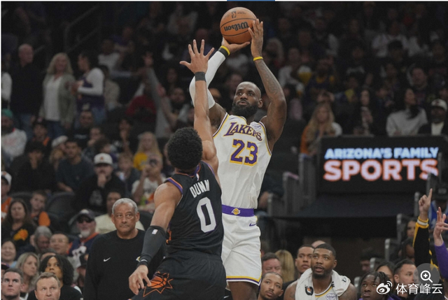
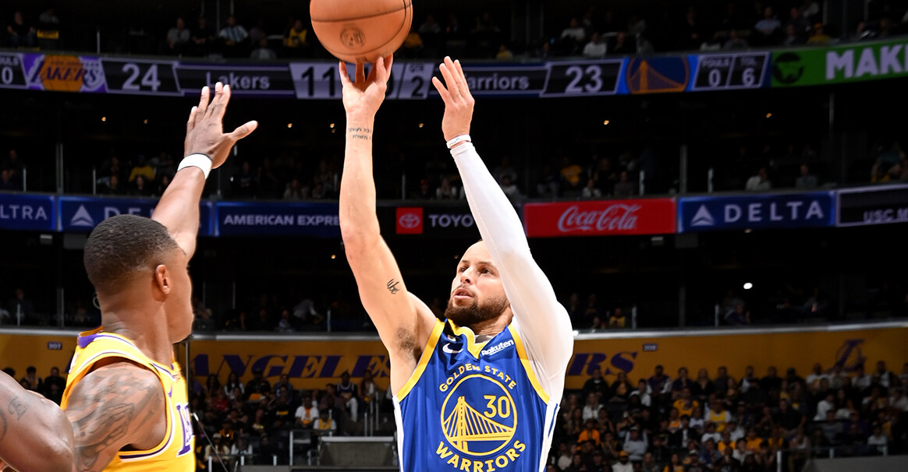
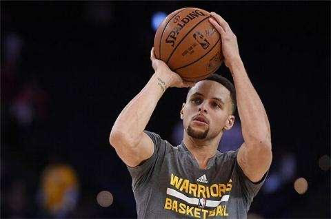
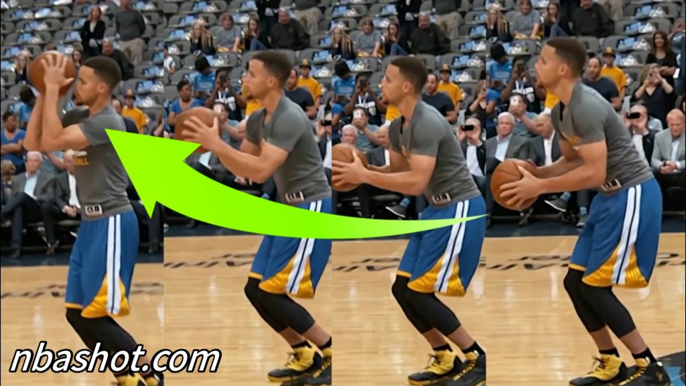

## 投篮记录

大二下学期就不怎么打球了，两年多没打，读研之后重新打，手感全无，从投篮开始练起，发现已经忘了怎么投篮了，看了一些视频重新学习投篮，下面是我遇到的一些问题的记录。

### 投篮歪

问题可能出现在不同位置，但基本上是手的问题。对于我来说有肘过于打开的问题

投篮的时候投篮手手肘太过于打开，导致出手的时候手肘并不指向篮筐，按照力线来看，这样的出球必定是歪的，勒布朗就有点这样，但是我和职业球星的力量没办法比，所以还是乖乖学适合我的

而有一类教学说要保证投篮的时候手肘手腕都是正对篮筐的，但是这样的发力非常别扭，当你尝试让手肘和手腕都指向篮筐，你会发现你的小臂在强行对抗扭转的力，之后我看了更多的一些教学，特别是我发现库里的手比较自然，发现这里有一个技术叫做“转腕投篮”，也就是在起球的时候手腕自然，手肘指向篮筐，而在发力投出的时候小臂自然旋转，手腕在最后出球的时候指向篮筐。这样还是比较自然和合适的

### 伸髋，蹬伸时机

在投篮的时候我们应该需要注意把力量从脚传导到手，我在路线之后发现我的投篮偶尔会有手快较慢的问题

指的是我们在正常沉球的过程中，腿在下蹲，而手已经在举球，造成发力脱节。我们更希望的发力顺序是：

1. 下蹲沉球
2. 伸髋起球（起到额头附近）
3. 在蹬伸的时候同时手在开始出球

据说高翻和硬拉的发力模式很类似投篮，我们可以用轻重量感受，小心受伤

### 重心偏移

我发现我在投篮的时候重心并不在两脚中间，很多时候左脚承载大部分重心，而我脚又是前后站，导致我总是重心偏移，导致后仰，一方面是腿部力量不足，一方面是前后站距过大

### 练习方法

在这里有几个推荐的练习方法：

[脚步节奏练习1](https://v.douyin.com/i5JBZgz5Seo/)

[脚步节奏练习2](https://v.douyin.com/D_XNGu7qRpY/)

[脚步节奏练习3](https://v.douyin.com/zGO7iPLPQvE/)

[脚步节奏练习4](https://v.douyin.com/S12O88x66H4/)

### 最后，多练多进步，练就有效，光看懒惰是没有效果的